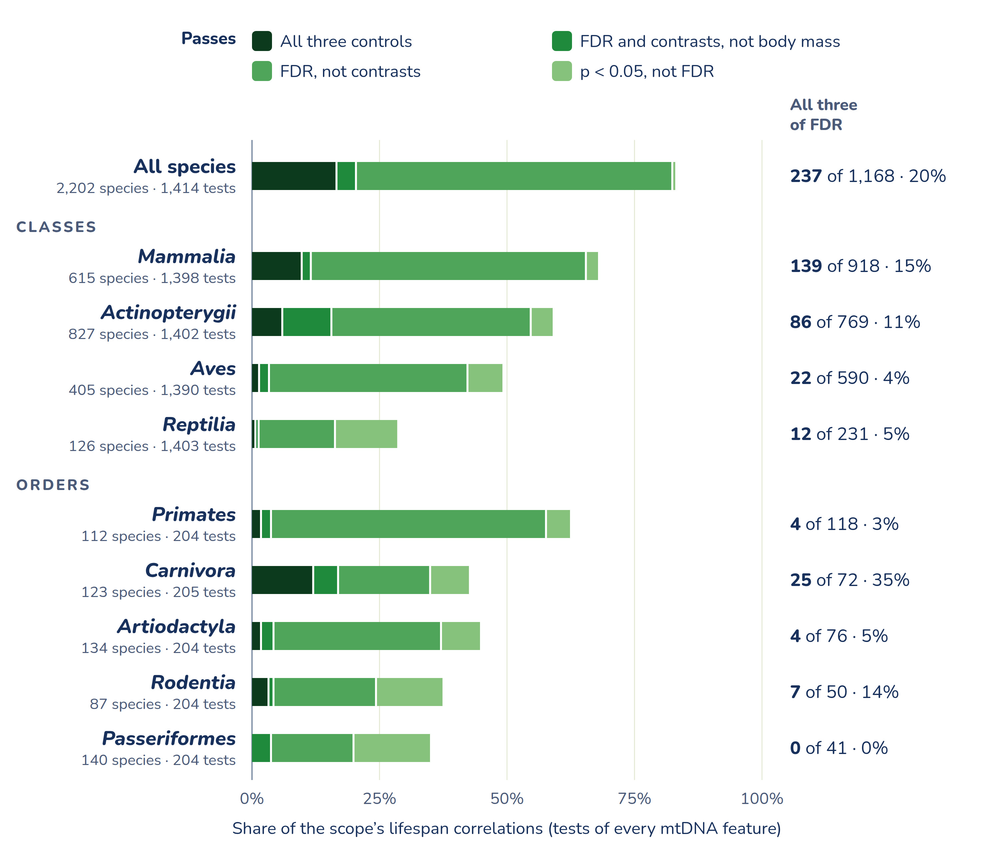
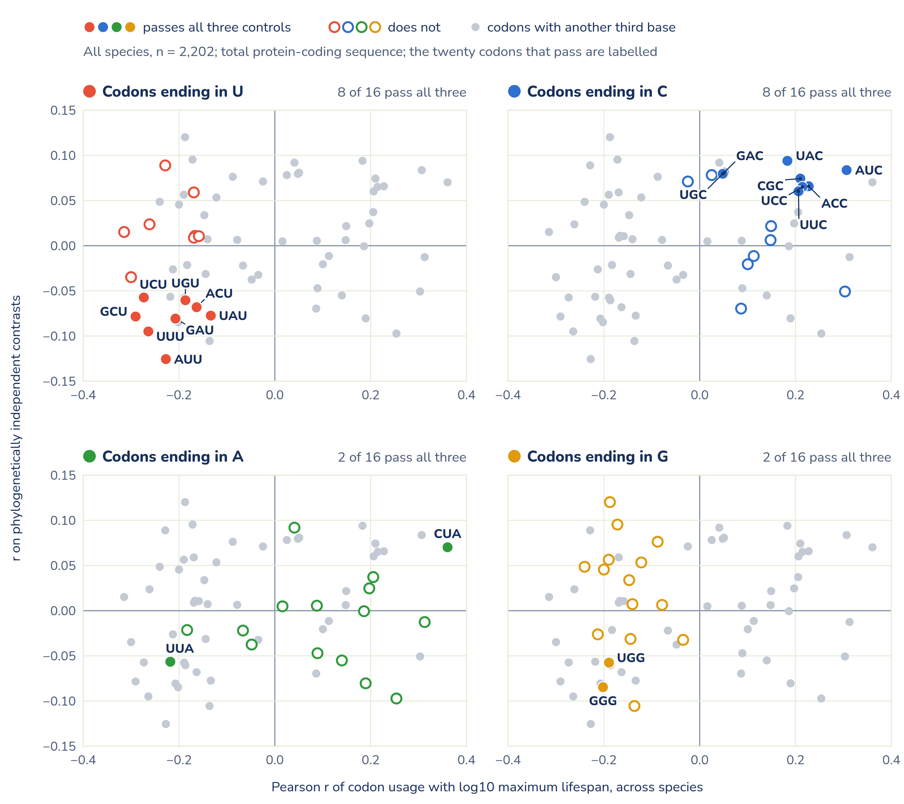
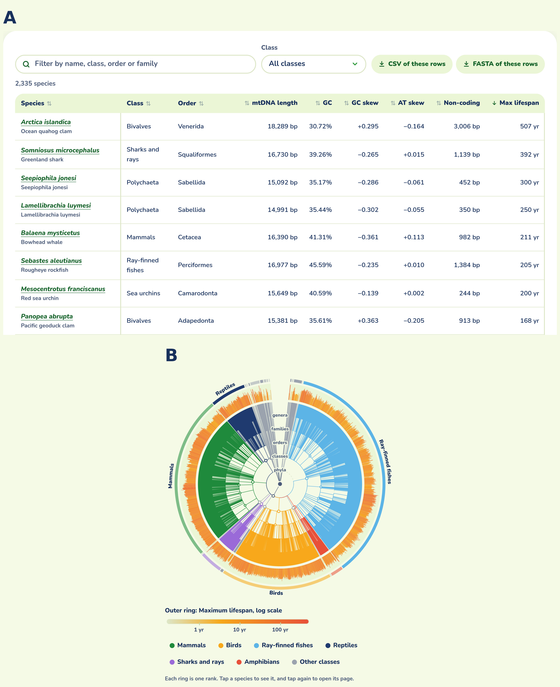
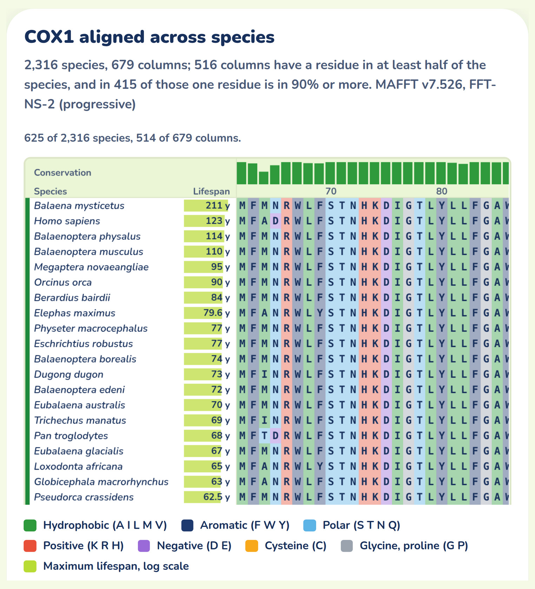
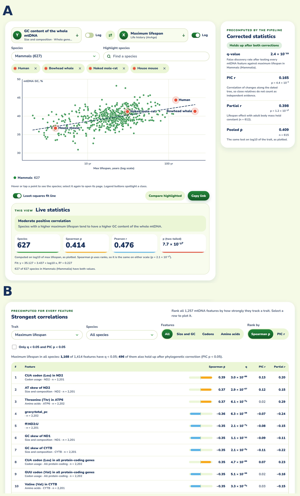

# MitoAge 2: a re-verified, phylogeny-aware database of mitochondrial DNA features and animal longevity

*Draft 0.1, 2026-11-14. Target: Nucleic Acids Research, Database issue (update article). Every number
is from MitoAge build 2 (2026-11-13) as committed in `dna-seq/mitoage` at 84ba6f7 (the correlations as rebuilt at 1dda8be, with the extended features and 32 scopes), from its report
(`docs/BUILD2_REPORT.md`) or from the correlation table its site build writes
(`dist/data/correlations.parquet`); `docs/manuscript/NOTES.md` gives the source of each number and the
questions only the authors can answer. Lines starting `> AUTHOR:` are notes to the authors, not
manuscript text.*

**Authors:** Anton Kulaga^1,2,3,†^, Dmitri Toren^2,3,†^, Nikolay Usanov^4^, Robi Tacutu^2,3,\*^

**Affiliations:**

1. Institute for Biostatistics and Informatics in Medicine and Ageing Research, Rostock University Medical Center, Rostock, Germany
2. Institute of Biochemistry of the Romanian Academy, Bucharest, Romania
3. ROGEN Consortium, the Romanian genomics project, Bucharest, Romania
4. HEALES (Healthy Life Extension Society)

† These authors contributed equally. \* Corresponding author.

## Abstract

Comparative studies link the composition of mitochondrial DNA (mtDNA) to the maximum lifespan of
animal species, and MitoAge (2016) made such analyses possible for 922 species. Ten years on, RefSeq holds
at least three times as many complete animal mitogenomes, and records and lifespans have been revised.
MitoAge 2 re-derives every value from fixed source versions and records each change to the original
species with its cause. It holds 2,335 species, 1,413 of them new, including 106 invertebrates
against 6 before, with lifespans from AnAge and otherwise from FishBase, SeaLifeBase and bird-ringing
records. Base composition is now reported on the strand deposited in RefSeq rather than its complement, so
strand skews change sign. Every mtDNA–trait correlation carries its false discovery rate and a test on
phylogenetically independent contrasts along a dated tree; every lifespan correlation also carries a
partial correlation on body mass where recorded. Most lifespan correlations that pass the false discovery rate do not keep their sign and significance
on contrasts: summed over 32 overlapping taxonomic scopes, 896 of 4,299 do. MitoAge 2 also provides alignments
of the 13 protein-coding and 2 rRNA genes, an independent reproduction of the build and open Parquet
downloads at https://www.mitoage.info.

> AUTHOR: about 200 words, the NAR limit.

## Introduction

Mitochondria are the only animal organelles with their own genome. Their mtDNA, which encodes
13 subunits of the respiratory chain and ATP synthase, 22 tRNAs and 2 rRNAs, has long been studied as a factor in ageing and
in the evolution of lifespan (1–6). Maximum lifespan varies by orders of magnitude across species,
and so does the composition of the mitochondrial genome. Correlations between the two have been
reported repeatedly in mammals and birds: with base composition, the skews between the two
strands, direct and inverted repeats, the amino-acid content of the encoded proteins, and
the rate at which those proteins evolve (4, 13–18, 30, 31). The asymmetry between the heavy and light strands is set by replication and by the mutations it favours (7, 8, 20). It has recently been tied to ageing directly: an A>G mutational signature on the heavy strand rises with age and, across mammals, with longer generation times (21).

MitoAge was published in 2016 to make such analyses routine (22). It combined complete mitogenomes
from NCBI RefSeq (19) with maximum lifespans from AnAge (9). For 922 species, it offered the base
composition of every gene and region, codon and amino-acid usage, and per-taxon statistics with the
correlation of each feature with log-transformed lifespan. Its authors reported more than 3,780
statistically significant correlations between mtDNA features and longevity across taxonomic groups (22).

Two problems with that kind of result have grown more pressing since: shared ancestry, and sources that
move. The first is that species are
not independent observations. Closely related species share their mitogenomes and their life
histories by descent, so a correlation across species can reflect differences among a few clades
rather than a relationship that holds within lineages. The standard remedy, phylogenetically
independent contrasts (23), correlates differences between sister lineages rather than the species' own
values; it needs a phylogeny with branch lengths, which the 2016 release did not provide. The second
problem is that the sources move. RefSeq records are suppressed, replaced and re-annotated, AnAge
revises lifespans as new records appear, and taxonomy renames species. A database that is not
re-derived from its sources drifts away from them without notice.

MitoAge 2 addresses both. It re-derives every value from pinned releases of its sources and records
each change to the original species with its cause. It places the species on a dated phylogeny and
reports every correlation with its false discovery rate and a control for shared ancestry, and, where body mass is
recorded, every correlation with lifespan also with a control for body mass. A reader can repeat the re-derivation in two ways: from the database's own pipeline, and from an
independent implementation that starts from the first release.

## Materials and methods

### Sources

All inputs are pinned (Table 4). Complete mitogenomes come from the RefSeq mitochondrion release 237
(file of 3 September 2026) (19). Maximum lifespans and the other life-history traits (adult and birth
weight, metabolic rate, body temperature, age at maturity, gestation or incubation time, litter or clutch
size and frequency, growth rate) come from AnAge build 15 (24, 37). Secondary lifespans come from FishBase
v26.06 (27), SeaLifeBase v26.06 (28) and the North American Bird Banding Program longevity records
v2025.1 (38). Names are resolved with the NCBI Taxonomy dump of 13 November 2026 (43). The tree topology
comes from the Open Tree of Life synthetic tree, version 16.1 (25, 39), and node ages from TimeTree 5 (26).
The first release is kept as its 2015 CSV export, converted to Parquet without change.

**Table 4.** Pinned upstream versions of MitoAge build 2.

| Source | Version |
|---|---|
| RefSeq mitochondrion | release 237, `mitochondrion.1.genomic.gbff.gz` of 2026-09-03 (md5 recorded) |
| NCBI Taxonomy | new_taxdump of 2026-11-13 |
| AnAge | build 15 (2023-07-03) |
| FishBase, SeaLifeBase | v26.06 (Parquet, files of 2026-09-04) |
| USGS Bird Banding Laboratory | NABBP Longevity Records v2025.1 |
| Open Tree of Life | synthetic tree opentree16.1 |
| TimeTree | TimeTree 5, public API |
| MitoAge release 1 | build 1 (2015-07-01), full CSV export, SHA-256 of every file recorded |

### Inclusion and lifespan precedence

The inclusion rule of the first release is unchanged: an animal species enters MitoAge if it has a
complete mitochondrial genome in RefSeq and a maximum lifespan from a curated, regularly maintained
source. A RefSeq record counts as complete if it is an NC_ accession whose definition names a complete
genome, a complete sequence or a circular mitochondrial organelle assembly; contigs, multipartite and partial records are excluded.
When a species has several complete records, the most recently updated one is kept and the choice is logged.
Between records of the same date, one at least 75% of the median length of its class is preferred, then the higher version.

AnAge is always the first lifespan source. Where AnAge has no value, fishes take their lifespan from
FishBase, aquatic invertebrates from SeaLifeBase, and birds from the EURING longevity list and then the
USGS records. EURING could not be retrieved for build 2, so all 26 of its secondary bird lifespans come from
the USGS records. Static one-off compilations were not used, because they are not maintained. Source records
are matched to NCBI species by taxon identifier, then by accepted name with synonym resolution. A record
that cannot be matched to one species without guessing goes to a review list and is left out of the
build. Every value from every source is kept in a long-format table, with its record type (captive, wild,
observed or estimated) and its quality on a scale shared across sources (high, acceptable, questionable or low).
AnAge's own data-quality grade is kept. For FishBase and SeaLifeBase, maximum ages are acceptable unless the source
flags them as questionable, wild and captive longevities are acceptable, and ages from growth studies are
low. Ringing records are acceptable; each records the oldest recaptured wild individual and usually
underestimates the maximum. AnAge values
are typed by the origin of the specimen, so its ages of wild animals count as wild whatever the method of
ageing; "estimated" marks a FishBase value from a growth study.

> AUTHOR: the EURING list could not be retrieved (euring.org was in maintenance on 2026-11-13), so the
> 26 bird lifespans taken from the USGS list are provisional and no EURING value is used.

### Mitochondrial features

For the whole mitogenome, each of the 13 protein-coding genes, the two rRNAs, the D-loop, and the
aggregates of all protein-coding, rRNA and tRNA genes, MitoAge 2 reports the length, the count of each
base, the GC content, the GC skew (G−C)/(G+C) and the AT skew (A−T)/(A+T). It also reports the non-coding length of the genome, codon usage for each protein-coding gene and their total, and amino-acid usage translated with the genetic code each RefSeq record specifies. Codon usage counts complete codons only, in gene sense, each codon as a percentage of all codons. Annotated
features are given with start, end and strand, with names made consistent across
records (COI, CO1 and COX1, for example) and the two leucine and two serine tRNAs told apart by codon
family. The extended features are the base composition of fourfold-degenerate sites (in gene sense and, for records
with the vertebrate layout, on the heavy strand), and the hydropathy (GRAVY) of each encoded protein. They also
include perfect direct, inverted and mirror repeats of at least 10 bases over the whole genome and the major arc (between the two replication origins),
repeat pairs bridging the two spans that flank most human mitochondrial deletions, sequence motifs
(G-quadruplexes, homopolymer runs, purine and pyrimidine tracts, short tandem repeats) and the number of
control-region copies. These enter the correlations and the false discovery rate like every other feature.

**Strand convention.** The 2016 release reported base composition mostly for the heavy strand, a primary target
of directional mutation pressure (20, 22). Its counts are the complement of the strand deposited in
RefSeq, for every region of every species, genes encoded on either strand included. For the human
reference (NC_012920.1), release 1 lists A = 4,094, C = 2,169, G = 5,181 and T = 5,124, whereas the
deposited sequence has A = 5,124, C = 5,181, G = 2,169 and T = 4,094. For most vertebrate records the
deposited strand is the light strand, so the release-1 counts are those of the heavy strand, as the paper
intended. RefSeq does not, however, fix which strand is deposited, and outside the vertebrates the convention is
not uniform. MitoAge 2 reports every count on the strand as deposited. GC content is unaffected; the GC
and AT skews, and their correlations with any trait, change sign relative to release 1.

> AUTHOR: the repository's documents call this a "base-label bug" of build 1. The 2016 paper states
> that the heavy strand was analysed, so the manuscript treats it as a convention made explicit, not an
> error. Please confirm against your memory of the 2015 pipeline (NOTES.md, Q1).

### Re-verification of the first release

Every value of the 922 original species was recomputed from the current RefSeq record and compared with
release 1. That record is the cited accession and version where it is live, its newer version, or, where it was
suppressed, a live successor record of the same species. Each difference becomes a row of a changelog that
records the table, row and field, the old and new values, the kind of change (added, value update,
correction, renamed, retired), the cause and the upstream version. Systematic corrections, such as the
strand convention above and the counting of features joined from several segments over their full span,
are logged once as rules. No row is deleted. A species whose record was suppressed without a successor, or whose lifespan no longer comes from a curated source, is marked retired and left out of the analyses. Its release-1 values stay in the table, re-expressed on the deposited strand like every other row. The pipeline's validation step checks that the per-row status and the changelog
agree.

### Alignments

Each of the 13 proteins, as RefSeq translates it, is aligned across all live species with MAFFT v7.526
(FFT-NS-2) (32), and the codon alignment it implies is written alongside. The two rRNA genes are aligned
as nucleotides the same way. A summary file gives, for each alignment, its size, how many columns are well
occupied or conserved, and its checksum. These are alignments made by one fast method across very distant
animals: columns in poorly conserved stretches are not reliable statements of homology.

### Phylogeny

The topology is the subtree of the Open Tree of Life synthetic tree induced by the species, with its
polytomies kept: 2,305 of the 2,335 species are placed. Node ages come from TimeTree 5 for 2,045 of the
2,229 internal nodes. The other 184 were placed midway between their parent and their oldest child, and
61 ages were raised so that every parent is older than its children. The 30 species not in the tree are left out of the phylogenetic tests, not given values. The dated tree is `src/data/generated/phylogeny.json` of the site repository.

### Statistics

Correlations are computed for two datasets, both excluding retired species and lifespans that are estimated or of low or questionable quality. The default dataset has every curated source (2,202 species: the 2,316 live species less 49 estimated and 65 questionable lifespans). An AnAge-only dataset (1,710 species) allows comparison with the first release.

For each mtDNA feature and each life-history trait, MitoAge 2 computes Pearson's r and Spearman's ρ against the log10-transformed trait, and controls the Benjamini–Hochberg false discovery rate (29) within each trait and scope. The false discovery rate and all counts use the two-tailed p value of Pearson's r, from the t distribution. The scopes are all species and each class and order with
at least 20 species; a species with no name at a rank joins no scope at that rank. Per-gene codon, amino-acid, fourfold-site and hydropathy features are tested in all species and in classes only,
and a correlation needs at least 10 species with both values.

For maximum lifespan, a Pearson partial correlation on log10 adult weight separates lifespan from body size, in the
species with a recorded adult weight (1,384 of the 2,202 in all species; 235 of the 827 ray-finned fishes). Each correlation is also computed on
phylogenetically independent contrasts (23) along the dated tree, as the correlation of the standardised contrasts through the origin, with polytomies resolved into
zero-length branches. Where two branches both have zero length, their values are averaged and give no contrast. The three
controls are applied one at a time: the contrasts are not adjusted for body mass, and the partial
correlation is not adjusted for shared ancestry. The contrast p value comes from the t distribution with m − 1 degrees of freedom for m contrasts, the
partial-correlation p value with n − 3 for n species. Neither is corrected for multiple testing, so the counts
that also pass them rest on a nominal 5% level at those steps.

### Reproducibility

The build is made by one command of the site repository, `bun run data`, a TypeScript pipeline that reads
the pinned downloads, stops if one is missing, and validates its output. A second command, `bun run align`,
makes the alignments, and the site build, `bun run build`, the derived tables (correlations and the explorer's
data). The pipeline has 192 tests at build 2.
Each new test of a build rule was checked when written, by breaking the code it guards and confirming that it
fails (`docs/BUILD2_REPORT.md` lists the checks). The build was cross-checked against an audit made separately in Python from the same downloads (`docs/BUILD2_CROSSCHECK.md`). The two agree on the new species and their lifespans, sources, quality, RefSeq records and names (1,413 of 1,413 for each field). For the original species, the cross-check compares the 8,733 changelog rows, other than additions, that name one of them (the
remaining six record systematic rules), counted by table, row and field. The two agree on 99.0% of the 3,325 changed values that both record, and every remaining difference is traced to a named design choice. Almost all of the other 5,408 rows belong to species that the build moved to a successor record and the audit retired.

A second repository, `dna-seq/mitoage-pipelines` (Python), is written for readers who want to rebuild
without our machines. It downloads every input with a pinned version, rebuilds build 2 from the release-1
export independently of the TypeScript pipeline, and compares the result with the published build.
From the pinned inputs, all 5,302,404 values of its seven tables, its 28 alignment files and its dated
tree come out identical (`docs/BUILD2_REPRODUCTION.md` there, at commit 3550281). The two tables of extended
features, added to the build afterwards, are not yet part of that comparison. It also holds the analyses that read the build (the example below
among them), each run by one command, with a record of which results reproduce byte for byte on a rerun and
which do not.

> AUTHOR: `docs/BUILD2_REPRODUCTION.md` is on `main` of mitoage-pipelines (commit 3550281, checked
> 2026-11-15), and the paragraph above reports what it found. Still open: extend the comparison to the two
> extended-feature tables, and cite the repository by a tagged release and Zenodo DOI rather than by commit.

## Results

### Database content

MitoAge 2 holds 2,335 species: the 922 of release 1 and 1,413 new ones (Table 1), for which AnAge supplies 838
of the lifespans, FishBase 475, SeaLifeBase 74 and the USGS list 26. A review list of 95 records holds what could not be matched without guessing, 79 of them source records that matched no species. Nineteen original
species are retired, leaving 2,316 live species in 23 classes and 9 phyla. Release 237 holds 16,008
complete metazoan mitogenomes from 15,876 species, against the 5,337 complete mitogenome entries counted
in 2015 (22); lifespan records have grown more slowly and remain the limiting factor.

The new species change the database most among fishes and invertebrates. Fishes go from 251 species to
993 and non-chordates from 6 to 104. The non-chordates include 35 bivalves, 30 malacostracans and 11 cephalopods, and with a
lancelet and an ascidian they make 106 invertebrates. Birds
nearly triple and mammals grow by 60%.

**Table 1.** Live species per taxon in MitoAge release 1 and MitoAge 2.

| Taxon | Release 1 | MitoAge 2 | of which new |
|---|--:|--:|--:|
| Mammals (Mammalia) | 390 | 625 | 237 |
| Birds (Aves) | 152 | 418 | 271 |
| Reptiles (Reptilia) | 94 | 129 | 42 |
| Amphibians (Amphibia) | 29 | 45 | 18 |
| Fishes (Actinopterygii, Sarcopterygii, Cephalaspidomorphi, Chondrichthyes) | 251 | 993 | 745 |
| Other chordates (Leptocardii, Ascidiacea) | 0 | 2 | 2 |
| Non-chordates | 6 | 104 | 98 |
| **Total** | **922** | **2,316** | **1,413** |

*Release 1 counts all 922 species; MitoAge 2 counts the live species (19 of the original 922 are
retired).*

> AUTHOR: order and family are not yet harmonised between the original species (AnAge taxonomy) and the
> new ones (NCBI); 41 new species have no order. Counts of orders and families are therefore left out of
> this draft (NOTES.md, Q4).

### What changed in the original 922 species

Fewer than half of the 922 original species are unchanged (392); 465 have at least one updated or
corrected value, 46 are renamed and 19 are retired (Table 2). Eighteen switched to a live successor record of the same species
and two to a new sequence version; 884 keep the accession and version they cited in 2015. Most RefSeq
mitochondrial records have been reprocessed since 2015, and annotations changed without a change of
version, typically around incomplete stop codons and frameshifted ND3 genes. AnAge build 15 gives a
different maximum lifespan for 59 species, many of them crocodilians and primates with longer captive
records, and none for one (*Andrias davidianus*, now retired). The changelog has 14,392 rows: 5,653
additions of the new species, 6,994 value updates, 1,639 corrections, 87 renames and 19 retirements.
Release 1 lacked 320 regions (263 of them D-loops) that the records it cited annotate; build 2 computes them from the sequence.

**Table 2.** The 922 species of release 1 in MitoAge 2, by record status.

| Status | Meaning | Species |
|---|---|--:|
| Original | No value changed | 392 |
| Updated | At least one value updated or corrected (new record version or successor, re-annotation, AnAge revision, release-1 value disagreeing with its record, systematic rule) | 465 |
| Renamed | Accepted name changed in NCBI Taxonomy; previous names kept | 46 |
| Retired | RefSeq record suppressed with no successor (17), only successor belongs to another species (1), no curated lifespan (1) | 19 |

*Each species has one status, ranked retired, renamed, updated: 22 of the 46 renamed species also have an updated
or corrected value, and 75 of the 465 updated species changed only their common name or a higher taxon.*

### What the controls change

Most correlations of the kind the 2016 release counted do not pass a control for shared ancestry. In the
default dataset, which leaves out estimated lifespans and those of low or questionable quality,
15,904 correlations of mtDNA features with maximum lifespan were tested across all scopes. Of these, 5,439
have p < 0.05 before any correction, and 4,299 pass a false discovery rate of 5%. Of those 4,299, 896 are
also significant on phylogenetic contrasts with the same sign, and 547 pass the partial correlation on body
mass as well, 481 of them with the same sign (Table 3, Figure 1). The AnAge-only dataset gives the same
picture (4,068 pass the false discovery rate, 659 also on contrasts), and over all features in all species
the correlations of the two datasets agree at r = 0.977. In both datasets most correlations that pass the
false discovery rate fail on contrasts, although a test on contrasts has less power than one across species.

Some orders show the loss on contrasts more clearly still. In primates, 118 lifespan correlations pass the
false discovery rate; 8 also pass on contrasts. In mammals as a whole, whole-genome GC content correlates
with lifespan at r = 0.47 (n = 615) and at 0.40 with body mass controlled, but on contrasts it falls to 0.17
(p = 4.4 × 10⁻⁵).

Across all species, whole-genome GC content barely correlates with lifespan (r = 0.07), yet its partial
correlation on body mass is 0.24 over the 1,384 species with a recorded body mass. Within classes, only the mammals show a significant positive association with body mass controlled (0.40). The partial correlation is −0.14 in ray-finned fishes (235 species, p = 0.04), 0.05 in birds and −0.01 in reptiles, so the all-species value does not describe a relationship within classes.

The correlations that survive all three controls include the strand skews and the codon usage that
follows them. Codon usage makes up most of the survivors because it makes up most of the tests (54% of the
547, 54% of the tests). In all species, 27 of the 40 skew correlations and 11 of the 16 GC-content
correlations that pass the false discovery rate survive, against 138 of 744 for codons. Across all species, the AT skew of the whole genome correlates with lifespan at
r = 0.31 (0.22 with body mass controlled, 0.11 on contrasts, p < 10⁻⁶). This scope includes the 104
non-chordates, whose deposited strand need not correspond to the vertebrates' (see Strand convention). In the total protein-coding
sequence, the 8 codons ending in U that pass all three controls are all used less in
longer-lived species, and the 8 ending in C all more (Figure 2). Seven of the eight pairs code the same amino acid
(threonine, isoleucine, aspartate, tyrosine, serine, cysteine and phenylalanine), so the shift is
synonymous. On contrasts these correlations are small (|r| between 0.06 and 0.13). Codons are counted in gene
sense, which in vertebrate records is the deposited strand for every protein-coding gene but ND6. In those
twelve genes this is a shift from T to C at the third codon position, the direction expected from an excess of A>G
mutations on the heavy strand (21).

In mammals, the GC content of the whole genome, of nine of the thirteen protein-coding genes and of
both rRNAs keeps its sign under all three controls, and so does the usage of isoleucine, threonine, leucine, phenylalanine and histidine over the 13 proteins.

Outside the chordates the
database cannot yet support a result. The bivalves are the only non-chordate scope large enough to test
(35 species), and none of their 1,331 correlations passes the false discovery rate (smallest q = 0.13).
No non-chordate has a recorded adult weight, so the body-mass control cannot be applied to any of
them.

**Table 3.** Correlations of mtDNA features with log10 maximum lifespan in the default dataset, by scope.
FDR: Benjamini–Hochberg q < 0.05 within scope. The scopes overlap (a species counts in all species, its class and its order), so the total row adds tests, not distinct relationships. PIC: p < 0.05 on phylogenetically independent contrasts,
uncorrected. Both: FDR and PIC with the same sign. All three: Both, and partial correlation on body mass
p < 0.05, whatever its sign (it keeps the sign of the correlation across species in 481 of the 547).

| Scope | Species | Tests | p < 0.05 | FDR | PIC | Both | All three |
|---|--:|--:|--:|--:|--:|--:|--:|
| All species | 2,202 | 1,414 | 1,179 | 1,168 | 565 | 291 | 237 |
| Mammalia | 615 | 1,398 | 954 | 918 | 224 | 164 | 139 |
| Actinopterygii | 827 | 1,402 | 832 | 769 | 546 | 221 | 86 |
| Aves | 405 | 1,390 | 688 | 590 | 181 | 49 | 22 |
| Reptilia | 126 | 1,403 | 405 | 231 | 94 | 21 | 12 |
| Primates | 112 | 204 | 128 | 118 | 12 | 8 | 4 |
| Carnivora | 123 | 205 | 88 | 72 | 53 | 35 | 25 |
| Artiodactyla | 134 | 204 | 92 | 76 | 27 | 9 | 4 |
| Rodentia | 87 | 204 | 77 | 50 | 23 | 9 | 7 |
| Passeriformes | 140 | 204 | 72 | 41 | 28 | 8 | 0 |
| **All scopes (32)** | | **15,904** | **5,439** | **4,299** | **3,008** | **896** | **547** |

The ten scopes above are all species, the four largest classes, the four largest mammalian orders and the
passerine birds. Supplementary Table S1 gives all 32, each with its number of species with a recorded body mass
and the share of its tests that the contrast test rejects. A scope with fewer than 10 species of recorded body mass
has no partial correlation, so none of its tests passes all three.

> AUTHOR: one check before this table is final (NOTES.md, Q5). In some clades the contrast tests
> reject far more often than chance with no raw signal at all: Chondrichthyes 42.8% of 1,368 lifespan
> tests at contrast p < 0.05 against 0.1% passing the FDR, Rajiformes 38.7% of 191 against none,
> Clupeiformes 35.0% of 200 against none. The explanation proposed in NOTES.md, contrasts standardised
> over near-zero branch lengths, is NOT supported by the dated tree: it has 54 polytomies costing 75
> degrees of freedom in all, and after the contrast recursion only 12 of its 2,229 contrasts are
> standardised by a daughter-variance sum below 1 Myr. The rejecting contrasts are not sign-biased
> either (54% positive in Chondrichthyes). What they are is heavy-tailed: |contrast r| averages 0.43 in
> Chondrichthyes and 0.61 in Rajiformes, where |r| across species averages 0.09 and 0.19 — which a
> Student-t p value on a through-origin correlation does not describe. The fix is a permutation null for
> the contrast test and a second ancestry control (PGLS with Pagel's lambda), not a change of tree; until
> it is run, the PIC column should not be read in those scopes. The empty-order scope is gone: the
> pipeline no longer forms a scope from species with no name at a rank, so the table has 32 scopes.

> AUTHOR: each figure sits at the end of the section that first cites it, as the tables do, and the
> figures are numbered in order of citation. Draft 0.1 listed the planned figures as 1 (interface),
> 2 (GC content against lifespan), 3 (controls) and 4 (codons); they are now 3, 5, 1 and 2, and the
> alignment, new with the screenshots, is 4. NAR wants the legends after the references and the figure
> files uploaded on their own, so they move there at submission. Figures 1 and 2 are charts of the
> correlation table the build writes; Figures 3, 4 and 5 are screenshots of the build 2 site at a desktop width
> of 1,440 pixels, taken on 2026-11-14. Figure 1 was redrawn and Figure 5 retaken on 2026-11-15 by
> `figures/figure-1-controls.ts` and `figures/capture-figure-5.ts` (NOTES.md, "Figures", says how). Still
> open: Figure 5B shows the site's stale "Rank all 1,257 mtDNA features" line and two raw feature keys
> (`gravy:total_pc`, `ff:ND2:U`); retake it once the site is fixed (roadmap RM19).

**Figure 1.** What the three controls leave of the correlations of mtDNA features with maximum lifespan,
by scope (default dataset; the data of Table 3). Each bar is the share of a scope's tests, one per mtDNA
feature, with p < 0.05, split by how far each gets through the controls in turn: the false discovery rate
(Benjamini–Hochberg q < 0.05 within the scope), phylogenetically independent contrasts (p < 0.05, with the
sign of the correlation across species) and the partial correlation on body mass (p < 0.05, of either sign). The column on
the right gives how many of the correlations that pass the false discovery rate pass all three; across all
32 scopes, 547 of 4,299 do.

**Figure 2.** Codon usage in the total protein-coding sequence against maximum lifespan across all species
(n = 2,202), one panel per third base. Each codon is placed by its Pearson r with log10 maximum lifespan
across species (x) and its r on phylogenetically independent contrasts (y). Filled points pass all three
controls (false discovery rate, contrasts with the same sign, partial correlation on body mass of either
sign), open points do not, and grey points are the 48 codons with another third base. Twenty codons pass all three: the 8
ending in U are all used less in longer-lived species and the 8 ending in C all more, while of those ending
in A or G only UUA, CUA, UGG and GGG pass. For UGG and GGG the partial correlation is positive while their
correlation across species is negative.

### An example: amino-acid content and the alignments

Amino-acid content, another of the relationships the introduction lists, can be retested with the tables,
the alignments and the dated tree together, and the answer depends on how shared ancestry is modelled.
Long-lived aerobic animals are reported to have fewer cysteines in their mitochondrially encoded proteins (30),
long-lived mammals less methionine (31), and higher primates more threonine in their transmembrane regions (33).
In 173 mammals, however, cysteine showed no detectable effect of longevity and threonine followed nucleotide composition
(34). The content of each amino acid over the 13 proteins was regressed on
log10 maximum lifespan, log10 body mass and base composition at fourfold-degenerate sites, with Pagel's λ estimated by
maximum likelihood on the dated tree (`mitoage longevity aa-pgls`). The model was fitted to the 604 mammals of the default dataset that have a body mass and a place in the tree.
No amino acid of the 20 passed a 5% false discovery rate: threonine rose by 0.15 percentage points per tenfold lifespan
(p = 0.03, q = 0.12), cysteine fell by 0.021 (p = 0.05, q = 0.15) and methionine did not change (p = 0.94).
Random intercepts of order and family in place of the tree, on the same species, gave seven amino acids at
q < 0.05, cysteine and threonine among them. Birds (379), ray-finned fishes (235) and reptiles (97) showed
nothing at q < 0.05. A screen of single alignment columns on the dated tree found two columns at q < 0.05 in mammals and none in
birds. One is a substitution confined to the marsupials and the other, COX1 position 419, sits at the threshold
(q = 0.049); without a replication, neither is reported here as associated with lifespan.

> AUTHOR: rerun of 2026-11-14 in mitoage-pipelines at da0c112 (`mitoage longevity aa-pgls`, tables
> `aa_pgls.<Class>.tsv`; dataset longevity-genie/mitoage at 6efa0959, dated tree at 18a13ec), replacing the
> earlier mixed-model numbers (622 mammals, 10 of them with questionable lifespans). Whether a database
> update should carry a worked example at all, or only point to the repository, is still yours (NOTES.md, Q6).

### Repeats, motifs and the rate of evolution

Two more of the relationships the introduction lists, inverted repeats and the rate at which the
mitochondrial proteins evolve, were retested on the species of the default dataset that carry the feature;
on the dated tree, neither holds. Inverted repeats were reported to correlate with maximum lifespan in mammals (18). Perfect inverted
repeats do so here too: across 604 mammals, Spearman's ρ = −0.40 (p = 2 × 10⁻²⁴) over the whole
record, and ρ = −0.33 over the major arc (n = 530, p = 3 × 10⁻¹⁵). Neither survives shared ancestry. On phylogenetically independent contrasts, Pearson's r is 0.02 over the whole record and −0.04 over the major arc (p = 0.62 and 0.40; 615
and 541 mammals). The partial correlations on body mass remain (−0.27 and −0.21). A phylogenetic regression in
the same 604 and 530 mammals agrees: with log10 body mass and base composition at fourfold-degenerate sites in
the model and Pagel's λ on the dated tree, the two associations fall to p = 0.67 and 0.45.
Repeat pairs bridging the two spans that flank most human mitochondrial deletions, ATP8 to COX3 and ND5 to
CYTB, behave the same way: ρ = −0.18 raw (p = 8 × 10⁻⁶, 602 mammals) and p = 0.03 after the controls, which
does not pass the false discovery rate. Across 132 tests of the motif, repeat and bridging-pair features in
four classes, none passes a 5% false discovery rate controlled within each class (smallest q = 0.16). The inverted-repeat correlation was reported to hold on independent
contrasts over a taxonomy with equal branch lengths (18), but it does not hold on contrasts along the dated tree,
nor with body mass and base composition in the model.

The rate at which the mitochondrial proteins evolve, reported to fall with longevity in mammals and birds (16),
was tested by the relative-rate test, which avoids the
normalisation choice that divides the literature (`mitoage longevity rates`). Two species sharing a parent in
the dated tree have had the same time since they split, so the difference in their distances to a common
outgroup, the nearest in the tree, is a rate contrast needing no correction for divergence time. Each rate
contrast is regressed through the origin on the lifespan contrast. Over 339 such pairs, with dN and dS as
Nei–Gojobori counts in each species' own mitochondrial code, no normalisation gives an
association between lifespan and rate on the concatenated 13 genes, in mammals (p = 0.02, q = 0.15),
birds, ray-finned fishes or all species together. The normalisations tried are the raw difference, the
difference per million years, the dN/dS ratio and the difference with body mass in the model. Four of 655 single-gene tests pass a 5% false discovery
rate and disagree in sign.

One limit applies to every number in this subsection and cannot be removed from the records as they stand:
repeat and motif counts depend on how a genome was sequenced. Long-read assemblies of vertebrate
mitogenomes recover repeats and control regions that short-read assemblies miss (35, 36). Of the records
matched in RefSeq mitochondrion release 237, one states a sequencing technology; 1,773 name the source
INSDC accession from which it could be resolved. The same tests restricted to long-read assemblies are
therefore not assessed here, rather than assessed and found negative.

> AUTHOR: runs of 2026-11-14 in mitoage-pipelines at 22cb140 (`mitoage longevity rates` and
> `mitoage longevity motif-pgls`, tables `rates.tsv`, `rate_contrasts.tsv` and `motif_pgls.tsv`; H7 and H8 in
> `docs/ANALYSIS_FINDINGS.md`, mitoage-pipelines main at 22cb140), on the motif features this repository's
> pipeline computes for all 2,335 species (main at e3d99b2). Whether the paper should carry this subsection at all, or leave it to the analysis
> repository as Q6 asks of the amino-acid example, is yours (NOTES.md, Q11).

## Website and interface

The menu follows the data: Species, Tree, Genes, Compare, Data and About (Figure 3).

- **Species.** A sortable, filterable list of all species in two views, genome features and life
  history (Figure 3A), with a page per species and its circular genome map (Figure 3D). The filtered rows
  download as CSV and their mitogenomes as one FASTA file, which the browser fetches from NCBI by versioned accession; MitoAge
  does not store the mitogenomes themselves.
- **Tree.** A zoomable radial tree of the species on the dated phylogeny (Figure 3B), with a page per
  class, order and family.
- **Genes.** A circular map of the genome of any species, and a page per gene with its distribution
  across species, its correlations with lifespan, and its alignment with lifespan shown beside the rows
  (Figure 4).
- **Compare.** The comparative statistics of the original site (summary statistics and r with log10 lifespan,
  by region or by child taxon, and codon usage), each table with a chart of its rows (Figure 3C). Two to six species can be set side by side.
- **Plot explorer**, under Compare. Any two mtDNA features, or a feature against a life-history trait, for all species or
  one taxon, with the strongest correlations listed with their false discovery rate, partial and contrast
  statistics (Figure 5).

The website is static: every page is generated when the data are built, and the browser fetches
small JSON files for the interactive views, so the site needs no database server and can be mirrored
whole. Old addresses of the data pages (species, taxa, genes, statistics and comparisons) redirect to their new pages, so
links to the original site's data in the literature keep working.

> AUTHOR: Figure 5 was planned as a scatter across species beside one on contrasts; the site does not
> plot the contrasts themselves, so panel A gives the contrast r beside the scatter, and panel B shows the
> explorer's ranking of every feature. Figure 4 is new with the screenshots: keep it or drop it (without
> it, the plot explorer becomes Figure 4).

**Figure 3.** The MitoAge 2 interface. (**A**) The species list, genome view, sorted by maximum lifespan:
the ocean quahog (*Arctica islandica*, 507 years) and the Greenland shark (*Somniosus microcephalus*,
392 years) lead the 2,335 species the list holds, the 19 retired ones included. The rows shown, after any filter, download as CSV and their mitogenomes
as one FASTA file. (**B**) The radial tree of all species by taxonomic rank, coloured by class, with each
species' maximum lifespan on a log scale in the outer ring; any clade zooms into view. (**C**) Compare,
class Mammalia: Pearson's r of the GC content of each region with log10 maximum lifespan and its 95%
confidence interval, computed by the page for 5 or more species and not corrected for multiple testing or shared ancestry. (**D**) The
circular genome map of the bowhead whale (*Balaena mysticetus*, NC_005268.1, 16,390 bp): genes on the
two strands in the outer and inner rings, and in the middle ring the GC content of each gene against that
of the whole genome.

**Figure 4.** The alignment of COX1 on its gene page, shown for the 625 mammals it holds and sorted
longest-lived first: the bowhead whale (211 years), human (123 years), then the fin, blue and humpback
whales. Residues are coloured by the class of their side chain; the bar above each column is the share of
the rows on show that carry its most common residue, and each species' maximum lifespan is drawn beside its
row. The alignment (MAFFT v7.526, FFT-NS-2) covers 2,316 species in 679 columns; columns where more than
half of the rows on show have a gap are hidden (514 of 679 remain; the panel shows the top rows and about 80 of
those columns).

**Figure 5.** The plot explorer. (**A**) Whole-genome GC content against maximum lifespan (log scale) in
all 627 mammals the site lists (the two retired ones included), with four species highlighted and the
least-squares line. The live statistics below the plot are computed in the browser for the points shown
(Pearson r = 0.48 with log10 lifespan, n = 627). The panel on the right gives the statistics the pipeline computed on the default dataset, which
leaves out estimated and low-quality lifespans: q = 2.4 × 10⁻³³, r on phylogenetically independent
contrasts 0.17 (p = 4.4 × 10⁻⁵) and partial r on body mass 0.40 (n = 612). (**B**) The mtDNA features
ranked by the strength of their correlation with maximum lifespan across all species, each with its q, its
r on contrasts and its partial r on body mass. Of the 1,414 features, 1,168 have q < 0.05 and 496 of
those have a contrast p < 0.05 (of either sign; Table 3 counts the 291 with the same sign).

## Data access and versioning

The downloads are the tables of species and traits, lifespan observations from every source, region statistics, codon
usage, genome features, the extended structural and protein features, correlations and the changelog. Every
table can be downloaded as Parquet (readable by DuckDB, pandas, polars and R arrow), the species table also as CSV; the
review list is in CSV and the alignments in gzipped FASTA. A README written by the pipeline describes every column, lists the pinned version of each source
and notes every known difference from release 1. Release 1 is kept, frozen, beside the current
build. Each build is dated and mirrored, with its alignments and the frozen release 1, as the Hugging Face dataset
`longevity-genie/mitoage`; each is intended to receive a Zenodo DOI.

> AUTHOR: Zenodo DOIs are planned, not minted.

Asked whether an mtDNA feature predicts lifespan, a language-model agent with only the downloads would
take a table and correlate two columns, the uncontrolled estimate this release argues against. An
experimental Model Context Protocol (MCP) server, `mitoage-mcp`, therefore serves the same build to such
agents. It opens one SQLite copy of the published tables and offers them as tools: the record of a
species, the composition of each region of its mitogenome, the features of a taxon ranked by their
correlation with a trait, and a read-only query. Its correlation tools never return a coefficient on its
own. Each carries its q-value, the partial correlation on body
mass, the correlation on independent contrasts and the filters of the dataset it was computed on, and
reports a control that was never computed as not assessed rather than as a failure. The read-only query
tool returns whatever columns it is asked for, and its description tells the agent to keep the q-value and
both controls beside the coefficient. The server is
pinned to one dataset revision, so an answer quoted from it does not change between builds. It is an
addition to the downloads, not a replacement.

> AUTHOR: the server is experimental and is described as such on purpose. If you would rather leave it
> out until it has users, this paragraph and one sentence in Data availability are the only places it
> appears.

## Conclusion

MitoAge 2 keeps what the first release offered: the composition of a complete RefSeq mitogenome for every animal species with a curated
lifespan, and its statistics by taxon. It adds what a comparative analysis now needs: values traceable to
pinned sources, a stated strand convention, alignments of the genes, and controls for body size and
shared ancestry next to every correlation in the correlation table and the plot explorer. The re-analysis is a caution as much as a resource. Most
correlations between mtDNA features and lifespan do not hold up on phylogenetic contrasts, which points to
differences between lineages. Those that pass on contrasts are fewer and weaker, although contrasts have less power than a test across species, and 184 of the 2,229 node ages of the tree are interpolated. They include the strand asymmetry and the codon usage it shapes, which
reflect the mutational processes of the mitogenome. Their contrast and body-mass tests are uncorrected, so
they are candidates from a screen rather than established relationships within lineages, and the next
analyses should look there. A hundred invertebrates, against six in the first release, are a first chance
to ask whether these relationships extend beyond the vertebrates. The database can now pose that question
but not yet answer it: only one non-chordate class is large enough to test, and none of its species has
a recorded body mass.

## Supplementary data

Supplementary data is available at NAR online.

## Conflict of interest

> AUTHOR: to be completed.

## Funding

> AUTHOR: to be completed.

## Data availability

The website is at https://www.mitoage.info and https://just-dna.life/mitoage/, with the downloads under
`/data/`. The build is mirrored as the Hugging Face dataset `longevity-genie/mitoage` (40); build 2 is its revision
c525adbff8c12b19981fdada7f1615c2559b7140. The site and its
data pipeline are at https://github.com/dna-seq/mitoage (41), and the independent reproduction and the
analyses at https://github.com/dna-seq/mitoage-pipelines (42), both under the MIT licence. The
experimental MCP server is in `mcp/` of the site repository and is to be released as the npm package
`mitoage-mcp`. Lifespan values from
FishBase and SeaLifeBase are CC BY-NC 4.0 (non-commercial use only) and are marked as such in the downloads.
AnAge data are under the Creative Commons Attribution 3.0 licence of the Human Ageing Genomic Resources (37),
and NCBI places no restrictions of its own on the use of RefSeq and Taxonomy data.

> AUTHOR: confirm the licence of MitoAge's own data (release 1 was under a Creative Commons licence).

## References

*Numbering follows the 2016 paper for its references 1–9, 13–18 and 20, so the two lists can be compared;
19 now cites the current RefSeq paper in place of the 2016 paper's 2014 RefSeq update, and 10–12 are not cited here. Renumber in order of citation before submission.*

1. Wallace DC. A mitochondrial paradigm of metabolic and degenerative diseases, aging, and cancer: a
   dawn for evolutionary medicine. Annu Rev Genet. 2005;39:359–407. https://doi.org/10.1146/annurev.genet.39.110304.095751
2. López-Otín C, Blasco MA, Partridge L et al. The hallmarks of aging. Cell.
   2013;153:1194–1217. https://doi.org/10.1016/j.cell.2013.05.039
3. Apostolova N, Blas-Garcia A, Esplugues JV. Mitochondria sentencing about cellular life and death: a
   matter of oxidative stress. Curr Pharm Des. 2011;17:4047–4060. https://doi.org/10.2174/138161211798764924
4. Lehmann G, Segal E, Muradian KK et al. Do mitochondrial DNA and metabolic rate complement
   each other in determination of the mammalian maximum longevity? Rejuvenation Res. 2008;11:409–417. https://doi.org/10.1089/rej.2008.0676
5. Sevini F, Giuliani C, Vianello D et al. mtDNA mutations in human aging and longevity: controversies and new perspectives
   opened by high-throughput technologies. Exp Gerontol. 2014;56:234–244. https://doi.org/10.1016/j.exger.2014.03.022
6. Khrapko K, Turnbull D. Mitochondrial DNA mutations in aging. Prog Mol Biol Transl Sci.
   2014;127:29–62. https://doi.org/10.1016/b978-0-12-394625-6.00002-7
7. Clayton DA. Transcription and replication of mitochondrial DNA. Hum Reprod. 2000;15 Suppl 2:11–17. https://doi.org/10.1093/humrep/15.suppl_2.11
8. Fernández-Silva P, Enriquez JA, Montoya J. Replication and transcription of mammalian mitochondrial
   DNA. Exp Physiol. 2003;88:41–56. https://doi.org/10.1113/eph8802514
9. Tacutu R, Craig T, Budovsky A et al. Human Ageing Genomic Resources: integrated databases and tools for the biology and
   genetics of ageing. Nucleic Acids Res. 2013;41:D1027–D1033. https://doi.org/10.1093/nar/gks1155
13. Lehmann G, Muradian KK, Fraifeld VE. Telomere length and body temperature-independent determinants
    of mammalian longevity? Front Genet. 2013;4:111. https://doi.org/10.3389/fgene.2013.00111
14. Samuels DC. Life span is related to the free energy of mitochondrial DNA. Mech Ageing Dev.
    2005;126:1123–1129. https://doi.org/10.1016/j.mad.2005.05.003
15. Samuels DC. Mitochondrial DNA repeats constrain the life span of mammals. Trends Genet.
    2004;20:226–229. https://doi.org/10.1016/j.tig.2004.03.003
16. Galtier N, Blier PU, Nabholz B. Inverse relationship between longevity and evolutionary rate of
    mitochondrial proteins in mammals and birds. Mitochondrion. 2009;9:51–57. https://doi.org/10.1016/j.mito.2008.11.006
17. Lehmann G, Budovsky A, Muradian KK et al. Mitochondrial genome anatomy and species-specific
    lifespan. Rejuvenation Res. 2006;9:223–226. https://doi.org/10.1089/rej.2006.9.223
18. Yang JN, Seluanov A, Gorbunova V. Mitochondrial inverted repeats strongly correlate with lifespan:
    mtDNA inversions and aging. PLoS One. 2013;8:e73318. https://doi.org/10.1371/journal.pone.0073318
19. Goldfarb T, Kodali VK, Pujar S et al. NCBI RefSeq: reference sequence standards through 25 years of
    curation and annotation. Nucleic Acids Res. 2025;53:D243–D257. https://doi.org/10.1093/nar/gkae1038
20. Reyes A, Gissi C, Pesole G et al. Asymmetrical directional mutation pressure in the
    mitochondrial genome of mammals. Mol Biol Evol. 1998;15:957–966. https://doi.org/10.1093/oxfordjournals.molbev.a026011
21. Mikhailova AG, Mikhailova AA, Ushakova K et al. A mitochondria-specific mutational signature of aging: increased rate of
    A>G substitutions on the heavy strand. Nucleic Acids Res. 2022;50:10264–10277. https://doi.org/10.1093/nar/gkac779
22. Toren D, Barzilay T, Tacutu R et al. MitoAge: a database for
    comparative analysis of mitochondrial DNA, with a special focus on animal longevity. Nucleic Acids
    Res. 2016;44:D1262–D1265. https://doi.org/10.1093/nar/gkv1187
23. Felsenstein J. Phylogenies and the comparative method. Am Nat. 1985;125:1–15. https://doi.org/10.1086/284325
24. Tacutu R, Thornton D, Johnson E et al. Human Ageing Genomic Resources: new and updated databases. Nucleic Acids Res.
    2018;46:D1083–D1090. https://doi.org/10.1093/nar/gkx1042
25. Hinchliff CE, Smith SA, Allman JF et al. Synthesis of phylogeny and taxonomy into a comprehensive tree of life. Proc
    Natl Acad Sci USA. 2015;112:12764–12769. https://doi.org/10.1073/pnas.1423041112
26. Kumar S, Suleski M, Craig JM et al. TimeTree 5: an expanded resource for species divergence times. Mol Biol Evol.
    2022;39:msac174. https://doi.org/10.1093/molbev/msac174
27. Froese R, Pauly D (eds). FishBase. www.fishbase.org; version 26.06, Parquet snapshot of 4 September 2026,
    https://source.coop/cboettig/fishbase (fb/v26.06).
28. Palomares MLD, Pauly D (eds). SeaLifeBase. www.sealifebase.org; version 26.06, Parquet snapshot of 4 September
    2026, https://source.coop/cboettig/fishbase (slb/v26.06).
29. Benjamini Y, Hochberg Y. Controlling the false discovery rate: a practical and powerful approach to
    multiple testing. J R Stat Soc B. 1995;57:289–300. https://doi.org/10.1111/j.2517-6161.1995.tb02031.x
30. Moosmann B, Behl C. Mitochondrially encoded cysteine predicts animal lifespan. Aging Cell.
    2008;7:32–46. https://doi.org/10.1111/j.1474-9726.2007.00349.x
31. Aledo JC, Li Y, de Magalhães JP et al. Mitochondrially encoded methionine
    is inversely related to longevity in mammals. Aging Cell. 2011;10:198–207. https://doi.org/10.1111/j.1474-9726.2010.00657.x
32. Katoh K, Standley DM. MAFFT multiple sequence alignment software version 7: improvements in
    performance and usability. Mol Biol Evol. 2013;30:772–780. https://doi.org/10.1093/molbev/mst010
33. Kitazoe Y, Kishino H, Hasegawa M et al. Adaptive threonine increase in
    transmembrane regions of mitochondrial proteins in higher primates. PLoS One. 2008;3:e3343. https://doi.org/10.1371/journal.pone.0003343
34. Aledo JC, Valverde H, de Magalhães JP. Mutational bias plays an important role in shaping
    longevity-related amino acid content in mammalian mtDNA-encoded proteins. J Mol Evol.
    2012;74:332–341. https://doi.org/10.1007/s00239-012-9510-7
35. Formenti G, Rhie A, Balacco J et al. Complete vertebrate mitogenomes reveal widespread repeats
    and gene duplications. Genome Biol. 2021;22:120. https://doi.org/10.1186/s13059-021-02336-9
36. Uliano-Silva M, Ferreira JGRN, Krasheninnikova K et al. MitoHiFi: a python pipeline for mitochondrial
    genome assembly from PacBio high fidelity reads. BMC Bioinformatics. 2023;24:288. https://doi.org/10.1186/s12859-023-05385-y
37. de Magalhães JP, Abidi Z, dos Santos GA et al. Human Ageing Genomic Resources: updates on key databases in ageing research.
    Nucleic Acids Res. 2024;52:D900–D908. https://doi.org/10.1093/nar/gkad927
38. U.S. Geological Survey Bird Banding Laboratory. North American Bird Banding Program longevity records,
    version 2025.1. Eastern Ecological Science Center, Laurel, MD.
    https://www.pwrc.usgs.gov/BBL/Bander_Portal/login/Longevity.php [data set]
39. Open Tree of Life. Open Tree of Life synthetic tree, version opentree16.1. [data set]
40. MitoAge build 2. Hugging Face dataset `longevity-genie/mitoage`. [data set]
41. dna-seq/mitoage: the MitoAge 2 site and data pipeline. [software]
42. dna-seq/mitoage-pipelines: the independent reproduction of MitoAge build 2 and its analyses. [software]
43. Schoch CL, Ciufo S, Domrachev M et al. NCBI Taxonomy: a comprehensive update on curation, resources and
    tools. Database (Oxford). 2020;2020:baaa062. https://doi.org/10.1093/database/baaa062

> AUTHOR: references 19, 21 and 24–36 are new and need checking (a reference-check pass is suggested).
> The data and software citations 38–42 are placed but have no version-level DOI yet: mint the Zenodo
> DOIs for both repositories and the dataset at revision (RP-5) and add them here; 39 takes the Open Tree
> of Life release DOI. Reference 37 is cited beside 24 because AnAge build 15 postdates the 2018 paper
> (RF-5).
