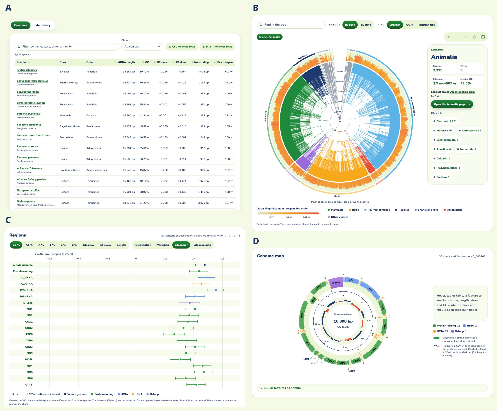
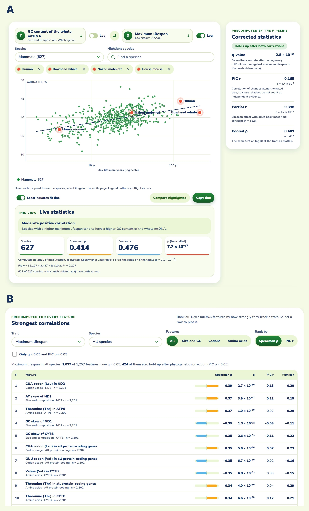
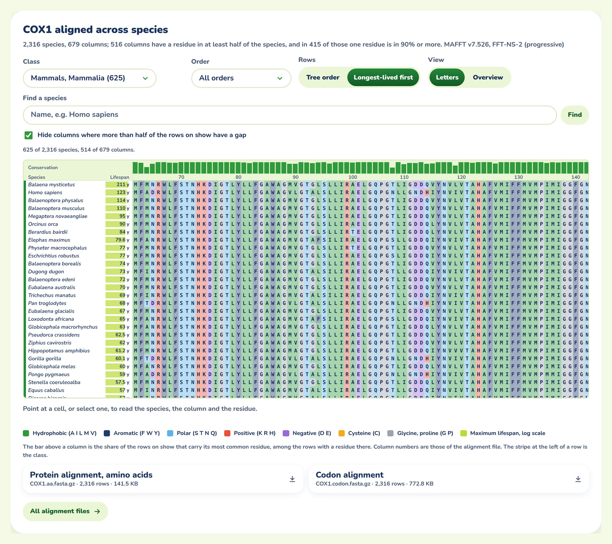

# MitoAge 2: a re-verified, phylogeny-aware database of mitochondrial DNA features and animal longevity

*Draft 0.1, 2026-11-14. Target: Nucleic Acids Research, Database issue (update article). Every number
is from MitoAge build 2 (2026-11-13) as committed in `dna-seq/mitoage` at 84ba6f7, from its report
(`docs/BUILD2_REPORT.md`) or from the correlation table its site build writes
(`dist/data/correlations.parquet`); `docs/manuscript/NOTES.md` gives the source of each number and the
questions only the authors can answer. Lines starting `> AUTHOR:` are notes to the authors, not
manuscript text.*

> AUTHOR: author list, affiliations and corresponding author to be filled in. The 2016 authors were
> Toren D, Barzilay T, Tacutu R, Lehmann G, Muradian KK, Fraifeld VE.

## Abstract

Comparative studies link the composition of mitochondrial DNA (mtDNA) to the maximum lifespan of
animal species, and MitoAge (2016) made such analyses possible for 922 species. Ten years on, its
sources have changed: RefSeq holds about three times as many complete animal mitogenomes, records have
been suppressed and re-annotated, and lifespans have been revised. MitoAge 2 re-derives every value from
pinned upstream releases and records each change to the original species with its cause. It holds 2,335
species, 1,413 of them new, including 104 invertebrates against 6 before; lifespans come from AnAge and,
where AnAge has none, from FishBase, SeaLifeBase and bird-ringing records. Base composition is reported
on the strand deposited in RefSeq, which reverses the sign of the strand skews relative to the first
release. Every mtDNA–trait correlation is given with its false discovery rate, a partial correlation on
body mass and a test on phylogenetically independent contrasts along a dated tree. Of 3,854 lifespan
correlations that pass the false discovery rate, 770 keep their sign and significance on contrasts. The
build also provides alignments of the 13 protein-coding and 2 rRNA genes, an independent reproduction of
the build, and open Parquet downloads at https://www.mitoage.info.

> AUTHOR: about 200 words, the NAR limit.

## Introduction

Mitochondria are the only animal organelles with their own genome, and the mtDNA that encodes
13 respiratory-chain subunits, 22 tRNAs and 2 rRNAs has long been studied as a factor in ageing and
in the evolution of lifespan (1–6). Maximum lifespan varies by orders of magnitude across species,
and so does the composition of the mitochondrial genome. Correlations between the two have been
reported repeatedly in mammals and birds: with base composition, with the skews between the two
strands, with direct and inverted repeats, with the amino-acid content of the encoded proteins, and
with the rate at which those proteins evolve (4, 13–18, 30, 31). The asymmetry between the heavy and
light strands is set by replication and by the mutations it favours (7, 8, 20), and it has recently been
tied to ageing directly: an A>G mutational signature on the heavy strand rises with age and with longer
generation times (21).

MitoAge was published in 2016 to make such analyses routine (22). It combined complete mitogenomes
from NCBI RefSeq (19) with maximum lifespans from AnAge (9) and offered, for 922 species, the base
composition of every gene and region, codon and amino-acid usage, and per-taxon statistics with the
correlation of each feature with log-transformed lifespan. Its authors reported more than 3,780
statistically significant correlations between mtDNA features and longevity across taxonomic groups.

Two problems with that kind of result have grown more pressing since. The first is that species are
not independent observations. Closely related species share their mitogenomes and their life
histories by descent, so a correlation across species can reflect differences among a few clades
rather than a relationship that holds within lineages. The standard remedy, phylogenetically
independent contrasts (23), needs a dated tree, which the 2016 release did not provide. The second
problem is that the sources move. RefSeq records are suppressed, replaced and re-annotated, AnAge
revises lifespans as new records appear, and taxonomy renames species. A database that is not
re-derived from its sources drifts away from them without notice.

MitoAge 2 addresses both. It re-derives every value from pinned releases of its sources and records
each change to the original species with its cause; it places the species on a dated phylogeny and
reports every correlation with three controls (false discovery rate, body mass and shared ancestry);
and it is built so that a reader can rebuild it, twice over: from its own pipeline, and from an
independent implementation that starts from the first release.

## Materials and methods

### Sources

All inputs are pinned (Table 4). Complete mitogenomes come from the RefSeq mitochondrion release 237
(file of 3 September 2026) (19). Maximum lifespans and the other life-history traits (adult and birth
weight, metabolic rate, body temperature, age at maturity, gestation or incubation time, litter or clutch
size and frequency, growth rate) come from AnAge build 15 (24). Secondary lifespans come from FishBase
v26.06 (27), SeaLifeBase v26.06 (28) and the North American Bird Banding Program longevity records
v2025.1 (USGS). Names are resolved with the NCBI Taxonomy dump of 13 November 2026. The tree topology
comes from the Open Tree of Life synthetic tree, version 16.1 (25), and node ages from TimeTree 5 (26).
The first release is kept as its 2015 CSV export, converted to Parquet without change.

**Table 4.** Pinned upstream versions of MitoAge build 2.

| Source | Version |
|---|---|
| RefSeq mitochondrion | release 237, `mitochondrion.1.genomic.gbff.gz` of 2026-09-03 (md5 recorded) |
| NCBI Taxonomy | new_taxdump of 2026-11-13 |
| AnAge | build 15 (2023-07-03) |
| FishBase, SeaLifeBase | v26.06 (Parquet, files of 2026-09-04) |
| USGS Bird Banding Laboratory | NABBP Longevity Records v2025.1 |
| Open Tree of Life | synthetic tree opentree16.1 |
| TimeTree | TimeTree 5, public API |
| MitoAge release 1 | build 1 (2015-07-01), full CSV export, SHA-256 of every file recorded |

### Inclusion and lifespan precedence

The inclusion rule of the first release is unchanged: an animal species enters MitoAge if it has a
complete mitochondrial genome in RefSeq and a maximum lifespan from a curated, regularly maintained
source. A RefSeq record counts as complete if it is an NC_ accession whose definition names a complete
genome or a complete single-molecule sequence; contigs, multipartite and partial records are excluded.
When a species has several complete records, the most recently updated full-length one is kept and the
choice is logged.

AnAge is always the first lifespan source. Where AnAge has no value, fishes take their lifespan from
FishBase, aquatic invertebrates from SeaLifeBase, and birds from the EURING longevity list and then the
USGS records. Static one-off compilations were not used, because they are not maintained. Source records
are matched to NCBI species by taxon identifier, then by accepted name with synonym resolution; a record
that cannot be matched to one species without guessing goes to a review list and is left out of the
build. Every value from every source is kept in a long-format table, with its record type (captive, wild,
observed or estimated) and its quality on a scale shared across sources. Ringing records are the oldest
recaptured wild individual and usually underestimate the maximum.

> AUTHOR: the EURING list could not be retrieved (euring.org was in maintenance on 2026-11-13), so the
> 26 bird lifespans taken from the USGS list are provisional and no EURING value is used.

### Mitochondrial features

For the whole mitogenome, each of the 13 protein-coding genes, the two rRNAs, the D-loop, and the
aggregates of all protein-coding, rRNA and tRNA genes, MitoAge 2 reports the length, the count of each
base, the GC content, the GC skew (G−C)/(G+C) and the AT skew (A−T)/(A+T). It also reports the non-coding
length of the genome, codon usage for each protein-coding gene and their total (gene sense, complete
codons only), and amino-acid usage translated with the genetic code each RefSeq record specifies. The
annotated features themselves are given with start, end and strand, with names made consistent across
records (COI, CO1 and COX1, for example) and the two leucine and two serine tRNAs told apart by codon
family.

**Strand convention.** The 2016 release reported base composition for the heavy strand, the main target
of directional mutation pressure (20, 22). Its counts are the complement of the strand deposited in
RefSeq, for every region of every species, genes encoded on either strand included. For the human
reference (NC_012920.1), release 1 lists A = 4,094, C = 2,169, G = 5,181 and T = 5,124, whereas the
deposited sequence has A = 5,124, C = 5,181, G = 2,169 and T = 4,094. For most vertebrate records the
deposited strand is the light strand, so the release-1 counts are those of the heavy strand, as the paper
intended; but RefSeq does not fix which strand is deposited, and outside the vertebrates the convention is
not uniform. MitoAge 2 reports every count on the strand as deposited. GC content is unaffected; the GC
and AT skews, and their correlations with any trait, change sign relative to release 1.

> AUTHOR: the repository's documents call this a "base-label bug" of build 1. The 2016 paper states
> that the heavy strand was analysed, so the manuscript treats it as a convention made explicit, not an
> error. Please confirm against your memory of the 2015 pipeline (NOTES.md, Q1).

### Re-verification of the first release

Every value of the 922 original species was recomputed from the current RefSeq record (the cited
accession and version where it is live, its newer version, or a live successor record of the same species
where it was suppressed) and compared with release 1. Each difference becomes a row of a changelog that
records the table, row and field, the old and new values, the kind of change (added, value update,
correction, renamed, retired), the cause and the upstream version. Systematic corrections, such as the
strand convention above and the counting of features joined from several segments over their full span,
are logged once as rules. No row is deleted: a species whose record was suppressed without a successor, or
whose lifespan no longer comes from a curated source, is marked retired, keeps its release-1 values, and is
left out of the analyses. The pipeline's validation step checks that the per-row status and the changelog
agree.

### Alignments

Each of the 13 proteins, as RefSeq translates it, is aligned across all live species with MAFFT v7.526
(FFT-NS-2) (32), and the codon alignment it implies is written alongside; the two rRNA genes are aligned
as nucleotides the same way. A summary file gives, for each alignment, its size, how many columns are well
occupied or conserved, and its checksum. These are alignments made by one fast method across very distant
animals: columns in poorly conserved stretches are not reliable statements of homology.

### Phylogeny

The topology is the subtree of the Open Tree of Life synthetic tree induced by the species, with its
polytomies kept: 2,305 of the 2,335 species are placed. Node ages come from TimeTree 5 for 2,045 of the
2,229 internal nodes. The other 184 were placed midway between their parent and their oldest child, and
61 ages were raised so that every parent is older than its children. The 30 species not in the tree are
left out of the phylogenetic tests, not given values.

### Statistics

Correlations are computed for two datasets, both excluding retired species and lifespans that are
estimated or of low or questionable quality: a default dataset with every curated source (2,202 species)
and an AnAge-only dataset (1,710 species) for comparison with the first release. For each mtDNA feature
and each life-history trait, MitoAge 2 computes Pearson's r and Spearman's ρ against the log10-transformed
trait, with a two-tailed p value from the t distribution, and controls the Benjamini–Hochberg false
discovery rate (29) within each trait and scope. The scopes are all species and each class and order with
at least 20 species; per-gene codon and amino-acid features are tested in all species and in classes only,
and a correlation needs at least 10 species with both values. For maximum lifespan, a partial correlation
on log10 adult weight separates lifespan from body size. Each correlation is also computed on
phylogenetically independent contrasts (23) along the dated tree, with polytomies resolved into
zero-length branches. The contrast p values are not corrected for multiple testing.

### Reproducibility

The build is made by one command of the site repository, `bun run data`, a TypeScript pipeline that reads
the pinned downloads, stops if one is missing, and validates its output; derived tables (correlations and
the explorer's data) are computed by the site build, `bun run build`. The pipeline's tests (192 at build 2)
include, for every rule a test guards, a check that the test fails when the rule is removed. The build was
cross-checked against an audit made separately in Python from the same downloads: the two agree on the set
of new species (1,413), on their lifespans, sources, quality, RefSeq records and names (1,413 of 1,413 for
each field), and on 99.0% of the 3,325 changed values of the original species, every remaining difference
traced to a named design choice (`docs/BUILD2_CROSSCHECK.md`).

A second repository, `dna-seq/mitoage-pipelines` (Python), is written for readers who want to rebuild
without our machines. It downloads every input with a pinned version, rebuilds build 2 from the release-1
export independently of the TypeScript pipeline, and compares the result with the published build
(`docs/BUILD2_REPRODUCTION.md` there). It also holds the analyses that read the build (the example below
among them), each one command, with a record of which results reproduce byte for byte on a rerun and
which do not. The published build itself is mirrored, with its alignments and the frozen release 1, as the
Hugging Face dataset `longevity-genie/mitoage`.

> AUTHOR: `docs/BUILD2_REPRODUCTION.md` is being finalized in a parallel session and is not yet on
> `origin/main` of mitoage-pipelines (checked 2026-11-14, head b113c0b). Once it lands, replace the
> sentence "rebuilds build 2 ... compares the result" with what it reports (how many values match), and
> cite the repository by a tagged release and Zenodo DOI rather than by branch.

## Results

### Database content

MitoAge 2 holds 2,335 species: the 922 of release 1 and 1,413 new ones (Table 1). Nineteen original
species are retired, leaving 2,316 live species in 23 classes and 9 phyla. Release 237 holds 16,008
complete metazoan mitogenomes from 15,876 species, against the 5,337 complete mitogenome entries counted
in 2015 (22); lifespan records have grown more slowly and remain the limiting factor. AnAge supplies 838
of the new lifespans, FishBase 475, SeaLifeBase 74 and the USGS list 26.

The new species change the database most among fishes and invertebrates. Fishes go from 251 species to
993 and non-chordates from 6 to 104 (35 bivalves, 30 malacostracans, 11 cephalopods among them); birds
nearly triple and mammals grow by 60%.

**Table 1.** Live species per taxon in MitoAge release 1 and MitoAge 2.

| Taxon | Release 1 | MitoAge 2 | of which new |
|---|--:|--:|--:|
| Mammals (Mammalia) | 390 | 625 | 237 |
| Birds (Aves) | 152 | 418 | 271 |
| Reptiles (Reptilia) | 94 | 129 | 42 |
| Amphibians (Amphibia) | 29 | 45 | 18 |
| Fishes (Actinopterygii, Sarcopterygii, Cephalaspidomorphi, Chondrichthyes) | 251 | 993 | 745 |
| Other chordates (Leptocardii, Ascidiacea) | 0 | 2 | 2 |
| Non-chordates | 6 | 104 | 98 |
| **Total** | **922** | **2,316** | **1,413** |

*Release 1 counts all 922 species; MitoAge 2 counts the live species (19 of the original 922 are
retired).*

> AUTHOR: order and family are not yet harmonised between the original species (AnAge taxonomy) and the
> new ones (NCBI); 41 new species have no order. Counts of orders and families are therefore left out of
> this draft (NOTES.md, Q4).

### What changed in the original 922 species

Of the 922 original species, 392 are unchanged, 465 have at least one updated or corrected value, 46 are
renamed and 19 are retired (Table 2). Eighteen switched to a live successor record of the same species
and two to a new sequence version; 884 keep the accession and version they cited in 2015. Most RefSeq
mitochondrial records have been reprocessed since 2015, and annotations changed without a change of
version, typically around incomplete stop codons and frameshifted ND3 genes. AnAge build 15 gives a
different maximum lifespan for 59 species, many of them crocodilians and primates with longer captive
records, and none for one (*Andrias davidianus*, now retired). The changelog has 14,392 rows: 5,653
additions of the new species, 6,994 value updates, 1,639 corrections, 87 renames and 19 retirements.
Release 1 lacked 320 regions that the current records annotate, 263 of them D-loops, and these are now
computed from the sequence.

**Table 2.** The 922 species of release 1 in MitoAge 2, by record status.

| Status | Meaning | Species |
|---|---|--:|
| Original | No value changed | 392 |
| Updated | At least one value updated or corrected (new record version or successor, re-annotation, AnAge revision, release-1 value disagreeing with its record, systematic rule) | 465 |
| Renamed | Accepted name changed in NCBI Taxonomy; previous names kept | 46 |
| Retired | RefSeq record suppressed with no successor (17), only successor belongs to another species (1), no curated lifespan (1) | 19 |

### What the controls change

In the default dataset, 13,947 correlations of mtDNA features with maximum lifespan were tested across all
scopes. Of these, 4,851 have p < 0.05 before any correction, and 3,854 pass a false discovery rate of 5%.
Of those 3,854, 770 are also significant on phylogenetic contrasts with the same sign, and 472 pass the
partial correlation on body mass as well (Table 3). Most correlations of the kind the 2016 release
counted do not survive a control for shared ancestry. The AnAge-only dataset gives the same picture
(3,568 pass the false discovery rate, 559 also on contrasts), and over all features in all species the
correlations of the two datasets agree at r = 0.975.

The orders show it most clearly. In primates, 101 lifespan correlations pass the false discovery rate;
8 also pass on contrasts. In mammals as a whole, whole-genome GC content correlates with lifespan at
r = 0.47 (n = 615) and at 0.40 with body mass controlled, but on contrasts it falls to 0.17 (p < 0.001).
Across all species, whole-genome GC content barely correlates with lifespan (r = 0.07), yet its partial
correlation on body mass is 0.24: a relationship within classes masked by the differences between them.

The correlations that survive all three controls lie mostly in the strand skews and in the codon usage
that follows them. Across all species, the AT skew of the whole genome correlates with lifespan at
r = 0.31 (0.22 with body mass controlled, 0.11 on contrasts, p < 10⁻⁶). In the total protein-coding
sequence, every codon ending in U among those that pass all three controls (8 codons) is used less in
longer-lived species, and every codon ending in C (8 codons) more. On the deposited strand this is a
shift from T to C at the third codon position, the direction expected from an excess of A>G mutations on
the heavy strand (21). In mammals, the GC content of ND4, ND1 and the rRNAs, and isoleucine usage, keep
their sign under all three controls.

**Table 3.** Correlations of mtDNA features with log10 maximum lifespan in the default dataset, by scope.
FDR: Benjamini–Hochberg q < 0.05 within scope. PIC: p < 0.05 on phylogenetically independent contrasts,
uncorrected. Both: FDR and PIC with the same sign. All three: Both, and partial correlation on body mass
p < 0.05.

| Scope | Species | Tests | p < 0.05 | FDR | PIC | Both | All three |
|---|--:|--:|--:|--:|--:|--:|--:|
| All species | 2,202 | 1,257 | 1,048 | 1,037 | 483 | 250 | 202 |
| Mammalia | 615 | 1,241 | 829 | 798 | 192 | 138 | 119 |
| Actinopterygii | 827 | 1,245 | 719 | 656 | 468 | 180 | 70 |
| Aves | 405 | 1,233 | 613 | 524 | 157 | 39 | 21 |
| Reptilia | 126 | 1,246 | 378 | 227 | 85 | 19 | 12 |
| Primates | 112 | 164 | 108 | 101 | 12 | 8 | 4 |
| Carnivora | 123 | 165 | 73 | 62 | 44 | 31 | 23 |
| Artiodactyla | 134 | 164 | 79 | 65 | 22 | 9 | 4 |
| Rodentia | 87 | 164 | 66 | 47 | 19 | 9 | 7 |
| Passeriformes | 140 | 164 | 61 | 39 | 24 | 8 | 0 |
| **All scopes (34)** | | **13,947** | **4,851** | **3,854** | **2,577** | **770** | **472** |

> AUTHOR: two checks before this table is final (NOTES.md, Q5). (1) In some poorly resolved clades the
> contrast tests reject far more often than chance with no raw signal at all: Chondrichthyes 494 of 1,212
> at p < 0.05, Clupeiformes 61 of 161, Rajiformes 57 of 152, with 0 or 2 passing the FDR. That pattern
> suggests contrasts standardised over near-zero branch lengths (polytomies resolved as zero-length, or
> interpolated ages), and the PIC column should not be read in those scopes until it is checked. (2) The
> scopes include an empty order ("order:", 41 species without an order). Neither affects the "Both"
> column much, which needs the FDR as well, but both affect the PIC column total.

### An example: amino-acid content and the alignments

The analyses in `mitoage-pipelines` show how the controls change a result at the level of the encoded
proteins. Long-lived animals are reported to have fewer cysteines in their mitochondrially encoded
proteins (30), and methionine has been debated (31). On build 2, with relatedness controlled by comparison
within families and by random effects of order and family, and with base composition at fourfold
degenerate sites in the model, mammals (622 species with body mass) show threonine rising (+0.30
percentage points per tenfold lifespan, p = 0.0005) and cysteine falling (−0.05, p = 0.00008), and nothing
for methionine (p = 0.4). Without any control for relatedness, threonine across all species has
p ≈ 10⁻⁶⁰; within families, p = 0.9. A screen of single alignment columns in a phylogenetic regression on
the dated tree finds no residue robustly associated with lifespan in 604 mammals or 379 birds: the one or
two columns near the threshold change with the tree, as chance would have them.

> AUTHOR: these results are from `docs/HYPOTHESES.md` of mitoage-pipelines (runs of 2026-11-13; the
> repository says "Nothing here is peer reviewed"). Decide whether a database update should carry them,
> or only point to the repository; the threonine reference is missing (NOTES.md, Q6).

## Website and interface

The website is a static site: every page is generated when the data are built, and the browser fetches
small JSON files for the interactive views, so the site needs no database server and can be mirrored
whole. The menu follows the data: Species, Tree, Genes, Compare, Data and About (Figure 1).

- **Species.** A sortable, filterable list of all species in two views, genome features and life
  history (Figure 1A), with a page per species and its circular genome map (Figure 1D). The filtered rows
  download as CSV and their mitogenomes as one FASTA file, which the browser fetches from NCBI; MitoAge
  stores no sequences.
- **Tree.** A zoomable radial tree of the species on the dated phylogeny (Figure 1B), with a page per
  class, order and family.
- **Genes.** A circular map of the genome of any species, and a page per gene with its distribution
  across species, its correlations with lifespan, and its alignment with lifespan shown beside the rows
  (Figure 5).
- **Compare.** The comparative statistics of the original site (n, mean, standard deviation, coefficient
  of variation, minimum, median, maximum, and r with log10 lifespan, by region or by child taxon, and codon
  usage), each table with a chart of its rows (Figure 1C). Two to six species can be set side by side.
- **Plot explorer.** Any two mtDNA features, or a feature against a life-history trait, for all species or
  one taxon, with the strongest correlations listed with their false discovery rate, partial and contrast
  statistics (Figure 2).

Old addresses redirect to their new pages, so links to the original site in the literature keep working.

## Data access and versioning

Every table can be downloaded as Parquet (readable by DuckDB, pandas, polars and R arrow), the species
table also as CSV: species and traits, lifespan observations from every source, region statistics, codon
usage, genome features, correlations, the changelog and the review list, with the alignments as gzipped
FASTA. A README written by the pipeline describes every column and lists the pinned version of each source
and the notes on every known difference from release 1. Release 1 is kept, frozen, beside the current
build. Each build is dated and mirrored as one Hugging Face dataset; each is intended to receive a Zenodo
DOI.

> AUTHOR: Zenodo DOIs are planned, not minted.

## Conclusion

MitoAge 2 keeps what the first release offered, the composition of every animal mitogenome with a known
lifespan and its statistics by taxon, and adds what a comparative analysis now needs: values traceable to
pinned sources, a stated strand convention, alignments of the genes, and controls for body size and
shared ancestry next to every correlation. The re-analysis is a caution as much as a resource. Most
correlations between mtDNA features and lifespan reflect differences between lineages, and those that
hold within lineages are fewer and weaker. They are concentrated in the strand asymmetry and the codon
usage it shapes, where the mutational processes of the mitogenome leave their mark, and that is where the
next analyses should look. A hundred invertebrates, against six in the first release, are a first chance
to ask whether these relationships extend beyond the vertebrates.

## Data availability

The website is at https://www.mitoage.info and https://just-dna.life/mitoage/, with the downloads under
`/data/`. The build is mirrored as the Hugging Face dataset `longevity-genie/mitoage`. The site and its
data pipeline are at https://github.com/dna-seq/mitoage, and the independent reproduction and the
analyses at https://github.com/dna-seq/mitoage-pipelines, both under the MIT licence. Lifespan values from
FishBase and SeaLifeBase are CC BY-NC 4.0 and are marked as such in the downloads; AnAge data are subject
to the Human Ageing Genomic Resources conditions of use; NCBI data carry no use restrictions.

> AUTHOR: confirm the licence of MitoAge's own data (release 1 was under a Creative Commons licence).

## Funding

> AUTHOR: to be completed.

## Conflict of interest statement

> AUTHOR: to be completed.

## Figures

> AUTHOR: Figures 1, 2 and 5 are screenshots of the build 2 site, taken on 2026-11-14 at a desktop width
> of 1,440 pixels (NOTES.md, "Figures", says how). Figure 2 was planned as a scatter across species beside
> one on contrasts; the site does not plot the contrasts themselves, so panel A gives the contrast r beside
> the scatter, and panel B shows the explorer's ranking of every feature. Figures 3 and 4 are charts of the
> correlation table and are not drawn yet. Figure 5 is new with the screenshots: keep it or drop it, and
> renumber the figures in order of citation before submission.

**Figure 1.** The MitoAge 2 interface. (**A**) The species list, genome view, sorted by maximum lifespan:
the ocean quahog (*Arctica islandica*, 507 years) and the Greenland shark (*Somniosus microcephalus*,
392 years) lead the 2,335 species. The rows shown, after any filter, download as CSV and their mitogenomes
as one FASTA file. (**B**) The radial tree of all species by taxonomic rank, coloured by class, with each
species' maximum lifespan on a log scale in the outer ring; any clade zooms into view. (**C**) Compare,
class Mammalia: Pearson's r of the GC content of each region with log10 maximum lifespan and its 95%
confidence interval, not corrected for multiple testing or shared ancestry, above the table of the same
rows (n, mean, standard deviation, coefficient of variation, minimum, median, maximum, r, p). (**D**) The
circular genome map of the bowhead whale (*Balaena mysticetus*, NC_005268.1, 16,390 bp): genes on the
two strands in the outer and inner rings, and in the middle ring the GC content of each gene against that
of the whole genome.

**Figure 2.** The plot explorer. (**A**) Whole-genome GC content against maximum lifespan (log scale) in
all 627 mammals the site lists (the two retired ones included), with four species highlighted and the
least-squares line. The live statistics
below the plot are computed in the browser for the points shown (Pearson r = 0.48 with log10 lifespan,
n = 627). The panel on the right gives the statistics the pipeline computed on the default dataset, which
leaves out estimated and low-quality lifespans: q = 2.8 × 10⁻³³, r on phylogenetically independent
contrasts 0.17 (p = 4.4 × 10⁻⁵) and partial r on body mass 0.40 (n = 612). (**B**) The mtDNA features
ranked by the strength of their correlation with maximum lifespan across all species, each with its q, its
r on contrasts and its partial r on body mass. Of the 1,257 features, 1,037 have q < 0.05 and 424 of
those have a contrast p < 0.05 (of either sign; Table 3 counts the 250 with the same sign).

**Figure 3.** Lifespan correlations retained at each control (p < 0.05, false discovery rate, contrasts
with the same sign, body mass), by scope (data of Table 3). *(Not drawn yet.)*

**Figure 4.** Third-position codon usage against lifespan across all species: the r of each codon of the
total protein-coding sequence, raw and on contrasts, coloured by third base. *(Not drawn yet.)*

**Figure 5.** The alignment of COX1 on its gene page, shown for the 625 mammals it holds and sorted
longest-lived first: the bowhead whale (211 years), human (123 years), then the fin, blue and humpback
whales. Residues are coloured by the class of their side chain; the bar above each column is the share of
the rows on show that carry its most common residue, and each species' maximum lifespan is drawn beside its
row. The alignment (MAFFT v7.526, FFT-NS-2) covers 2,316 species in 679 columns; columns where more than
half of the rows on show have a gap are hidden (514 of 679 are shown).

## References

*Numbering follows the 2016 paper for its references 1–9 and 13–20, so the two lists can be compared;
10–12 are not cited here. Renumber in order of citation before submission.*

1. Wallace DC. A mitochondrial paradigm of metabolic and degenerative diseases, aging, and cancer: a
   dawn for evolutionary medicine. Annu Rev Genet. 2005;39:359–407.
2. López-Otín C, Blasco MA, Partridge L, Serrano M, Kroemer G. The hallmarks of aging. Cell.
   2013;153:1194–1217.
3. Apostolova N, Blas-Garcia A, Esplugues JV. Mitochondria sentencing about cellular life and death: a
   matter of oxidative stress. Curr Pharm Des. 2011;17:4047–4060.
4. Lehmann G, Segal E, Muradian KK, Fraifeld VE. Do mitochondrial DNA and metabolic rate complement
   each other in determination of the mammalian maximum longevity? Rejuvenation Res. 2008;11:409–417.
5. Sevini F, et al. mtDNA mutations in human aging and longevity: controversies and new perspectives
   opened by high-throughput technologies. Exp Gerontol. 2014;56:234–244.
6. Khrapko K, Turnbull D. Mitochondrial DNA mutations in aging. Prog Mol Biol Transl Sci.
   2014;127:29–62.
7. Clayton DA. Transcription and replication of mitochondrial DNA. Hum Reprod. 2000;15 Suppl 2:11–17.
8. Fernández-Silva P, Enriquez JA, Montoya J. Replication and transcription of mammalian mitochondrial
   DNA. Exp Physiol. 2003;88:41–56.
9. Tacutu R, et al. Human Ageing Genomic Resources: integrated databases and tools for the biology and
   genetics of ageing. Nucleic Acids Res. 2013;41:D1027–D1033.
13. Lehmann G, Muradian KK, Fraifeld VE. Telomere length and body temperature-independent determinants
    of mammalian longevity? Front Genet. 2013;4:111.
14. Samuels DC. Life span is related to the free energy of mitochondrial DNA. Mech Ageing Dev.
    2005;126:1123–1129.
15. Samuels DC. Mitochondrial DNA repeats constrain the life span of mammals. Trends Genet.
    2004;20:226–229.
16. Galtier N, Blier PU, Nabholz B. Inverse relationship between longevity and evolutionary rate of
    mitochondrial proteins in mammals and birds. Mitochondrion. 2009;9:51–57.
17. Lehmann G, Budovsky A, Muradian KK, Fraifeld VE. Mitochondrial genome anatomy and species-specific
    lifespan. Rejuvenation Res. 2006;9:223–226.
18. Yang JN, Seluanov A, Gorbunova V. Mitochondrial inverted repeats strongly correlate with lifespan:
    mtDNA inversions and aging. PLoS One. 2013;8:e73318.
19. O'Leary NA, et al. Reference sequence (RefSeq) database at NCBI: current status, taxonomic
    expansion, and functional annotation. Nucleic Acids Res. 2016;44:D733–D745.
20. Reyes A, Gissi C, Pesole G, Saccone C. Asymmetrical directional mutation pressure in the
    mitochondrial genome of mammals. Mol Biol Evol. 1998;15:957–966.
21. Mikhailova AG, et al. A mitochondria-specific mutational signature of aging: increased rate of
    A>G substitutions on the heavy strand. Nucleic Acids Res. 2022;50:10264–10277.
22. Toren D, Barzilay T, Tacutu R, Lehmann G, Muradian KK, Fraifeld VE. MitoAge: a database for
    comparative analysis of mitochondrial DNA, with a special focus on animal longevity. Nucleic Acids
    Res. 2016;44:D1262–D1265.
23. Felsenstein J. Phylogenies and the comparative method. Am Nat. 1985;125:1–15.
24. Tacutu R, et al. Human Ageing Genomic Resources: new and updated databases. Nucleic Acids Res.
    2018;46:D1083–D1090.
25. Hinchliff CE, et al. Synthesis of phylogeny and taxonomy into a comprehensive tree of life. Proc
    Natl Acad Sci USA. 2015;112:12764–12769.
26. Kumar S, et al. TimeTree 5: an expanded resource for species divergence times. Mol Biol Evol.
    2022;39:msac174.
27. Froese R, Pauly D (eds). FishBase. www.fishbase.org, version 26.06.
28. Palomares MLD, Pauly D (eds). SeaLifeBase. www.sealifebase.org, version 26.06.
29. Benjamini Y, Hochberg Y. Controlling the false discovery rate: a practical and powerful approach to
    multiple testing. J R Stat Soc B. 1995;57:289–300.
30. Moosmann B, Behl C. Mitochondrially encoded cysteine predicts animal lifespan. Aging Cell.
    2008;7:32–46.
31. Aledo JC, Li Y, de Magalhães JP, Ruíz-Camacho M, Pérez-Claros JA. Mitochondrially encoded methionine
    is inversely related to longevity in mammals. Aging Cell. 2011;10:198–207.
32. Katoh K, Standley DM. MAFFT multiple sequence alignment software version 7: improvements in
    performance and usability. Mol Biol Evol. 2013;30:772–780.

> AUTHOR: references 19, 21 and 24–32 are new and need checking (a reference-check pass is suggested).
> Data citations are needed for the USGS BBL longevity records (v2025.1), the Hugging Face dataset and
> both repositories.
