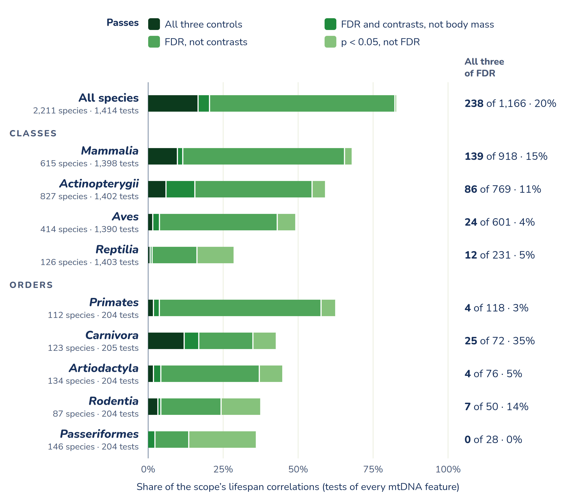
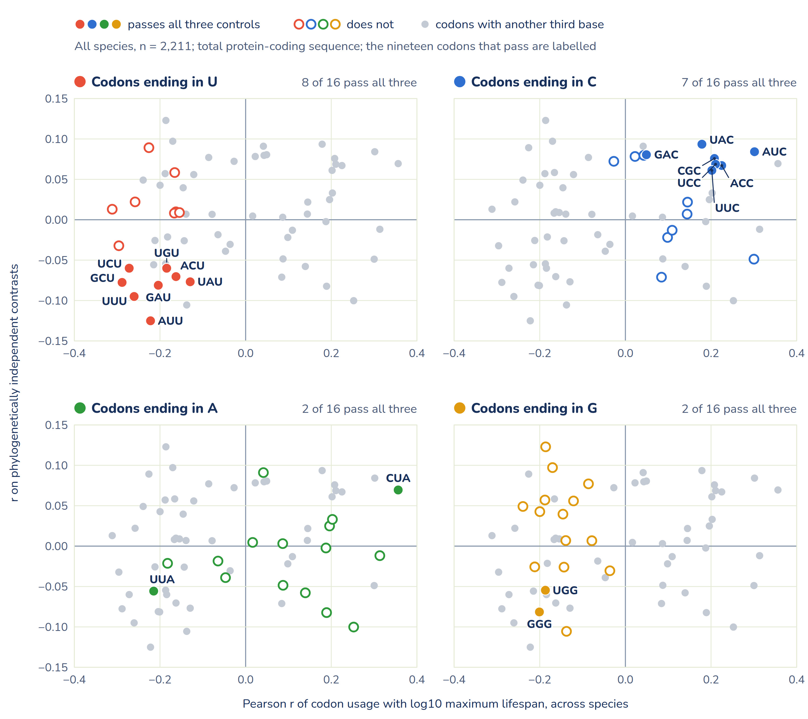
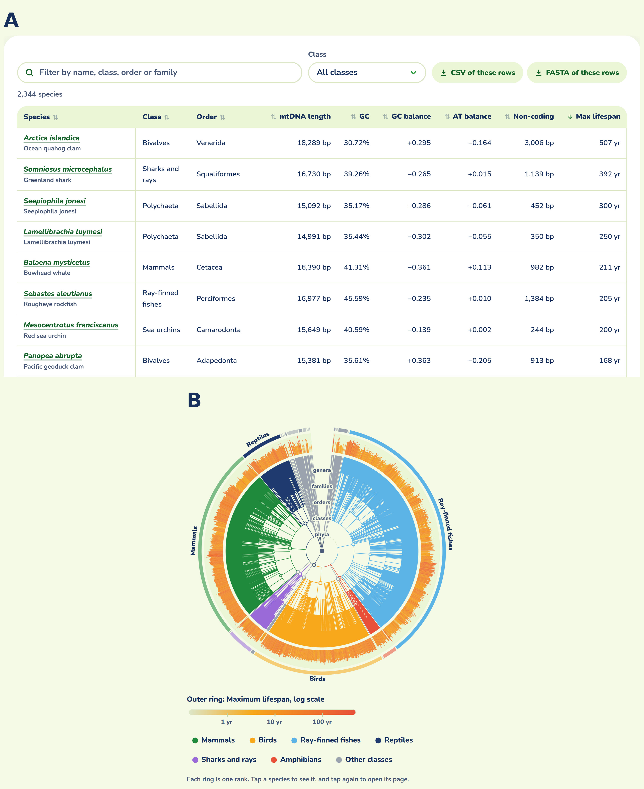
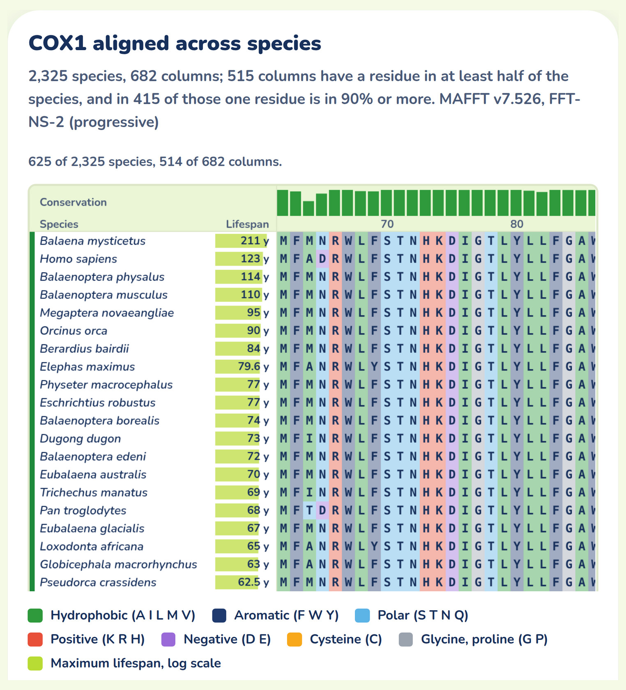
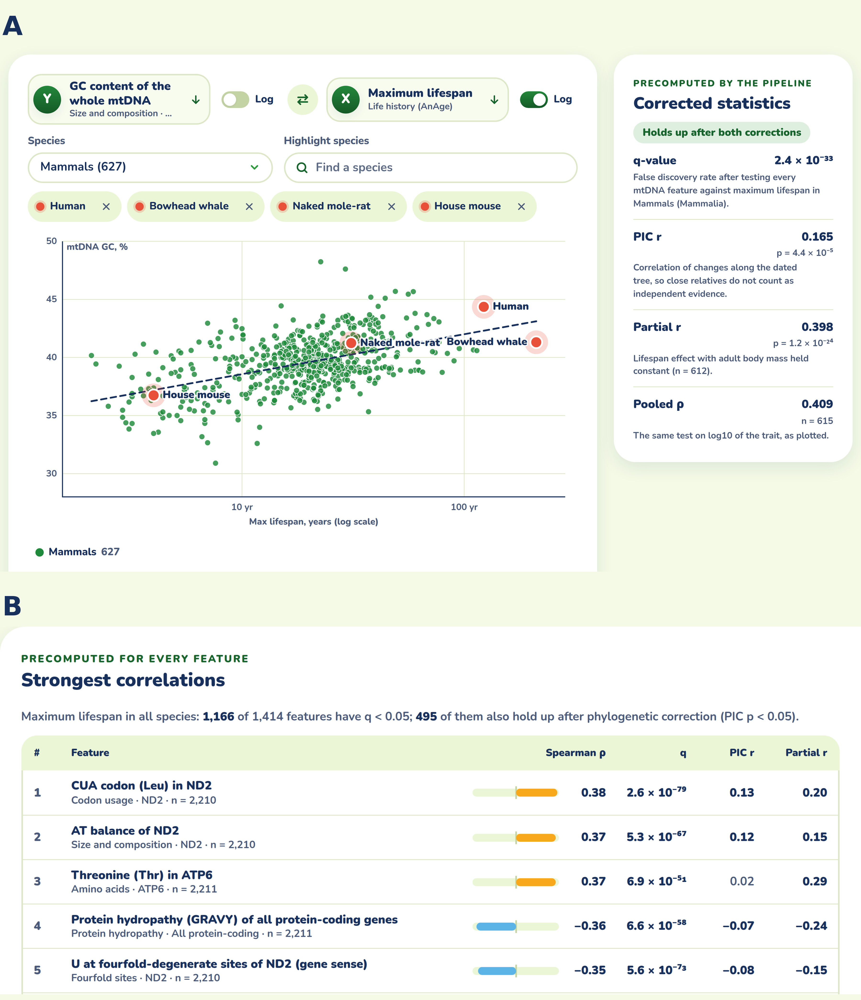

# MitoAge 2: a re-verified, phylogeny-aware database of mitochondrial DNA features and animal longevity

*Draft 0.1 of 2026-11-14, restructured on 2026-11-15 for Nucleic Acids Research as a regular research article
(the fourth journal selection; a presubmission inquiry asks the editors whether they take it outside the
Database issue), then Molecular Biology and Evolution (Resources). The sections follow NAR's order:
Introduction, Materials and methods, Results, Discussion. Every number
is from MitoAge build 2 with the EURING bird records and the annotation patch, as committed in `dna-seq/mitoage` at 03c0949 (Hugging Face revision 0f4e970; the correlations from the site build of that commit), from its report
(`docs/BUILD2_REPORT.md`) or from the correlation table its site build writes
(`dist/data/correlations.parquet`); `docs/manuscript/NOTES.md` gives the source of each number and the
questions only the authors can answer. Lines starting `> AUTHOR:` are notes to the authors, not
manuscript text.*

**Authors:** Anton Kulaga^1,2,3,†^, Dmitri Toren^2,3,†^, Nikolay Usanov^4^, Robi Tacutu^2,3,\*^

**Affiliations:**

1. Institute for Biostatistics and Informatics in Medicine and Ageing Research, Rostock University Medical Center, Rostock, Germany
2. Institute of Biochemistry of the Romanian Academy, Bucharest, Romania
3. ROGEN Consortium, the Romanian genomics project, Bucharest, Romania
4. HEALES (Healthy Life Extension Society), Brussels, Belgium

† These authors contributed equally. \* Corresponding author: robi.tacutu@gmail.com.

## Abstract

Do the reported links between mitochondrial DNA and animal lifespan hold up? MitoAge (2016) made such
comparisons possible for 922 species. We rebuilt it as MitoAge 2: 2,325 species, 106 of them invertebrates,
every value re-derived from pinned sources, with gene alignments and a dated tree. The sources had moved: half
of the original species changed at least one value, each change logged with its cause. We tested every
correlation against shared ancestry and body size. Of 4,296 lifespan correlations that pass the false
discovery rate, one in five keeps its sign and significance between sister lineages, and 393 survive ancestry
and body mass controlled together. Published relationships retested on the dated tree, among them inverted
repeats, slower protein evolution and fewer cysteines in long-lived species, are not detected. One signal
stands out: long-lived mammals have GC-richer mitogenomes, with C in place of T at synonymous sites, and the
shift follows the slow life history as a whole, gestation, maturity and birth weight as much as lifespan. Its
direction matches the age-related mutational signature on the heavy strand. Birds show no such signal. MitoAge
2 puts these controls beside every correlation, so new claims can be checked within lineages.

> AUTHOR: 200 words in one paragraph, without references or the URL, as NAR asks of a regular
> article: one paragraph of at most 200 words, with URLs only in its Database and Web Server issues.
> The URL is in Data availability. MBE allows 250 words.

## Introduction

Mitochondria are the only animal organelles with their own genome. Their mtDNA, which encodes
13 subunits of the respiratory chain and ATP synthase, 22 tRNAs and 2 rRNAs, has long been studied as a factor in ageing and
in the evolution of lifespan (1–6). Maximum lifespan varies by orders of magnitude across species,
and so does the composition of the mitochondrial genome. Correlations between the two have been
reported repeatedly in mammals and birds: with base composition, direct and inverted repeats, the amino-acid content of the encoded proteins, and
the rate at which those proteins evolve (4, 13–18, 30, 31). The two strands of mtDNA differ in composition,
and this asymmetry between the heavy and light strands, which the GC/AT balance measures, is set by replication and
by the mutations it favours (7, 8, 20). It has recently been tied to ageing directly: an A>G mutational
signature on the heavy strand rises with age and, across mammals, with longer generation times (21). Composition
has also been tied to other traits of the slow life history: in a machine-learning model of maximum lifespan in
mammals, mtDNA GC content (taken from MitoAge's first release) and gestation were the two most influential traits (45).
That model did not control for shared ancestry.

MitoAge was published in 2016 to make such analyses routine (22). It combined complete mitogenomes
from NCBI RefSeq with maximum lifespans from AnAge (9). For 922 species, it offered the base
composition of every gene and region, codon and amino-acid usage, and per-taxon statistics with the
correlation of each feature with log-transformed lifespan. Its authors reported more than 3,780
statistically significant correlations between mtDNA features and longevity across taxonomic groups (22).

Two things can make a count of that kind misleading, and both have grown more pressing since: shared
ancestry, and sources that move. The first arises because species are not independent observations.
Closely related species share their mitogenomes and their life histories by descent, so a correlation
across species can reflect differences among a few clades rather than a relationship that holds within
lineages. The standard remedy, phylogenetically independent contrasts (23), therefore correlates
differences between sister lineages rather than the species' own values; it needs a phylogeny with branch
lengths, which the 2016 release did not provide. The second arises because the sources keep changing:
RefSeq records are suppressed, replaced and re-annotated, AnAge revises lifespans as new records appear,
and taxonomy renames species. A database that is not re-derived from its sources therefore drifts away
from them without notice.

We rebuilt MitoAge to test both. If the sources have drifted, re-deriving the original species from current
records should change many of their values, so we re-derived every value from pinned releases of the
sources and recorded each change to the original species with its cause. If many of the published correlations reflect differences among a few clades, most should lose their sign
or their significance when sister lineages are compared. To test this, we placed the species on a dated phylogeny and report every
correlation with its false discovery rate and a test on contrasts. To separate lifespan from body size,
every correlation with lifespan also carries a control for body mass where body mass is recorded. A correlation that survives both controls raises a third question. Lifespan evolves together with age at
maturity, gestation and birth weight, so a feature that follows lifespan may follow the slow life history
as a whole, as the links to generation time (21) and gestation (45) suggest; we therefore tested the survivors
against each of these traits and against a slow-fast axis built from them. We then retested published
relationships that the tables, the alignments and the tree can address together: amino-acid content,
inverted repeats, the rate at which the proteins evolve, and the structural features of the proteins. We call the
rebuilt database MitoAge 2, its current data build 2 and the data of 2016 release 1. A reader can repeat the
re-derivation in two ways: from the database's own pipeline, and from an independent implementation that
starts from the first release.

## Materials and methods

### Sources

All inputs are pinned (Supplementary Methods S1 and Supplementary Table S2). Complete mitogenomes come from the RefSeq mitochondrion release 237
(file of 3 September 2026) (19). Maximum lifespans and the other life-history traits (adult and birth
weight, metabolic rate, body temperature, age at maturity, gestation or incubation time, litter or clutch
size and frequency, growth rate) come from AnAge build 15 (24, 37). Secondary lifespans come from FishBase
v26.06 (27), SeaLifeBase v26.06 (28), the EURING list of longevity records for European birds of
1 September 2023 (53) and the North American Bird Banding Program longevity records v2025.1 (38). Names are resolved with the NCBI Taxonomy dump of 13 November 2026 (43). The tree topology
comes from the Open Tree of Life synthetic tree, version 16.1 (25, 39), and node ages from TimeTree 5 (26).
The first release is kept as its 2015 CSV export, converted to Parquet without change.

### Inclusion and lifespan precedence

The inclusion rule of the first release is unchanged: an animal species enters MitoAge if it has a
complete mitochondrial genome in RefSeq and a maximum lifespan from a curated, regularly maintained
source. A RefSeq record counts as complete if it is an NC_ accession whose definition names a complete
genome, a complete sequence or a circular mitochondrial organelle assembly; contigs, multipartite and partial records are excluded.
When a species has several complete records, the most recently updated one is kept and the choice is logged.
Between records of the same date, one at least 75% of the median length of its class is preferred, then the higher version (Supplementary Methods S2).

AnAge is always the first lifespan source. Where AnAge has no value, fishes take their lifespan from
FishBase, aquatic invertebrates from SeaLifeBase, and birds from the European and then the North American ringing records (9 and 26 species).
Static one-off compilations were not used, because they are not maintained. Source records
are matched to NCBI species by taxon identifier, then by accepted name with synonym resolution. A record
that cannot be matched to one species without guessing goes to a review list and is left out of the
build (Supplementary Methods S3). Every value from every source is kept in a long-format table, with its record type (captive, wild,
observed or estimated) and its quality on a scale shared across sources (high, acceptable, questionable or low).
AnAge's own data-quality grade is kept. For FishBase and SeaLifeBase, maximum ages are acceptable unless the source
flags them as questionable, wild and captive longevities are acceptable, and ages from growth studies are
low. Ringing records are acceptable; each records the oldest recaptured wild individual and usually
underestimates the maximum. AnAge values
are typed by the origin of the specimen, so its ages of wild animals count as wild whatever the method of
ageing; "estimated" marks a FishBase value from a growth study. The two sources are therefore treated
asymmetrically: AnAge ages of wild animals that were estimated rather than observed stay in the default
dataset, among them the Greenland shark (392 years) and two tubeworms (300 and 250 years), which enter the
all-species analyses at the extreme of the trait, while FishBase ages from growth studies are left out. Supplementary Methods S4 gives the mapping
field by field.

### Mitochondrial features

For the whole mitogenome, each of the 13 protein-coding genes, the two rRNAs, the D-loop, and the
aggregates of all protein-coding, rRNA and tRNA genes, MitoAge 2 reports the length, the count of each
base, the GC content and the GC/AT balance of the strand: the GC balance (G−C)/(G+C) and the AT balance (A−T)/(A+T), often called the GC and AT skews. It also reports the non-coding length of the genome, codon usage for each protein-coding gene and their total, and amino-acid usage translated with the genetic code each RefSeq record specifies. Codon usage counts complete codons only, in gene sense, each codon as a percentage of all codons. Annotated
features are given with start, end and strand, with names made consistent across
records (COI, CO1 and COX1, for example) and the two leucine and two serine tRNAs told apart by codon
family. A protein gene a record does not annotate is not filled in from a relative: each of the 26 species that lack one of the 13 carries a review flag with the reason (the gene is not in the record's sequence, or the record marks it as frameshifted; ATP8 is not annotated in 18 bivalves and is lost in nematodes). The one exception is the ND6 of the African grey parrot, intact in its record's sequence between tRNA-Pro and tRNA-Glu but not annotated, which the build adds and records in the changelog. The extended features are the base composition of fourfold-degenerate sites (in gene sense and, for records
with the vertebrate layout, on the heavy strand), and the hydropathy (GRAVY) of each encoded protein. They also
include perfect direct, inverted and mirror repeats of at least 10 bases over the whole genome and the major arc, which runs between the two replication origins.
Further features are the repeat pairs bridging the two spans that flank most human mitochondrial deletions (47) and the number of
control-region copies. The motif features cover G-quadruplexes, homopolymer runs, purine and pyrimidine tracts and short tandem repeats. These enter the correlations and the false discovery rate like every other feature.
Supplementary Methods S7 defines every feature.

**Strand convention.** The 2016 release reported base composition mostly for the heavy strand, a primary target
of directional mutation pressure (20, 22). Its counts are the complement of the strand deposited in
RefSeq, for every region of every species, genes encoded on either strand included. For the human
reference (NC_012920.1), release 1 lists A = 4,094, C = 2,169, G = 5,181 and T = 5,124, whereas the
deposited sequence has A = 5,124, C = 5,181, G = 2,169 and T = 4,094. For most vertebrate records the
deposited strand is the light strand, so the release-1 counts are those of the heavy strand, as the paper
intended. RefSeq does not, however, fix which strand is deposited, and outside the vertebrates the convention is
not uniform. MitoAge 2 reports every count on the strand as deposited. GC content is unaffected; the GC
and AT balance, and their correlations with any trait, change sign relative to release 1 (Supplementary
Methods S5).

> AUTHOR: the repository's documents call this a "base-label bug" of build 1. The 2016 paper states
> that the heavy strand was analysed, so the manuscript treats it as a convention made explicit, not an
> error. Please confirm against your memory of the 2015 pipeline (NOTES.md, Q1).

### Re-verification of the first release

Every value of the 922 original species was recomputed from the current RefSeq record and compared with
release 1. That record is the cited accession and version where it is live, its newer version, or, where it was
suppressed, a live successor record of the same species. Each difference becomes a row of a changelog that
records the table, row and field, the old and new values, the kind of change (added, value update,
correction, renamed, retired), the cause and the upstream version. Systematic corrections, such as the
strand convention above and the counting of features joined from several segments over their full span,
are logged once as rules. No row is deleted. A species whose record was suppressed without a successor, or whose lifespan no longer comes from a curated source, is marked retired and left out of the analyses. Its release-1 values stay in the table, re-expressed on the deposited strand like every other row. The pipeline's validation step checks that the per-row status and the changelog
agree (Supplementary Methods S6).

### Alignments

Each of the 13 proteins, as RefSeq translates it (and the parrot's ND6 as the build translates it), is aligned across all live species with MAFFT v7.526
(FFT-NS-2) (32), and the codon alignment it implies is written alongside. The two rRNA genes are aligned
as nucleotides the same way. A summary file gives, for each alignment, its size, how many columns are well
occupied or conserved, and its checksum. These are alignments made by one fast method across very distant
animals: columns in poorly conserved stretches are not reliable statements of homology. Supplementary
Methods S8 describes the choice of aligner and its comparison with other aligners and with structure.

### Phylogeny

The topology is the subtree of the Open Tree of Life synthetic tree induced by the species, with its
polytomies kept: 2,314 of the 2,344 species are placed. Node ages come from TimeTree 5 for 2,054 of the
2,238 internal nodes. The other 184 were placed midway between their parent and their oldest child, and
61 ages were raised so that no parent is younger than its children. The 30 species not in the tree are left out of the phylogenetic tests, not given values. The dated tree is `src/data/generated/phylogeny.json` of the site repository (Supplementary Methods S9).

### Statistics

Correlations are computed for two datasets, both excluding retired species and lifespans that are estimated or of low or questionable quality. The default dataset has every curated source (2,211 species: the 2,325 live species less 49 estimated and 65 questionable lifespans). An AnAge-only dataset (1,710 species) allows comparison with the first release (Supplementary Methods S10.1).

For each mtDNA feature and each life-history trait, MitoAge 2 computes Pearson's r and Spearman's ρ against the log10-transformed trait, and controls the Benjamini–Hochberg false discovery rate (29) within each trait and scope. The false discovery rate and all counts use the two-tailed p value of Pearson's r, from the t distribution. The scopes are all species and each class and order with
at least 20 species; a species with no name at a rank joins no scope at that rank. Orders and families are not yet harmonised: species of release 1 take AnAge's, new species NCBI Taxonomy's, so one clade can fall into two order scopes (Supplementary Methods S3). Per-gene codon, amino-acid, fourfold-site and hydropathy features are tested in all species and in classes only,
and a correlation needs at least 10 species with both values.

For maximum lifespan, a Pearson partial correlation on log10 adult weight separates lifespan from body size, in the
species with a recorded adult weight (1,386 of the 2,211 in all species; 235 of the 827 ray-finned fishes). Each correlation is also computed on
phylogenetically independent contrasts (23) along the dated tree, as the correlation of the standardised contrasts through the origin, with polytomies resolved into
zero-length branches. Where two branches both have zero length, their values are averaged and give no contrast. The contrast p value comes from the t distribution with m − 1 degrees of freedom for m contrasts, the
partial-correlation p value with n − 3 for n species. Neither is corrected for multiple testing, so the counts
that also pass them rest on a nominal 5% level at those steps. The three controls of the funnel in Results are applied one at a time: the contrasts are not adjusted for body mass, and the partial
correlation is not adjusted for shared ancestry. To control for both together, each lifespan correlation is also
computed on the contrasts with log10 body mass partialled out, on the species with a recorded adult weight (at
least 10). Its p value comes from the t distribution with m − 2 degrees of freedom, and the Results report it beside the
funnel. Each contrast correlation with lifespan also carries a second p value, from up to 9,999 random sign
flips of the contrast products, which does not assume normal contrasts of equal variance; the counts use the
t test. The contrast test also rejects more than 5% of tests in several scopes when lifespan is shuffled across species (Supplementary Methods S10.6). The test with body mass partialled out has no sign-flip p value. The counts that rest on either are therefore nominal. Supplementary Methods S10.6 gives the contrast
computation step by step, and S10.7 what each count of the Results requires.

### Life-history and structural models

To ask whether a composition feature follows lifespan or the slow life history it belongs to, we fixed 43
composition features before any of these models was run: the GC content, GC balance and AT balance of the protein-coding
genes and of the whole record; the four bases at fourfold-degenerate sites, in gene sense; the share of
pyrimidine-ending codons that end in C; and the 32 codons ending in U or C, each as a percentage of all
complete codons. Each feature, standardised, was regressed on the dated tree with Pagel's λ (49) estimated by
maximum likelihood, and with λ fixed at 1 as a check (`mitoage longevity generation-time`). Pagel's λ scales the similarity expected of related species from none (λ = 0) to that of Brownian motion along the tree (λ = 1). The regressions use our own implementation (NumPy and SciPy), which, unlike the contrast code, has not been compared with an established package. The traits, each
log10, are maximum lifespan, adult body mass and three AnAge traits: female age at maturity, gestation
(incubation in birds) and birth weight. For each trait the models are the trait alone and with mass,
lifespan alone and with mass, and lifespan, the trait and mass together. On the species with every trait
they are also mass alone, all five traits together and two slow-fast axes: the first phylogenetic principal
component (46) of the four traits and mass (the axis with size), and of the four traits after mass is
regressed out on the tree, fitted together with mass (the axis beyond size), each oriented so that lifespan
loads positively and scaled to unit standard deviation. Models with several traits show how a signal is
shared among traits that evolve together; they are not read as one trait explaining it instead of another.
q is the Benjamini–Hochberg value over the 43 features within class, trait set, model and term. Every test in the paper is two-sided. Age at
maturity is the build's proxy for generation time; it is not the generation length of (21), which the build
does not hold.

The structural features were tested class by class on the species of the amino-acid model (Results), with
log10 maximum lifespan regressed on each standardised feature, log10 body mass and base composition at
fourfold-degenerate sites, with Pagel's λ (`mitoage longevity structure-pgls`). The 298 residues of cytochrome c oxidase subunits 1 to 3 at contacts with its nuclear-encoded subunits were taken from the
structure 5Z62 (52). The first structural feature is the share of them where a species' residue differs from the class's most common one.
The others are the same share at 298 control residues matched for burial, the difference between the two shares, and the hydropathy (GRAVY) of each of the 13 proteins and of all 13 together. Both analyses ran
on build 2 with the nine EURING birds and the annotation patch from `dna-seq/mitoage-pipelines` at commit 2ee27a1; their
records are entries H11 and H12 of its `docs/HYPOTHESES.md`, and Supplementary Methods S12.6 and S12.7 describe them.

### Reproducibility

The build is made by one command of the site repository, `bun run data`, a TypeScript pipeline that reads
the pinned downloads, stops if one is missing, and validates its output. A second command, `bun run align`,
makes the alignments, and the site build, `bun run build`, the derived tables (correlations and the explorer's
data). The pipeline has 192 tests at build 2.
Each new test of a build rule was checked when written, by breaking the code it guards and confirming that it
fails (`docs/BUILD2_REPORT.md` lists the checks). The build was cross-checked against an audit made separately in Python from the same downloads; the audit's scripts are not published (`docs/BUILD2_CROSSCHECK.md` gives the comparison). The two agree on the new species and their lifespans, sources, quality, RefSeq records and names (1,422 of 1,422 for each field). For the original species, the cross-check compares the 8,733 changelog rows, other than additions, that name one of them (the
remaining six record systematic rules), counted by table, row and field. The two agree on 99.0% of the 3,325 changed values that both record, and every remaining difference is traced to a named design choice. Almost all of the other 5,408 rows belong to species that the build moved to a successor record and the audit retired. Supplementary Methods S11 sets out what each of these checks covers and what it does not.

A second repository, `dna-seq/mitoage-pipelines` (Python), is written for readers who want to rebuild
without our machines. It downloads every input with a pinned version, rebuilds build 2 from the release-1
export independently of the TypeScript pipeline, and compares the result with the published build.
From the pinned inputs, all 5,328,755 values of its seven tables, its 28 alignment files and its dated
tree come out identical to the build with the EURING birds, Hugging Face revision f75bdc9 (`docs/BUILD2_REPRODUCTION.md`
there, at commit bb5d70d). The build cited here differs from that one only by a later patch to gene annotations
(the African grey parrot's ND6, added by hand, and review flags naming why other species lack a gene), which the
reproduction does not make yet. Neither the two tables of extended
features, added to the build afterwards, nor the correlations are part of that comparison: the correlation table and every count drawn from it rest on the TypeScript pipeline, whose contrast computation was checked against R's `ape::pic` (Supplementary Methods S10.6 and S11). `dna-seq/mitoage-pipelines` also holds the analyses that read the build (the worked examples in Results
among them), each run by one command, with a record of which results reproduce byte for byte on a rerun and
which do not. Package versions are fixed by the lock files of the two repositories at the commits cited (`bun.lock`, `uv.lock`), and the external programs of the analyses by the analysis repository's `environment.yml`.

> AUTHOR: `docs/BUILD2_REPRODUCTION.md` is on `main` of mitoage-pipelines (commit bb5d70d, checked
> 2026-11-15), and the paragraph above reports what it found. Still open: extend the comparison to the two
> extended-feature tables, and cite the repository by a tagged release and Zenodo DOI rather than by commit.

### Use of AI tools

The data pipeline, the analyses and this manuscript were developed with AI agents. Claude Code and Claude
Science (Anthropic), running Claude Opus 5.5 at high and extra-high reasoning effort, wrote most of the code
and drafted most of the text. The authors' own manuscript-skills plugin for Claude Code was used to check the
manuscript's quality and find its weak points, through simulated referees and readers, reference and
reporting checks and edits the authors reviewed. Codex (OpenAI), running GPT-6.1-Sol at high reasoning
effort, served as a reviewer and reader independent of Claude and reproduced code. Every number in the paper
is computed by code from pinned sources: the build's by the pipeline, the counts of the Results from its correlation table (the script that draws Figure 1 recomputes those of Table 3; Supplementary Methods S10.7), and the worked analyses' by commands of `dna-seq/mitoage-pipelines`. The build's tables, alignments and tree, though not its correlations, were cross-checked against an independent Python
reproduction (see Reproducibility). The authors checked the analyses and the text, and take full
responsibility for the content.

## Results

### Database content

We first asked how much of the growth in sequenced mitogenomes reaches the database. Release 237 of RefSeq
holds 16,008 complete metazoan mitogenomes from 15,876 species, against the 5,337 complete mitogenome
entries counted in 2015, a count the 2016 paper does not restrict to animals (22). MitoAge 2 holds 2,344 species: the 922 of release 1 and 1,422 new ones
(Table 1), for which AnAge supplies 838 of the lifespans, FishBase 475, SeaLifeBase 74, the EURING list 9 and the USGS list 26.
A review list of 97 records holds what could not be matched without guessing, 80 of them source records
that matched no species. Nineteen original species are retired (kept in the tables but left out of the
analyses, because their record was withdrawn or they no longer have a curated lifespan), leaving 2,325 live species in 23 classes
and 9 phyla. The database grew far less than the sequences did because a species enters only with a
curated lifespan, and lifespan records have grown more slowly; they remain the limiting factor.

The new species change the database most among fishes and invertebrates: fishes go from 251 species to
993 and non-chordates from 6 to 104, while birds nearly triple and mammals grow by 60%. The non-chordates
include 35 bivalves, 30 malacostracans and 11 cephalopods, and with a lancelet and an ascidian they make
106 invertebrates. These are enough to raise the question of whether relationships found in vertebrates
extend beyond them, which the controls below take up.

**Table 1.** Species per taxon in MitoAge release 1 (all 922) and live species in MitoAge 2.

| Taxon | Release 1 | MitoAge 2 | of which new |
|----------------------------------------------|-------------:|-------------:|-------------:|
| Mammals (Mammalia) | 390 | 625 | 237 |
| Birds (Aves) | 152 | 427 | 280 |
| Reptiles (Reptilia) | 94 | 129 | 42 |
| Amphibians (Amphibia) | 29 | 45 | 18 |
| Fishes (Actinopterygii, Sarcopterygii, Cephalaspidomorphi, Chondrichthyes) | 251 | 993 | 745 |
| Other chordates (Leptocardii, Ascidiacea) | 0 | 2 | 2 |
| Non-chordates | 6 | 104 | 98 |
| **Total** | **922** | **2,325** | **1,422** |

*Release 1 counts all 922 species; MitoAge 2 counts the live species (19 of the original 922 are
retired).*

> AUTHOR: order and family are not yet harmonised between the original species (AnAge taxonomy) and the
> new ones (NCBI); 41 new species have no order. Counts of orders and families are therefore left out of
> this draft (NOTES.md, Q4).

### What changed in the original 922 species

To see how far the sources have moved, we compared every value of the original species, re-derived from
current records, with release 1. Fewer than half of the 922 are unchanged (392); 465 have at least one
updated or corrected value, 46 are renamed and 19 are retired (Table 2). The changes behind the 465 are changes upstream, release-1 values that disagree with the records they cite, and systematic rules (Supplementary Methods S6). Few of these changes come with a
new accession: eighteen species switched to a live successor record of the same species and two to a new
sequence version, while 884 keep the accession and version they cited in 2015. Most updated species
therefore changed without a new accession: most RefSeq mitochondrial records have been reprocessed since
2015, and annotations changed without a change of version, typically around incomplete stop codons and
frameshifted ND3 genes.
The lifespans moved as well: AnAge build 15 gives a different maximum lifespan for 59 species, many of them
crocodilians and primates with longer captive records, and none for one (*Andrias davidianus*, now
retired). Release 1 also lacked 320 regions (263 of them D-loops) that the records it cited annotate; build 2
computes them from the sequence. The changelog has 14,429 rows: 5,689 additions of the new species, 6,994
value updates, 1,640 corrections, 87 renames and 19 retirements. Release 1 and build 2 can therefore be
compared value by value only through the changelog, which gives the cause of each difference.

**Table 2.** The 922 species of release 1 in MitoAge 2, by record status.

| Status | Meaning | Species |
|----------------|------------------------------------------------------------------|---------:|
| Original | No value changed | 392 |
| Updated | At least one value updated or corrected (new record version or successor, re-annotation, AnAge revision, release-1 value disagreeing with its record, systematic rule) | 465 |
| Renamed | Accepted name changed in NCBI Taxonomy; previous names kept | 46 |
| Retired | RefSeq record suppressed with no successor (17), only successor belongs to another species (1), no curated lifespan (1) | 19 |

*Each species has one status, ranked retired, renamed, updated: 22 of the 46 renamed species also have an updated
or corrected value, and 75 of the 465 updated species changed only their common name or a higher taxon.*

### What the controls change

If many of the correlations the 2016 release counted reflect differences among a few clades, most of them
should lose their sign or their significance once sister lineages are compared. To test this, we followed
every correlation of an mtDNA feature with maximum lifespan through the three controls in turn: the false
discovery rate, phylogenetically independent contrasts and the partial correlation on body mass. We used
the default dataset, which leaves out retired species and lifespans that are estimated or of low or
questionable quality, and tested each feature in every scope: all species, and each class and order with
at least 20 species. Most correlations that pass the false discovery rate fail on contrasts, a pattern consistent with differences among clades. Of the 15,906 correlations tested across all scopes, 5,441 have p < 0.05 before any
correction, and 4,296 pass a false discovery rate of 5% (q < 0.05, where q is the p value adjusted for the
false discovery rate). Of those 4,295, 900 are also significant on phylogenetic contrasts with the same
sign, and 550 pass the partial correlation on body mass as well, 485 of them with the same sign (Table 3,
Figure 1). With the sign-flip p value in place of the contrast t test, which rejects too often in several scopes, 535 pass on contrasts with the same sign (Supplementary Methods S10.6). Controlling for shared ancestry and body mass together, as the correlation of the contrasts with
log10 body mass partialled out, 393 of the 4,296 remain significant with the same sign, 283 of which also
pass the partial correlation across species (Table 3, PIC + mass).

Because the scopes overlap, one relationship can be counted more than once in these totals: a species counts in all species, in its class and in its order, so the same feature is tested on the same species in up to
three scopes. The totals over the 32 scopes are therefore best read as shares. About one in five of the
correlations that pass the false discovery rate survive on contrasts (900). One in eight survive all
three controls (550), and 485 of these keep the sign of the correlation across species. Within the all-species scope alone, 292 correlations pass both the false discovery rate and
contrasts with the same sign.

Because the default dataset adds lifespans from sources other than AnAge, we repeated the count on the
AnAge-only dataset, the one comparable with the first release. It gives the same picture (4,069 pass the
false discovery rate, 658 also on contrasts), and over all features in all species the correlations of the
two datasets agree at r = 0.977. In both datasets most correlations that pass the false discovery rate fail
on contrasts, so the new lifespan sources do not change the result.

Some orders show the loss on contrasts more clearly still. In primates, 118 lifespan correlations pass the
false discovery rate, and 8 of them also pass on contrasts. The loss shows even where a correlation
survives: in mammals as a whole, whole-genome GC content correlates with lifespan at r = 0.47 (n = 615) and
at 0.40 with body mass controlled, but on contrasts it falls to 0.17 (p = 4.4 × 10⁻⁵).

The body-mass control can also bring out a correlation that the raw test misses, so we checked where one
comes from. Across all species, whole-genome GC content barely correlates with lifespan (r = 0.07), yet its
partial correlation on body mass is 0.24 over the 1,386 species with a recorded body mass. The raw correlation was not computed on those species, so part of the difference may come from the subset rather than from the control. Within classes,
only the mammals show a significant positive association with body mass controlled (0.40). The partial
correlation is −0.14 in ray-finned fishes (235 species, p = 0.04), 0.05 in birds and −0.01 in reptiles, so
the all-species value does not describe a relationship within classes, and a pooled scope has to be read
beside its classes.

We then asked which features survive all three controls. Codon usage makes up most of the survivors because
it makes up most of the tests (55% of the 550, 54% of the tests), so the share of each family that survives
is the better guide. In all species, 27 of the 40 GC/AT-balance correlations and 11 of the 16 GC-content
correlations that pass the false discovery rate survive, against 139 of 741 for codons. Across all species,
the AT balance of the whole genome correlates with lifespan at r = 0.31 (0.22 with body mass controlled, 0.11
on contrasts, p < 10⁻⁶).

These survivors pass the controls one at a time, so we asked whether they also survive two stricter tests:
contrasts with body mass partialled out, which control for ancestry and size together, and a sign-flip p
value, which does not assume that the contrasts are normal with equal variance (Materials and methods).
Across all species the GC/AT balance does not. Of its 27 correlations, 5 keep a sign-flip p < 0.05 and 1 keeps
its sign and significance with mass partialled out of the contrasts; the whole-genome AT balance falls to
r = 0.04 (p = 0.11) there. The contrast test is also unreliable in the all-species scope: with
lifespan shuffled across its species, it rejects 29% of the tests at p < 0.05, against 9% in mammals and 22% to 33% in the fish scopes. GC
content holds up better: of its 11 correlations, 9 keep a sign-flip p < 0.05 and 6 keep their sign and significance with mass partialled out of the contrasts. In mammals the survivors hold under both: whole-genome GC
content keeps a sign-flip p = 0.0001 and, with mass partialled out of the contrasts, r = 0.15
(p = 2.3 × 10⁻⁴), and so does the share of U at fourfold-degenerate sites in the protein-coding genes,
which falls with lifespan. The next subsection asks
what this mammalian signal follows.

We also looked at the codons whose usage the GC/AT balance shapes. In the total protein-coding
sequence, the 8 codons ending in U that pass all three controls are all used less in longer-lived species,
and the 7 ending in C all more (Figure 2). Six amino acids have one of each among them (threonine,
isoleucine, aspartate, tyrosine, serine and phenylalanine), so the shift is synonymous. On
contrasts these correlations are small (|r| between 0.06 and 0.13). Codons are counted in gene sense, which
in vertebrate records is the deposited strand for every protein-coding gene but ND6, so in those twelve
genes this is a shift from T to C at the third codon position. With mass partialled out of the contrasts,
5 of these 15 codons keep their sign and significance, and 12 keep a sign-flip p < 0.05.

Within mammals, the survivors include base composition and amino-acid usage. The GC content of the whole genome,
of nine of the thirteen protein-coding genes and of both rRNAs keeps its sign under all three controls, and
so does the usage of isoleucine, threonine, leucine, phenylalanine and histidine over the 13 proteins.

Finally, we asked whether any of these relationships can yet be tested outside the chordates. The bivalves
are the only non-chordate scope large enough to test (35 species), and none of their 1,331 correlations
passes the false discovery rate (smallest q = 0.13). No non-chordate has a recorded adult weight, so the
body-mass control cannot be applied to any of them.

**Table 3.** Correlations of mtDNA features with log10 maximum lifespan in the default dataset, by scope.
FDR: Benjamini–Hochberg q < 0.05 within scope. The scopes overlap (a species counts in all species, its class and its order), so the total row adds tests, not distinct relationships, and gives no species count. PIC: p < 0.05 on phylogenetically independent contrasts,
uncorrected. Both: FDR and PIC with the same sign. Both (sign-flip): FDR, and a sign-flip p < 0.05 on contrasts with the same sign; it does not assume normal contrasts of equal variance (Materials and methods). All three: Both, and partial correlation on body mass
p < 0.05, whatever its sign (it keeps the sign of the correlation across species in 485 of the 550). PIC +
mass: FDR, and p < 0.05 with the same sign on contrasts with log10 body mass partialled out, uncorrected. PIC + mass is a separate test beside the funnel: it is computed on the species with a recorded body mass only, so a scope can have more tests passing it than passing All three, or even Both.

| Scope | Species | Tests | p < 0.05 | FDR | PIC | Both | Both (sign-flip) | All three | PIC + mass |
|--------------------|----------:|----------:|--------:|--------:|--------:|--------:|--------:|--------:|--------:|
| All species | 2,211 | 1,414 | 1,175 | 1,166 | 566 | 292 | 103 | 238 | 81 |
| Mammalia | 615 | 1,398 | 954 | 918 | 224 | 164 | 153 | 139 | 136 |
| Actinopterygii | 827 | 1,402 | 832 | 769 | 546 | 221 | 99 | 86 | 38 |
| Aves | 414 | 1,390 | 687 | 601 | 184 | 55 | 34 | 24 | 46 |
| Reptilia | 126 | 1,403 | 405 | 231 | 94 | 21 | 17 | 12 | 12 |
| Primates | 112 | 204 | 128 | 118 | 12 | 8 | 11 | 4 | 5 |
| Carnivora | 123 | 205 | 88 | 72 | 53 | 35 | 24 | 25 | 36 |
| Artiodactyla | 134 | 204 | 92 | 76 | 27 | 9 | 7 | 4 | 5 |
| Rodentia | 87 | 204 | 77 | 50 | 23 | 9 | 6 | 7 | 9 |
| Passeriformes | 146 | 204 | 74 | 28 | 25 | 5 | 4 | 0 | 5 |
| **All scopes (32)** | | **15,906** | **5,441** | **4,296** | **3,025** | **900** | **535** | **550** | **393** |

The ten scopes above are all species, the four largest classes, the four largest mammalian orders and the
passerine birds. Supplementary Table S1 gives all 32, each with its number of species with a recorded body mass
and the share of its tests that the contrast test rejects. A scope with fewer than 10 species of recorded body mass has no partial correlation, so none of its tests passes all three
or PIC + mass.

> AUTHOR: one check before this table is final (NOTES.md, Q5). In some clades the contrast tests
> reject far more often than chance with no raw signal at all: Chondrichthyes 42.8% of 1,368 lifespan
> tests at contrast p < 0.05 against 0.1% passing the FDR, Rajiformes 38.7% of 191 against none,
> Clupeiformes 35.0% of 200 against none. The explanation proposed in NOTES.md, contrasts standardised
> over near-zero branch lengths, is NOT supported by the dated tree: it has 54 polytomies costing 75
> degrees of freedom in all, and after the contrast recursion only 12 of its 2,229 contrasts are
> standardised by a daughter-variance sum below 1 Myr. The rejecting contrasts are not sign-biased
> either (54% positive in Chondrichthyes). What they are is heavy-tailed: |contrast r| averages 0.43 in
> Chondrichthyes and 0.61 in Rajiformes, where |r| across species averages 0.09 and 0.19 — which a
> Student-t p value on a through-origin correlation does not describe. The fix is a permutation null for
> the contrast test and a second ancestry control (PGLS with Pagel's lambda), not a change of tree; until
> it is run, the PIC column should not be read in those scopes. The empty-order scope is gone: the
> pipeline no longer forms a scope from species with no name at a rank, so the table has 32 scopes.
> Since then (D10, `docs/PIC_CALIBRATION.md`) the contrast code matches `ape::pic`, the t test stays, and
> the table carries a sign-flip p value: with it, 535 of the 4,296 pass "Both" instead of 900. Decided
> on 2026-11-15 (D13): the t test stays the headline, and the sign-flip count gets its own column here and
> in Supplementary Table S1.

> AUTHOR: each figure sits at the end of the section that first cites it, as the tables do, and the
> figures are numbered in order of citation. Draft 0.1 listed the planned figures as 1 (interface),
> 2 (GC content against lifespan), 3 (controls) and 4 (codons); they are now 3, 5, 1 and 2, and the
> alignment, new with the screenshots, is 4. NAR wants the legends after the references and the figure
> files uploaded on their own, so they move there at submission. Figures 1 and 2 are charts of the
> correlation table the build writes; Figures 3, 4 and 5 are screenshots of the build 2 site. On 2026-11-15
> every figure was redrawn or retaken for print by the scripts in `figures/` (NOTES.md, "Figures"), the
> screenshots from a build of `main` after roadmap RM19, and every legend number was checked against them.
> Figure 3 was split on 2026-11-15 (decision D7): its Compare chart and genome map are now Supplementary
> Figure S1, in the supplement, under NAR's naming for supplementary figures. The smallest printed text is 3.4 to 6 pt across the screenshots (the tree and the genome map).

**Figure 1.** What the three controls leave of the correlations of mtDNA features with maximum lifespan,
for the ten scopes of Table 3 (default dataset). Each bar is the share of a scope's tests, one per mtDNA
feature, with p < 0.05, split by how far each gets through the controls in turn: the false discovery rate
(FDR; Benjamini–Hochberg q < 0.05 within the scope), phylogenetically independent contrasts (p < 0.05, with the
sign of the correlation across species) and the partial correlation on body mass (p < 0.05, of either sign). The column on
the right gives how many of the correlations that pass the false discovery rate pass all three; across all
32 scopes, 550 of 4,296 do.

**Figure 2.** Codon usage in the total protein-coding sequence against maximum lifespan across all species
(n = 2,211), one panel per third base. Each codon is placed by its Pearson r with log10 maximum lifespan
across species (x) and its r on phylogenetically independent contrasts (y). Filled points pass all three
controls (false discovery rate, contrasts with the same sign, partial correlation on body mass of either
sign), open points do not, and grey points are the 48 codons with another third base. Nineteen codons pass all three: the 8
ending in U are all used less in longer-lived species and the 7 ending in C all more, while of those ending
in A or G only UUA, CUA, UGG and GGG pass. For UGG and GGG the partial correlation is positive while their
correlation across species is negative. The controls are applied one at a time here; with body mass
partialled out of the contrasts, 5 of the 15 codons ending in U or C keep their sign and significance
(Results).

### Lifespan or the slow life history

Lifespan evolves together with the other traits of a slow life history, so a composition feature that follows
lifespan may follow them all. Two earlier results point that way: the heavy-strand A>G signature rises with
generation time across mammals (21), and in mammals mtDNA GC content and gestation were the two most
influential traits in a model of lifespan (45). MitoAge 2 carries the traits needed to test it: of the 625
live mammals, 573 have a gestation time, 544 a female age at maturity and 484 a birth weight. The
correlation table already shows the overlap. On contrasts, mammalian whole-genome GC content correlates
with gestation at r = 0.18 (p = 1.8 × 10⁻⁵, 564 species), as strongly as with lifespan (0.17). We therefore
regressed each of 43 composition features, fixed before any of these models was run, on lifespan, each of the other
traits and two slow-fast axes, with and without body mass, on the dated tree (Materials and methods).

In mammals, composition follows each slow trait as well as lifespan (Table 4). Taken one at a time on the same species, gestation and birth weight
are followed by more features than lifespan is: 21 against 9, and 23 against 18. More also remain for them
once body mass is in the model. These are counts of tests on each row's species; they do not compare effect sizes. On the 439 mammals with every trait, 32 of the 43 features pass q < 0.05
against the slow-fast axis beyond size, on which lifespan, maturity, gestation and birth weight all load
positively; 27 pass against the axis that includes size, 24 against lifespan alone and 3 against body mass
alone. Whole-genome GC content rises by 0.28 standard deviations per standard deviation of the axis beyond
size (standard error 0.065, q = 8 × 10⁻⁵). Because these traits evolve together, a model with several of them cannot single out the one trait that carries the
signal: the trait measured with less error takes the shared part,
and maximum lifespan is a noisy record. The effect is modest, about 0.3 standard deviations of a
composition feature per standard deviation of the slow-fast axis. Its direction, less T and more C in
gene sense at the slow end, is the one the heavy-strand A>G signature predicts for the twelve genes read on the light strand in mammals with long generation times (21).

In birds we detected no such signal. Incubation, birth weight, body mass alone and either slow-fast axis
follow no composition feature (107 to 175 species). Lifespan follows one, codon UAU, in the 115 birds with a birth weight, and none in its other species sets (107 to 282 birds). Only age at maturity follows seven or eight features,
in the opposite direction to mammals: later-maturing birds carry more T and less C in gene sense. That
reversal comes from a screen of 43 features without replication, and the bird traits are coarse: 72% of the
292 bird maturity ages of live species are whole years.

**Table 4.** Mammalian composition features (of 43) that follow each life-history trait at q < 0.05, in
phylogenetic regressions with Pagel's λ. Each row uses the mammals of the default dataset with a body mass,
a place in the tree and the trait; "+ mass" adds log10 body mass to the model. The lifespan columns are refitted on each row's species, so they differ between rows.

| Trait (mammals) | Lifespan alone | Trait alone | Lifespan + mass | Trait + mass |
|------------------------|----------------:|----------------:|----------------:|----------------:|
| Age at maturity (527) | 20 | 12 | 11 | 1 |
| Gestation (557) | 9 | 21 | 6 | 17 |
| Birth weight (470) | 18 | 23 | 5 | 19 |

*On the 439 mammals with every trait: slow-fast axis beyond size, 32; axis with size, 27; lifespan alone,
24; body mass alone, 3.*

### An example: amino-acid content and the alignments

Amino-acid content, another of the relationships the introduction lists, shows what the tables, the alignments and the dated tree can test together. Where the screen above applies its controls one at a time, we asked whether this published relationship survives a model that controls for ancestry, body mass and base composition together. Long-lived aerobic animals are reported to have fewer cysteines in
their mitochondrially encoded proteins (30), long-lived mammals less methionine (31), and higher primates
more threonine in their transmembrane regions (33). In 173 mammals, however, cysteine showed no detectable
effect of longevity and threonine followed nucleotide composition (34). To hold composition and body size
fixed, we regressed the content of each amino acid over the 13 proteins on log10 maximum
lifespan, log10 body mass and base composition at fourfold-degenerate sites, with Pagel's λ estimated by
maximum likelihood on the dated tree (`mitoage longevity aa-pgls`). The model was fitted to the 604 mammals
of the default dataset that have a body mass and a place in the tree (Supplementary Methods S12.1). No amino
acid of the 20 passed a 5% false discovery rate: threonine rose by 0.15 percentage points per tenfold
lifespan (p = 0.03, q = 0.12), cysteine fell by 0.021 (p = 0.05, q = 0.15) and methionine did not change
(p = 0.94). The answer depends on how shared ancestry is modelled: random intercepts of order and family in
place of the tree, on the same species, gave seven amino acids at q < 0.05, cysteine and threonine among
them. Birds (382), ray-finned fishes (235) and reptiles (97) showed nothing at q < 0.05.

If single residues differed with lifespan, the alignments could show them, so we also screened single
alignment columns on the dated tree. The screen found two columns at q < 0.05 in mammals and none in birds.
One is a substitution found almost only in the marsupials (24 of its 28 carriers). The other, COX1 position 419, sits at the threshold
(q = 0.049). Without a replication, neither is reported here as associated with lifespan (Supplementary
Methods S12.2).

> AUTHOR: rerun of 2026-11-15 in mitoage-pipelines at 2ee27a1 on the build with the EURING birds and the parrot's ND6
> (Slurm job 6490079, `slurm/manuscript-rerun.sbatch`; tables `aa_pgls.<Class>.tsv` and `pgls.<Class>.tsv` in
> `results/nd6-patch/`; build of dna-seq/mitoage at 03c0949, Hugging Face revision 0f4e970; against the EURING build
> alone, `results/euring/`, only the bird rows and the renumbered ND6 columns change). The mammal results are those of the run of 2026-11-14 at
> da0c112, unchanged; the column screen moved with the realignment (5,262 tests, the same two columns pass). The
> earlier mixed-model numbers (622 mammals, 10 of them with questionable lifespans) were replaced on 2026-11-14. Whether a database
> update should carry a worked example at all, or only point to the repository, is still yours (NOTES.md, Q6).

### Repeats, motifs, protein structure and the rate of evolution

We then retested more of the relationships the introduction lists: inverted repeats, the structural
features of the proteins and the rate at which they evolve, on the species of the default dataset that carry the feature.
Inverted repeats were reported to correlate with maximum lifespan in mammals, and the correlation to hold on
independent contrasts over a taxonomy with equal branch lengths (18). That study measured them as a score summed over
repeats of every length, with mismatches allowed and the D-loop left out. Perfect inverted repeats correlate
here too: across 604 mammals, Spearman's ρ = −0.40 (p = 2 × 10⁻²⁴) over the whole record, and ρ = −0.33
over the major arc, the span between the two replication origins (n = 530, p = 3 × 10⁻¹⁵). A dated tree gives the contrasts real branch lengths, so we tested the correlation on contrasts along it.
Neither survives shared ancestry: on phylogenetically
independent contrasts, Pearson's r is 0.02 over the whole record and −0.04 over the major arc (p = 0.62 and
0.40; 615 and 541 mammals). The partial correlations on body mass remain (−0.27 and −0.21), so we fitted a
model that controls for both. A phylogenetic regression in the same 604 and 530 mammals agrees with the
contrasts: with log10 body mass and base composition at fourfold-degenerate sites in the model and Pagel's
λ on the dated tree, the two associations fall to p = 0.67 and 0.45 (Supplementary Methods S12.3). Repeat
pairs bridging the two spans that flank most human mitochondrial deletions, ATP8 to COX3 and ND5 to CYTB,
behave the same way: ρ = −0.18 raw (p = 8 × 10⁻⁶, 602 mammals) and p = 0.03 after the controls, which does
not pass the false discovery rate. Across 132 tests of the motif, repeat and bridging-pair features in four
classes, none passes a 5% false discovery rate controlled within each class (smallest q = 0.16). The
inverted-repeat correlation therefore holds across species but not on contrasts along the dated tree, nor
with body mass and base composition in the model.

If mismatch between the two genomes at the contacts of their proteins mattered for lifespan, the mitochondrial residues at the
contacts of cytochrome c oxidase might diverge with it. We therefore measured their divergence from each class's most common residue, against residues
matched for burial (Materials and methods). This divergence does not follow lifespan in mammals, birds or ray-finned fishes. In mammals the slope of the
contact-specific divergence is −0.007 log10 years per standard deviation (95% interval −0.029 to +0.015,
q = 0.83, 604 species) and in birds −0.016 (−0.039 to +0.007, q = 0.17, 382 species); nothing passes in
ray-finned fishes (235). In reptiles it passes narrowly, −0.11 (−0.21 to −0.010, q = 0.046, 97 species), but on
the alignment made before the nine EURING birds were added it gave q = 0.052 on the same 97 reptiles. A result
that crosses the threshold when birds join the alignment rests on the alignment, and we do not claim it. Of the hydropathy of the 13 proteins and of their total, two pass
in mammals and none in the other classes: ND5 is less hydrophobic in longer-lived mammals (−0.026 log10
years per standard deviation, q = 0.013) and ND6, the one protein read from the other strand, more so
(+0.030, q = 0.024).

The rate at which the mitochondrial proteins evolve was reported to fall with longevity in mammals and
birds (16). How to normalise a rate divides the literature (48), so we used the relative-rate test, which avoids
that choice (`mitoage longevity rates`). Two species sharing a parent in the dated tree have had the same
time since they split, so the difference in their distances to a common outgroup, the nearest in the tree,
is a rate contrast needing no correction for divergence time. Each rate contrast is regressed through the
origin on the lifespan contrast. There are 340 such pairs. Their nonsynonymous and synonymous
distances, dN and dS, are Nei–Gojobori counts (50) in the mitochondrial code the three species share, or code 2 where they differ. Over these pairs, no normalisation gives an
association between lifespan and rate on the concatenated 13 genes, in mammals (p = 0.02, q = 0.15),
birds, ray-finned fishes or all species together. The normalisations tried are the raw difference, the
difference per million years, the dN/dS ratio and the difference with body mass in the model. Four of 655
single-gene tests pass a 5% false discovery rate and disagree in sign. The synonymous distances are corrected for multiple hits (Jukes–Cantor), yet dS exceeds 1 in 24.1% of the pairs (Supplementary Methods S12.4).

> AUTHOR: runs of 2026-11-14 in mitoage-pipelines at 22cb140 (`mitoage longevity rates` and
> `mitoage longevity motif-pgls`, tables `rates.tsv`, `rate_contrasts.tsv` and `motif_pgls.tsv`; H7 and H8 in
> `docs/ANALYSIS_FINDINGS.md`, mitoage-pipelines main at 22cb140), rerun on 2026-11-15 at 2ee27a1 on the build
> with the EURING birds and its motif features for all 2,344 species (Slurm job 6489877; `results/euring/` of
> mitoage-pipelines, with the structural models of H12), and again on the build with the parrot's ND6 (job 6490079,
> `results/nd6-patch/`), which adds one bird cherry (340) and one bird (382). Every number in this subsection is the same on both builds
> except the bird and reptile structural results given in the text. Whether the paper should carry this subsection at all, or leave it to the analysis
> repository as Q6 asks of the amino-acid example, is yours (NOTES.md, Q11).

### Peptides encoded inside mtDNA

Short peptides are reported to be translated from open reading frames inside mitochondrial genes: humanin
(54) and the six small humanin-like peptides (55) inside the 16S rRNA gene, MOTS-c inside the 12S rRNA gene
(56), and MTALTND4 in an alternative reading frame of ND4 (57). Almost all of the evidence for them comes from
human cells. The alignments let us ask whether their reading frames exist beyond human. For four of them we
found the published sequence in the human row, carried its columns over to every species, and asked whether
the frame keeps its start codon and has no stop codon before 90% of its length. The null is the set of other
windows of the same length in the same gene that are open in human (Supplementary Methods S12.8). In mammals
the humanin frame is open in 558 of 624 species (89%) but keeps its ATG start in 464 (74%). SHLP6 is open in
548 of 621 mammals (88%) and keeps its start codon in 2,189 of 2,191 vertebrates that have the region. Neither
is kept more widely than chance would give: 10% and 14% of random 16S windows that are open in human are kept
at least as widely. The MOTS-c frame is open in 54% of mammals, no more than a random open window of 12S
(median 56%). The MTALTND4 frame is open in 21% of mammals (131 of 625), and every one of 68 random open
windows of ND4 in the same frame is kept at least as widely. A frame that stays open is not evidence that it
is translated, and the nuclear copies of these regions, which humanin is known to have, are out of reach of
these data. Whether keeping a frame follows lifespan is not tested here.

> AUTHOR: pilot run of `mitoage peptides pilot` (mitoage-pipelines; table `output/peptides/summary.txt` of
> the Hugging Face dataset `longevity-genie/mitoage-pipelines` at b9be61a; H4 in `docs/ANALYSIS_FINDINGS.md`).
> A run over the whole build with the full catalogue (SHLP1–6, MTALTCO1, MENTSH) and the null of the host
> gene's synonymous codons shuffled, which H4 lists as not done, is under way on the cluster; its numbers
> will replace these. The earlier text of H4 said SHLP6 keeps its start "in every vertebrate"; the table gives
> 2,189 of 2,191.

### The website and interface

The website, [www.mitoage.info](https://www.mitoage.info) (for now at https://just-dna.life/mitoage/), presents the same build, and its menu follows the data: Species, Tree, Genes, Compare, Data and About (Figure 3).

- **Species.** A sortable, filterable list of all species in two views, genome features and life
  history (Figure 3A), with a page per species and its circular genome map (Supplementary Figure S1B). The filtered rows
  download as CSV and their mitogenomes as one FASTA file, which the browser fetches from NCBI by versioned accession; MitoAge
  does not store the mitogenomes themselves.
- **Tree.** A zoomable radial tree of the species on the dated phylogeny (Figure 3B), with a page per
  class, order and family.
- **Genes.** A circular map of the genome of any species, and a page per gene with its distribution
  across species, its correlations with lifespan, and its alignment with lifespan shown beside the rows
  (Figure 4).
- **Compare.** The comparative statistics of the original site (summary statistics and r with log10 lifespan,
  by region or by child taxon, and codon usage), each table with a chart of its rows (Supplementary Figure S1A). Two to six species can be set side by side.
- **Plot explorer**, under Compare. Any two mtDNA features, or a feature against a life-history trait, for all species or
  one taxon, with the strongest correlations listed with their false discovery rate, partial and contrast
  statistics (Figure 5).

The website is static: every page is generated when the data are built, and the browser fetches
small JSON files for the interactive views, so the site needs no database server and can be mirrored
whole. Old addresses of the data pages (species, taxa, genes, statistics and comparisons) redirect to their new pages, so
links to the original site's data in the literature keep working.

Where the 2016 site showed its data, MitoAge 2 lets a reader work with it. The original site served each view
as a fixed table (statistics by taxon, a page per species with its composition and codon usage, and each
region's values in all species) that could be downloaded as CSV but not sorted or filtered on the page. It drew
no charts and had no phylogeny or alignments, and its pages are laid out at a fixed width of 1,024 pixels, so a
phone shows them shrunk or scrolled sideways. In MitoAge 2 every table sorts and filters in the browser and
downloads the rows it shows, the species tables also as one FASTA file; each comparative table comes with a
chart drawn from the rows the table shows, so a filter or a sort applies to both. Any two of the 1,414 features,
or a feature and a life-history trait, can be plotted for all species or one taxon, with the statistics of
the pair beside the plot, and a point of any scatter, chosen with the mouse, a tap or the keyboard, opens its
species' page. The species can be followed on the zoomable tree from class to family, and each gene read
aligned across species with the longest-lived first. The views keep their state in the page address (the
axes of the plot explorer, the species set side by side, the clade the tree is zoomed to, the filter of the
species list), so a view can be linked from a paper or a message, and the layout fits a phone as well as a
desktop, in a light and a dark theme.

> AUTHOR: Figure 5 was planned as a scatter across species beside one on contrasts; the site does not
> plot the contrasts themselves, so panel A gives the contrast r beside the scatter, and panel B shows the
> explorer's ranking of every feature. Figure 4 is new with the screenshots: keep it or drop it (without
> it, the plot explorer becomes Figure 4).

**Figure 3.** The MitoAge 2 interface. (**A**) The species list, genome view, sorted by maximum lifespan:
the ocean quahog (*Arctica islandica*, 507 years) and the Greenland shark (*Somniosus microcephalus*,
392 years) lead the 2,344 species the list holds, the 19 retired ones included. The rows shown, after any filter, download as CSV and their mitogenomes
as one FASTA file. (**B**) The radial tree of all species by taxonomic rank, coloured by class, with each
species' maximum lifespan on a log scale in the outer ring; any clade zooms into view.

**Figure 4.** The alignment of COX1 on its gene page, shown for the 625 mammals it holds and sorted
longest-lived first: the bowhead whale (211 years), human (123 years), then the fin, blue and humpback
whales. Residues are coloured by the class of their side chain; the bar above each column is the share of
the rows on show that carry its most common residue, and each species' maximum lifespan is drawn beside its
row. The alignment (MAFFT v7.526, FFT-NS-2) covers 2,325 species in 682 columns; columns where more than
half of the rows on show have a gap are hidden (514 of 682 remain; the panel shows the first 20 rows and 24 of
those columns). Sorted by lifespan, each column puts the residues of long- and short-lived species side by side;
the screen of single alignment columns on the dated tree (Results) tests such differences systematically, and reports none as associated with lifespan without a replication.

**Figure 5.** The plot explorer. (**A**) Whole-genome GC content against maximum lifespan (log scale) in
all 627 mammals the site lists (the two retired ones included), with four species highlighted and the
least-squares line. The panel on the right gives the statistics the pipeline computed on the default dataset, which
leaves out estimated and low-quality lifespans: q = 2.4 × 10⁻³³, r on phylogenetically independent
contrasts 0.17 (p = 4.4 × 10⁻⁵) and partial r on body mass 0.40 (n = 612). (**B**) The first five of the mtDNA features
ranked by the absolute value of Spearman's ρ with maximum lifespan across all species, each with its ρ, its q (from Pearson's r), its
r on contrasts and its partial r on body mass. Of the 1,414 features, 1,166 have q < 0.05 and 495 of
those have a contrast p < 0.05 (of either sign; Table 3 counts the 292 with the same sign).

### Data access and versioning

The downloads are the tables of species and traits, lifespan observations from every source, region statistics, codon
usage, genome features, the extended structural and protein features, correlations and the changelog. Every
table can be downloaded as Parquet (readable by DuckDB, pandas, polars and R arrow), the species table also as CSV; the
review list is in CSV and the alignments in gzipped FASTA. A README written by the pipeline describes every column, lists the pinned version of each source
and notes every known difference from release 1. Release 1 is kept, frozen, beside the current
build. Each build is dated and mirrored, with its alignments and the frozen release 1, as the Hugging Face dataset
`longevity-genie/mitoage`; each is intended to receive a Zenodo DOI. MitoAge 2 is maintained by its authors,
who rebuild it and fix reported errors as the need arises rather than on a fixed schedule; errors are reported
as issues at https://github.com/dna-seq/mitoage/issues.

> AUTHOR: Zenodo DOIs are planned, not minted.

The same build is also served to language-model agents, by an experimental Model Context Protocol (MCP) server, `mitoage-mcp`. An agent given only the downloads might answer a question about lifespan from a single table:
asked whether an mtDNA feature predicts lifespan, it could correlate two
columns. That is the uncontrolled estimate this release argues against. We have not tested how agents answer such questions. The server is built so that agents receive the controls with the coefficient. It opens one SQLite copy of the published tables and offers them as tools: the record of a
species, the composition of each region of its mitogenome, the features of a taxon ranked by their
correlation with a trait, and a read-only query. Its correlation tools never return a coefficient on its
own. Each carries its q value, the partial correlation on body
mass, the correlation on independent contrasts and the filters of the dataset it was computed on, and
reports a control that was never computed as not assessed rather than as a failure. The read-only query
tool returns whatever columns it is asked for, and its description tells the agent to keep the q value and
both controls beside the coefficient. The server is
pinned to one dataset revision, so an answer quoted from it does not change between builds. It is an
addition to the downloads, not a replacement (Supplementary Methods S13).

> AUTHOR: the server is experimental and is described as such on purpose. If you would rather leave it
> out until it has users, this paragraph and one sentence in Data availability are the only places it
> appears.

## Discussion

MitoAge 2 keeps what the first release offered: the composition of a complete RefSeq mitogenome for every
animal species with a curated lifespan, and its statistics by taxon. It adds what a comparative analysis now
needs: values traceable to pinned sources, a stated strand convention, alignments of the genes, and controls
for body size and shared ancestry next to every correlation in the correlation table and the plot explorer.
It also turns a site that could be read into one that can be explored: from a correlation in the plot explorer
to the species behind each point, and from a species to its clade on the tree and its genes in the alignments.
We built it to ask how many of the reported correlations between mtDNA and lifespan survive a re-derivation
from current sources and a test within lineages. Most correlations between mtDNA features and lifespan do not hold up on phylogenetic
contrasts. That points to differences between lineages or to effects too weak to detect within them. Yet how much of that loss the re-derivation alone causes was not measured. The re-analysis is therefore a caution
as much as a resource.

The published relationships we retested point the same way as the screen: none of them is detected on the dated tree. The correlation of inverted repeats with
lifespan in mammals was reported to hold on contrasts over a taxonomy with equal branch lengths (18); on
contrasts along the dated tree, and with body mass and base composition in the model, it does not. The
slower evolution of the mitochondrial proteins in long-lived mammals and birds (16) does not appear in the
relative-rate test under any of the four normalisations tried. The test's dN and dS are Nei–Gojobori counts with the Jukes–Cantor correction for multiple hits. Even so, they saturate over the
distance from a sister pair to its outgroup (dS exceeds 1 in 24.1% of the pairs; Supplementary Methods S12.4) and compress the rate contrasts towards zero, so the test may be
biased towards the null. Galtier et al. found the slower rate with a model that lets rates vary across sites, and explained earlier
opposite results by distance-based methods that do not (16); the distances used here do not either. For amino-acid content the answer depends on the model of ancestry: cysteine (30),
methionine (31) and threonine (33) pass no false discovery rate on the dated tree, but cysteine and threonine
do with random intercepts of order and family, a model that ignores the branch lengths. On the dated tree
the result agrees with the earlier finding that in mammals cysteine shows no detectable effect of longevity
and threonine follows nucleotide composition (34). Divergence of the mitochondrial residues at the contacts with the
nuclear subunits of cytochrome c oxidase, measured against each class's most common residue, follows lifespan in no class but reptiles, where it passes only on the alignment that includes the EURING birds. This divergence does not measure compatibility with a species' own nuclear partners, which compensating changes could preserve.

The correlations that pass on contrasts are fewer and weaker. Across all species, the GC/AT-balance correlations pass the three controls one at a time but 26 of the 27 do not survive ancestry and body
mass controlled together. The codon usage they shape survives them only in part (6 of 16 codons), and the all-species contrast test rejects too often under shuffled lifespans to be
read on its own. What survives both in mammals is base composition, and its signal is shared by lifespan and the other traits
of the slow life history. That agrees with the earlier model of mammalian lifespan, in which mtDNA GC
content and gestation were the two most influential traits (45), and with the heavy-strand A>G signature,
which rises with age and, across mammals, with longer generation times (21): in the twelve mammalian
protein-coding genes read on the deposited strand, the shift from T to C at the slow end is the direction
that signature predicts. Lifespan, maturity, gestation and birth weight evolve together, so the data show a signal shared among
them and cannot assign it to one of them.
In birds we detected no such signal, and a reversed one for age at maturity. The two hydropathy results in mammals
point the same way as composition: ND5 and ND6, read from opposite strands, move in opposite directions, as
one strand-wide mutational bias would move them, rather than as selection on the fold would. This reading rests on two of 14 features in one class,
without replication, and was not tested.

Four things limit how far these survivors can be trusted. First, a test on contrasts has less power than one
across species, so the correlations lost on contrasts mix those absent within lineages with those too weak
to detect there. Second, in some clades the contrast test is not calibrated, because it rejects far more often than chance
would allow where the test across species finds almost nothing. In the cartilaginous fishes, for example,
42.8% of 1,368 lifespan tests reject at contrast p < 0.05 and 0.1% pass the false discovery rate
(Supplementary Table S1 gives the rejection rate of every scope). The contrast code agrees with R's
`ape::pic` (51), and the excess arises where one pair of sister lineages dominates a scope's contrasts, so in
those scopes the contrast column cannot be read at face value. Third, the contrast and body-mass tests are not corrected for multiple testing, and in the funnel they are applied one at
a time; applied together, as contrasts with body mass partialled out, they keep 393 of the 4,296. The 550 that pass all three controls are candidates from a screen rather than
established relationships within lineages, and the partial correlation reverses the sign of the
correlation across species in 65 of them. Fourth, the tree is partly interpolated: 184 of the 2,238 node
ages are placed midway between their parent and their oldest child rather than taken from TimeTree.

Strand orientation limits the GC/AT balance in particular. They are reported on the strand deposited in RefSeq,
which for most vertebrate records is the light strand, but RefSeq does not fix which strand is deposited,
and outside the vertebrates the convention is not uniform. The all-species scope includes 89 of the 104
non-chordates (the quality filter leaves out the others). Its GC/AT-balance correlations, the AT balance of the whole genome among them, therefore combine records whose
deposited strand need not correspond to the vertebrates'. Users of release 1's GC and AT skews, the same
quantities, also need to know that their sign has changed.

The records themselves limit the repeat and motif results, and this limit cannot be removed from the records
as they stand: repeat and motif counts depend on how a genome was sequenced. Long-read assemblies of
vertebrate mitogenomes recover repeats and control regions that short-read assemblies miss (35, 36). Of the
records matched in RefSeq mitochondrion release 237, one states a sequencing technology; 1,773 name the
source INSDC accession from which it could be resolved. The same tests restricted to long-read assemblies
are therefore not assessed here, rather than assessed and found negative.

The next analyses should therefore look where the survivors are, at mammalian base composition and the slow
life history it follows. They need generation length, which the build does not yet hold; age at maturity is
its proxy here, and it leaves out the part of the reproductive years that generation length includes. They also need a second model
of ancestry for the whole table that does not rest on the contrast t test, such as phylogenetic regression with Pagel's λ,
and records whose strand and sequencing technology are known. A
hundred invertebrates, against six in the first release, are a first chance to ask whether these
relationships extend beyond the vertebrates. They are not yet enough to answer it, because
only one non-chordate class is large enough to test, and none of its species has a recorded body mass.

## Supplementary data

Supplementary data is available online. Supplementary Methods S1–S15 describe each step of the
build and of the worked analyses at length, with the reasons, alternatives and assumptions behind them;
Supplementary Table S1 gives all 32 scopes of Table 3, Supplementary Table S2 the pinned version of
each source, Supplementary Table S3 every download with where it is and at which revision, and
Supplementary Figure S1 two further views of the interface.

## Acknowledgements

During the preparation of this work the authors used Claude Code and Claude Science (Anthropic), running
Claude Opus 5.5, to write most of the code and draft most of the text, and to check and edit the manuscript
through the authors' manuscript-skills plugin; and Codex (OpenAI), running GPT-6.1-Sol, as a reviewer and
reader independent of Claude and to reproduce code. Materials and methods, "Use of AI tools", gives the
details. The authors checked the analyses and the text and take full responsibility for the content.

## Author contributions

Anton Kulaga: conceptualization, methodology, software, data curation, formal analysis, visualization,
writing (original draft). Dmitri Toren: validation (human checking of the AI-assisted analyses and text),
writing (review and editing). Nikolay Usanov: software (infrastructure and deployment). Robi Tacutu:
supervision.

## Conflict of interest

> AUTHOR: to be completed.

## Funding

> AUTHOR: to be completed.

## Data availability

The website is at [www.mitoage.info](https://www.mitoage.info), with the downloads under `/data/`; until that
address, which still serves the 2016 site, moves to MitoAge 2, the site is at https://just-dna.life/mitoage/. The build is mirrored as the Hugging Face dataset `longevity-genie/mitoage` (40); build 2, with the EURING bird records and the annotation patch, is its revision 0f4e970554b2fe0265e718321f422347293dde17. The site and its
data pipeline are at https://github.com/dna-seq/mitoage (41), and the independent reproduction and the
analyses at https://github.com/dna-seq/mitoage-pipelines (42), both with their code under the MIT licence; the data in them keep the terms given below. Build 2 was made by `dna-seq/mitoage` at commit 03c09498564c17d1445bc4c18c70d0e710d471db, and its correlation table by the site build of the same commit. The build and
the datasets of the analyses (snapshots of build 2's sources, the nuclear partners, ESM-2 embeddings, the
alignments by other aligners, predicted structures and the result tables) are gathered in the Hugging Face
collection MitoAge, https://huggingface.co/collections/longevity-genie/mitoage-6af952ac7256661d479577a5 (44).
Supplementary Table S3 lists each of them with its revision: besides the build, the alignments and the dated
tree, they hold data that are not about lifespan and that other studies can reuse, among them ESM-2
embeddings of the 13 mitochondrial proteins and of 61 nuclear partners, 806 predicted structures of the 13
proteins in 62 mammals, the contact map of the mitochondrial and nuclear subunits of human cytochrome c oxidase
with burial-matched control residues, and the reading frames of the peptides encoded inside mtDNA in every
species. The experimental MCP server is in `mcp/` of the site repository and is to be released as the npm package
`mitoage-mcp`. Lifespan values from
FishBase and SeaLifeBase are CC BY-NC 4.0 (non-commercial use only) and are marked as such in the downloads.
AnAge data are under the Creative Commons Attribution 3.0 Unported licence of the Human Ageing Genomic Resources (37; https://genomics.senescence.info/legal.html),
and NCBI places no restrictions of its own on the use of RefSeq and Taxonomy data. The USGS longevity records are a U.S. Government work, which the USGS places in the public domain. Release 1 may be used for any purpose, commercial use included, provided MitoAge is cited (22).

> AUTHOR: confirm the licence of MitoAge's own data (release 1 was under a Creative Commons licence).

## References

*Numbering follows the 2016 paper for its references 1–9, 13–18 and 20, so the two lists can be compared;
19 now cites the current RefSeq paper in place of the 2016 paper's 2014 RefSeq update, and 10–12 are not cited here. Renumber in order of citation before submission.*

1. Wallace DC. A mitochondrial paradigm of metabolic and degenerative diseases, aging, and cancer: a
   dawn for evolutionary medicine. Annu Rev Genet. 2005;39:359–407. https://doi.org/10.1146/annurev.genet.39.110304.095751
2. López-Otín C, Blasco MA, Partridge L et al. The hallmarks of aging. Cell.
   2013;153:1194–1217. https://doi.org/10.1016/j.cell.2013.05.039
3. Apostolova N, Blas-Garcia A, Esplugues JV. Mitochondria sentencing about cellular life and death: a
   matter of oxidative stress. Curr Pharm Des. 2011;17:4047–4060. https://doi.org/10.2174/138161211798764924
4. Lehmann G, Segal E, Muradian KK et al. Do mitochondrial DNA and metabolic rate complement
   each other in determination of the mammalian maximum longevity? Rejuvenation Res. 2008;11:409–417. https://doi.org/10.1089/rej.2008.0676
5. Sevini F, Giuliani C, Vianello D et al. mtDNA mutations in human aging and longevity: controversies and new perspectives
   opened by high-throughput technologies. Exp Gerontol. 2014;56:234–244. https://doi.org/10.1016/j.exger.2014.03.022
6. Khrapko K, Turnbull D. Mitochondrial DNA mutations in aging. Prog Mol Biol Transl Sci.
   2014;127:29–62. https://doi.org/10.1016/b978-0-12-394625-6.00002-7
7. Clayton DA. Transcription and replication of mitochondrial DNA. Hum Reprod. 2000;15 Suppl 2:11–17. https://doi.org/10.1093/humrep/15.suppl_2.11
8. Fernández-Silva P, Enriquez JA, Montoya J. Replication and transcription of mammalian mitochondrial
   DNA. Exp Physiol. 2003;88:41–56. https://doi.org/10.1113/eph8802514
9. Tacutu R, Craig T, Budovsky A et al. Human Ageing Genomic Resources: integrated databases and tools for the biology and
   genetics of ageing. Nucleic Acids Res. 2013;41:D1027–D1033. https://doi.org/10.1093/nar/gks1155
13. Lehmann G, Muradian KK, Fraifeld VE. Telomere length and body temperature-independent determinants
    of mammalian longevity? Front Genet. 2013;4:111. https://doi.org/10.3389/fgene.2013.00111
14. Samuels DC. Life span is related to the free energy of mitochondrial DNA. Mech Ageing Dev.
    2005;126:1123–1129. https://doi.org/10.1016/j.mad.2005.05.003
15. Samuels DC. Mitochondrial DNA repeats constrain the life span of mammals. Trends Genet.
    2004;20:226–229. https://doi.org/10.1016/j.tig.2004.03.003
16. Galtier N, Blier PU, Nabholz B. Inverse relationship between longevity and evolutionary rate of
    mitochondrial proteins in mammals and birds. Mitochondrion. 2009;9:51–57. https://doi.org/10.1016/j.mito.2008.11.006
17. Lehmann G, Budovsky A, Muradian KK et al. Mitochondrial genome anatomy and species-specific
    lifespan. Rejuvenation Res. 2006;9:223–226. https://doi.org/10.1089/rej.2006.9.223
18. Yang JN, Seluanov A, Gorbunova V. Mitochondrial inverted repeats strongly correlate with lifespan:
    mtDNA inversions and aging. PLoS One. 2013;8:e73318. https://doi.org/10.1371/journal.pone.0073318
19. Goldfarb T, Kodali VK, Pujar S et al. NCBI RefSeq: reference sequence standards through 25 years of
    curation and annotation. Nucleic Acids Res. 2025;53:D243–D257. https://doi.org/10.1093/nar/gkae1038
20. Reyes A, Gissi C, Pesole G et al. Asymmetrical directional mutation pressure in the
    mitochondrial genome of mammals. Mol Biol Evol. 1998;15:957–966. https://doi.org/10.1093/oxfordjournals.molbev.a026011
21. Mikhailova AG, Mikhailova AA, Ushakova K et al. A mitochondria-specific mutational signature of aging: increased rate of
    A>G substitutions on the heavy strand. Nucleic Acids Res. 2022;50:10264–10277. https://doi.org/10.1093/nar/gkac779
22. Toren D, Barzilay T, Tacutu R et al. MitoAge: a database for
    comparative analysis of mitochondrial DNA, with a special focus on animal longevity. Nucleic Acids
    Res. 2016;44:D1262–D1265. https://doi.org/10.1093/nar/gkv1187
23. Felsenstein J. Phylogenies and the comparative method. Am Nat. 1985;125:1–15. https://doi.org/10.1086/284325
24. Tacutu R, Thornton D, Johnson E et al. Human Ageing Genomic Resources: new and updated databases. Nucleic Acids Res.
    2018;46:D1083–D1090. https://doi.org/10.1093/nar/gkx1042
25. Hinchliff CE, Smith SA, Allman JF et al. Synthesis of phylogeny and taxonomy into a comprehensive tree of life. Proc
    Natl Acad Sci USA. 2015;112:12764–12769. https://doi.org/10.1073/pnas.1423041112
26. Kumar S, Suleski M, Craig JM et al. TimeTree 5: an expanded resource for species divergence times. Mol Biol Evol.
    2022;39:msac174. https://doi.org/10.1093/molbev/msac174
27. Froese R, Pauly D (eds). FishBase. www.fishbase.org; version 26.06, Parquet snapshot of 4 September 2026,
    https://source.coop/cboettig/fishbase (fb/v26.06).
28. Palomares MLD, Pauly D (eds). SeaLifeBase. www.sealifebase.org; version 26.06, Parquet snapshot of 4 September
    2026, https://source.coop/cboettig/fishbase (slb/v26.06).
29. Benjamini Y, Hochberg Y. Controlling the false discovery rate: a practical and powerful approach to
    multiple testing. J R Stat Soc B. 1995;57:289–300. https://doi.org/10.1111/j.2517-6161.1995.tb02031.x
30. Moosmann B, Behl C. Mitochondrially encoded cysteine predicts animal lifespan. Aging Cell.
    2008;7:32–46. https://doi.org/10.1111/j.1474-9726.2007.00349.x
31. Aledo JC, Li Y, de Magalhães JP et al. Mitochondrially encoded methionine
    is inversely related to longevity in mammals. Aging Cell. 2011;10:198–207. https://doi.org/10.1111/j.1474-9726.2010.00657.x
32. Katoh K, Standley DM. MAFFT multiple sequence alignment software version 7: improvements in
    performance and usability. Mol Biol Evol. 2013;30:772–780. https://doi.org/10.1093/molbev/mst010
33. Kitazoe Y, Kishino H, Hasegawa M et al. Adaptive threonine increase in
    transmembrane regions of mitochondrial proteins in higher primates. PLoS One. 2008;3:e3343. https://doi.org/10.1371/journal.pone.0003343
34. Aledo JC, Valverde H, de Magalhães JP. Mutational bias plays an important role in shaping
    longevity-related amino acid content in mammalian mtDNA-encoded proteins. J Mol Evol.
    2012;74:332–341. https://doi.org/10.1007/s00239-012-9510-7
35. Formenti G, Rhie A, Balacco J et al. Complete vertebrate mitogenomes reveal widespread repeats
    and gene duplications. Genome Biol. 2021;22:120. https://doi.org/10.1186/s13059-021-02336-9
36. Uliano-Silva M, Ferreira JGRN, Krasheninnikova K et al. MitoHiFi: a python pipeline for mitochondrial
    genome assembly from PacBio high fidelity reads. BMC Bioinformatics. 2023;24:288. https://doi.org/10.1186/s12859-023-05385-y
37. de Magalhães JP, Abidi Z, dos Santos GA et al. Human Ageing Genomic Resources: updates on key databases in ageing research.
    Nucleic Acids Res. 2024;52:D900–D908. https://doi.org/10.1093/nar/gkad927
38. U.S. Geological Survey Bird Banding Laboratory. North American Bird Banding Program longevity records,
    version 2025.1. Eastern Ecological Science Center, Laurel, MD.
    https://www.pwrc.usgs.gov/BBL/Bander_Portal/login/Longevity.php [data set]
39. Open Tree of Life. Open Tree of Life synthetic tree, version opentree16.1.
    https://files.opentreeoflife.org/synthesis/opentree16.1/ [data set]
40. MitoAge build 2. Hugging Face dataset `longevity-genie/mitoage`, revision 0f4e970554b2fe0265e718321f422347293dde17.
    https://huggingface.co/datasets/longevity-genie/mitoage [data set]
41. dna-seq/mitoage: the MitoAge 2 site and data pipeline. https://github.com/dna-seq/mitoage [software]
42. dna-seq/mitoage-pipelines: the independent reproduction of MitoAge build 2 and its analyses.
    https://github.com/dna-seq/mitoage-pipelines [software]
43. Schoch CL, Ciufo S, Domrachev M et al. NCBI Taxonomy: a comprehensive update on curation, resources and
    tools. Database (Oxford). 2020;2020:baaa062. https://doi.org/10.1093/database/baaa062
44. MitoAge. Hugging Face collection `longevity-genie/mitoage`: the build and the datasets of its analyses.    https://huggingface.co/collections/longevity-genie/mitoage-6af952ac7256661d479577a5 [data set]
45. Kulaga AY, Ursu E, Toren D et al. Machine learning analysis of longevity-associated gene expression
    landscapes in mammals. Int J Mol Sci. 2021;22:1073. https://doi.org/10.3390/ijms22031073
46. Revell LJ. Size-correction and principal components for interspecific comparative studies. Evolution.
    2009;63:3258–3268. https://doi.org/10.1111/j.1558-5646.2009.00804.x
47. Shamanskiy V, Mikhailova AA, Tretiakov EO et al. Secondary structure of the human mitochondrial genome affects
    formation of deletions. BMC Biol. 2023;21:103. https://doi.org/10.1186/s12915-023-01606-1
48. Sterling JE, Zwonitzer KD, Havird JC. Lifespan predicts mitochondrial substitution rates across vertebrates, but
    methodology matters. Genome Biol Evol. 2026;18:evag067. https://doi.org/10.1093/gbe/evag067
49. Pagel M. Inferring the historical patterns of biological evolution. Nature. 1999;401:877–884.
    https://doi.org/10.1038/44766
50. Nei M, Gojobori T. Simple methods for estimating the numbers of synonymous and nonsynonymous nucleotide
    substitutions. Mol Biol Evol. 1986;3:418–426. https://doi.org/10.1093/oxfordjournals.molbev.a040410
51. Paradis E, Schliep K. ape 5.0: an environment for modern phylogenetics and evolutionary analyses in R.
    Bioinformatics. 2019;35:526–528. https://doi.org/10.1093/bioinformatics/bty633
52. Zong S, Wu M, Gu J et al. Structure of the intact 14-subunit human cytochrome c oxidase. Cell Res.
    2018;28:1026–1034. https://doi.org/10.1038/s41422-018-0071-1
53. Fransson T, Kolehmainen T, Moss D, Robinson R. EURING list of longevity records for European birds.
    List of 1 September 2023. https://euring.org/data-and-codes/longevity-list-2023 [data set]
54. Hashimoto Y, Niikura T, Tajima H et al. A rescue factor abolishing neuronal cell death by a wide spectrum
    of familial Alzheimer's disease genes and Abeta. Proc Natl Acad Sci USA. 2001;98:6336–6341.
    https://doi.org/10.1073/pnas.101133498
55. Cobb LJ, Lee C, Xiao J et al. Naturally occurring mitochondrial-derived peptides are age-dependent
    regulators of apoptosis, insulin sensitivity, and inflammatory markers. Aging (Albany NY).
    2016;8:796–809. https://doi.org/10.18632/aging.100943
56. Lee C, Zeng J, Drew BG et al. The mitochondrial-derived peptide MOTS-c promotes metabolic homeostasis and
    reduces obesity and insulin resistance. Cell Metab. 2015;21:443–454.
    https://doi.org/10.1016/j.cmet.2015.02.009
57. Kienzle L, Bettinazzi S, Choquette T et al. A small protein coded within the mitochondrial canonical gene
    nd4 regulates mitochondrial bioenergetics. BMC Biol. 2023;21:111.
    https://doi.org/10.1186/s12915-023-01609-y

> AUTHOR: references 19, 21 and 24–36 are new and need checking (a reference-check pass is suggested).
> The data and software citations 38–42 are placed but have no version-level DOI yet: mint the Zenodo
> DOIs for both repositories and the dataset at revision (RP-5) and add them here; 39 takes the Open Tree
> of Life release DOI. Reference 37 is cited beside 24 because AnAge build 15 postdates the 2018 paper
> (RF-5). Reference 44 is a Hugging Face collection, which has neither a DOI nor revisions of its own: it
> lists the datasets. Pin each dataset the text relies on by its own revision: build 2 is pinned above; the
> embeddings (`longevity-genie/mitoage-embeddings` fc70053) and the predicted structures
> (`longevity-genie/mitoage-structures` 8e5cfdc) wherever the Supplementary Methods cite them.
