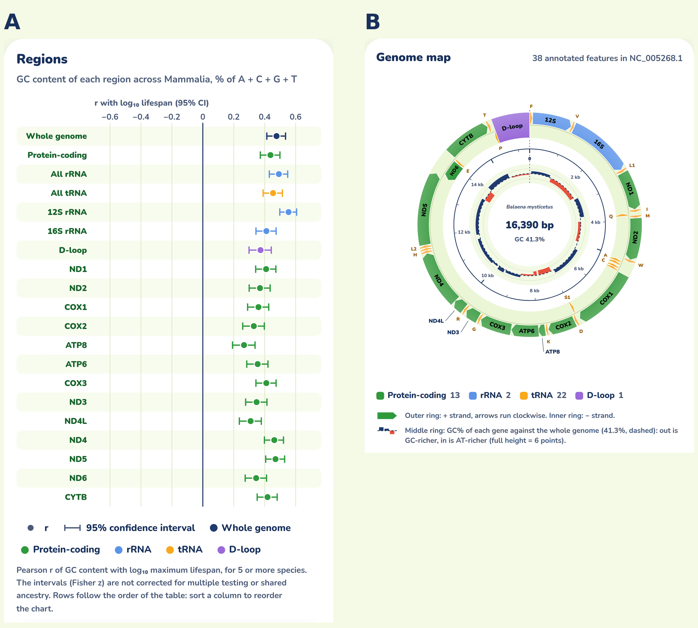

# MitoAge 2: Supplementary Methods

*Supplement to `../mitoage2.md`, draft of 2026-11-15. It describes MitoAge build 2 (2026-11-13) as built by
`dna-seq/mitoage` and the analyses run on it in `dna-seq/mitoage-pipelines`. Hidden comments in this file give the file, and where it matters the line, that each rule is taken from; they are
for the authors and are not part of the text. Lines starting `> AUTHOR:` are questions for the authors,
also not part of the text.*

<!-- src: written from dna-seq/mitoage at 2e9c5d4 (main, 2026-11-15) and dna-seq/mitoage-pipelines at f2006a9
(main). The main text cites the build at 84ba6f7 and the correlation table as rebuilt at 1dda8be; no rule
described here changed between those commits and 2e9c5d4 except the scope rule of S10.3 (IC-8), which the
main text's numbers already follow. -->

The main text keeps its Methods short. This supplement describes the same work at length, in the order
the build and the analyses were made: what we did at each step, why, what we considered instead, what
the step assumes and what it leaves unknown. Where the project's records give no reason for a choice,
the text says so; it does not supply one after the fact. Each section can be read on its own, and the
main text refers to them as Supplementary Methods S1 to S14.

## S1. Sources, and why each version is pinned

MitoAge 2 is built from eight inputs: the RefSeq mitochondrion release, the NCBI Taxonomy, four lifespan
sources (AnAge, FishBase, SeaLifeBase and the USGS bird-banding records), the Open Tree of Life synthetic
tree with node ages from TimeTree, and the first release of MitoAge itself. Every one of them changes
over time. NCBI keeps only the current RefSeq mitochondrion release on its server: release 238
appeared on 2026-11-13, the day build 2 was assembled from release 237, so release 237 can no longer be
downloaded from NCBI. The NCBI Taxonomy dump is replaced by newer ones, and NCBI's archive keeps only the
dump of the first day of each month, so the dump of 2026-11-13 that build 2 read is in no NCBI archive. AnAge and the USGS records are served at unversioned addresses. A
build that read "the current version" of each would give different results on different days, and a
reader could not tell which.

<!-- src: mitoage-pipelines docs/BUILD2_REPRODUCTION.md, "Sources" (release 238 of 2026-11-13; taxonomy
archives keep the 1st of each month; AnAge URL unversioned) -->

We therefore fixed one version of each input and recorded it with a checksum where the source gives a file
(Supplementary Table S2).

**Supplementary Table S2.** Pinned upstream versions of MitoAge build 2.

| Input | Version read by build 2 | Checksum or identifier recorded |
|----------------------|--------------------------------------------|----------------------------------|
| RefSeq mitochondrion | release 237, `mitochondrion.1.genomic.gbff.gz`, file of 2026-09-03 | md5 4491799651740f49c8f6a011cf9a96e5 |
| NCBI Taxonomy | `new_taxdump` of 2026-11-13 (Last-Modified 2026-11-13T00:42:20Z) | md5 91f95787dd7c7cfd7042ab7610f2b4b2 |
| AnAge | build 15 (2023-07-03), `dataset.zip` | md5 7ec4d19f6c8f57b22595a9ffd50ea66b |
| FishBase, SeaLifeBase | v26.06 Parquet tables on source.coop `cboettig/fishbase` (files of 2026-09-04) | md5 of each of the 8 tables read |
| USGS Bird Banding Laboratory | NABBP Longevity Records v2025.1 | md5 of the table as saved |
| EURING longevity list | list of 2023-09-01, `EURING_longevity_list_20230901.pdf`, from the Internet Archive | md5 c82b37efe23fe95b5e2945f894c46496 |
| Open Tree of Life | synthetic tree opentree16.1 | the 2,250 answers of its API and of TimeTree's, kept |
| TimeTree | TimeTree 5, public API | as above |
| MitoAge release 1 | the full CSV export of 2015-07-01 | SHA-256 of every CSV file |

<!-- src: docs/BUILD2_REPORT.md "Pinned upstream versions"; mitoage-pipelines docs/BUILD2_REPRODUCTION.md
"Sources" (taxonomy md5, the 8 FishBase/SeaLifeBase files, the 2,250 tree answers of snapshot revision a762151); pipeline/sources/pinned.ts -->

The pipeline refuses to run when a pinned file is missing, and it refuses an AnAge file whose md5 differs
from the pin, since a new `dataset.zip` would be a new AnAge build. It does not fall back to a newer file.
The EURING list is read from the Internet Archive's copy of the PDF (capture of 2026-10-11, the same
file as every capture since 2023-12-16), because euring.org has shown a maintenance page since November 2026. The inputs that no upstream
archive keeps (RefSeq release 237, the taxonomy dump of 2026-11-13, the GenBank records read by efetch,
AnAge build 15, the USGS table, the Open Tree and TimeTree answers and the pages of the old site) are
mirrored in the Hugging Face dataset `longevity-genie/mitoage-build2-sources` (revision 9d55d726…, 18
files, with the original address, retrieval date, md5 and SHA-256 of each).

<!-- src: pipeline/sources/pinned.ts:92-101 (requirePinned throws, "no silent substitute");
pipeline/sources/anage.ts:46-50 (md5 check); docs/BUILD2_REPORT.md "Pinned upstream versions" (EURING);
mitoage-pipelines docs/BUILD2_REPRODUCTION.md "The snapshot dataset" -->

Two choices about sources were made at the start and kept. Mitogenomes come from RefSeq only, as in
release 1; no GenBank record outside RefSeq is used. The project's records give no reason beyond keeping
release 1's rule. Lifespans come only from sources that are curated and regularly maintained. Static
compilations published once (the Amniote database, AmphiBIO, COMBINE and PanTHERIA) were excluded under
that rule, because they cannot be re-derived from a newer version when their values are corrected.

<!-- src: plans/DATA_BUILD2_DECISIONS.md §1 ("Static one-off compilations ... are excluded under the
'regularly maintained' rule"; "Mitogenomes: RefSeq only") -->

**Assumptions and what is not known.** Pinning makes the build repeatable; it does not make a source correct, and it fixes the errors of the pinned version along with its values.
Newer releases of the sources are looked for weekly, and a newer release becomes its own piece of work. Whether the USGS records and AnAge change at their unversioned addresses is checked
by md5 each time the reproduction downloads them (both matched on 2026-11-14), not prevented.

<!-- src: docs/ROADMAP.md RM6 (weekly check for a release newer than each pin); mitoage-pipelines
docs/BUILD2_REPRODUCTION.md "Known gaps" (AnAge and the USGS page are unversioned) -->

## S2. Which mitogenomes enter: complete records, one per species

The inclusion rule of release 1 is kept: an animal species enters if it has a complete mitochondrial
genome in RefSeq and a maximum lifespan from a curated source. For build 2 we had to make "complete"
explicit, because RefSeq's records do not carry a completeness field. The rule reads the record's
definition line. A record counts as complete when its accession begins with `NC_`, its definition does
not say "partial" or "nearly complete", does not name one of several molecules (chromosome, minicircle,
segment, part, fragment, minichromosome, molecule), and does say "complete genome", "complete
mitochondrial genome" or "complete sequence", or describes a genome assembly of the mitochondrion with
circular topology. A linear assembly, a non-`NC_` record and a definition that fits none of these are
excluded, and the class of each exclusion is kept. Only records whose lineage includes Metazoa are read.

<!-- src: pipeline/sources/refseq-release.ts:80-105 (completeness, MULTI regex); pipeline/steps/refseq.ts:19-24 -->

The species of a record is found through the taxonomy: the record's taxon identifier is brought up to
date through the taxonomy's list of merged identifiers, and then raised to its nearest ancestor of
species rank, so that a record of a subspecies counts for its species. When a species has several
complete records, the one whose LOCUS date is latest is kept; between records of the same date, one at
least 75% as long as the median complete record of its NCBI class is preferred to a shorter one; then the
higher accession.version, compared as text. The choice and the records not chosen are logged. In release
237 this rule finds 16,008 complete metazoan mitogenomes from 15,876 species.

<!-- src: pipeline/steps/refseq.ts:21-60 (classifyRelease, 0.75 * class median, compareRecords);
data/cache/build2/candidates/build2_candidates_summary.md via docs/manuscript/NOTES.md (16,008 / 15,876) -->

The order of these preferences was set as a default at the start of build 2 ("keep the most recently
updated full-length record") and was not separately confirmed; the records give no further reason. As
implemented, the date comes first, so a newer record that is short for its class would be kept over an
older full-length one. The length test only breaks ties of date.

<!-- src: plans/DATA_BUILD2_DECISIONS.md §9 (defaults set without explicit confirmation); pipeline/steps/refseq.ts:54-60 -->

> AUTHOR: the default said "most recently updated full-length record"; the code orders by date first and
> uses length only between records of the same date. How many species, if any, keep a record that is
> short for its class has not been counted. Confirm the intended order.

Six of the records chosen carry only a CONTIG line in the release file, with no sequence. Their sequence
and features were taken from the same accession.version through NCBI efetch and checked to have the
length the release states. The 2015 export holds 923 species, one more than the published release: the
extra one, *Loxioides bailleui* (NC_025626.1), is titled a complete genome but is 9,243 bp long, about 7
kb short of a complete bird mitogenome, and is excluded from every build.

<!-- src: public/data/README.md "Data notes" (6 CONTIG-only accessions; Loxioides bailleui) -->

**Assumptions and what is not known.** The rule trusts the definition line: a record titled complete
that is not complete would enter, as *L. bailleui* shows, and only that one case has been examined by
hand. Nothing in the rule checks that the 13 protein genes, 2 rRNAs and 22 tRNAs are all annotated; the
alignments and features record which genes a record lacks (S8).

## S3. Matching lifespan records to species without guessing

Each lifespan source names its species in its own way, and those names must be matched to the NCBI
species of the mitogenomes. A wrong match puts one species' lifespan on another's genome, which no later
check would detect, so the matcher was written to refuse rather than guess.

Names are compared after removing parenthesised parts and quotation marks, collapsing spaces and
lower-casing. A source record is then tried against four lists in a fixed order, and the first that gives
an answer is used: the NCBI scientific names; the NCBI synonyms (names marked synonym, equivalent name or
GenBank synonym); for FishBase and SeaLifeBase, the source's own synonym table, using names it marks as
synonym, accepted name or provisionally accepted name and never a misapplied name; and last, for a name of
three words, its first two. A name that leads to more than one NCBI species is ambiguous and is not used.
When several records of one source lead to the same species, the record matched by the strictly best
method of the four is used and the others are set aside; if two records tie on method, none is used.

<!-- src: pipeline/steps/lifespan.ts:1-10, 67-73 (METHOD_RANK), 90-157 (matchSourceNames); name normalisation
in pipeline/sources/ncbi-taxonomy.ts (nameKey), as stated in mitoage-pipelines docs/BUILD2_REPRODUCTION.md
"Lifespan sources and matching" -->

Records that could not be matched go to a review list and stay out of the build until someone resolves
them. The list is limited to records that could have mattered: an unmatched name is listed only if the
release has complete mitogenomes in its genus, and an ambiguous or set-aside record only if one of its
candidate species has a complete mitogenome. Build 2's review list has 97 items: 80 source names that
matched no species, 11 records set aside because a better-matched record of the same source named the
same species, 3 pairs of possible duplicate species, 2 RefSeq species excluded because a release-1 row
already links to them, and 1 release-1 row whose taxon identifier another release-1 row shares.

<!-- src: pipeline/steps/build2.ts:645-662 (review rules); public/data/review_list.csv (counts by review_type) -->

The species of release 1 were linked to AnAge build 15 through their release-1 AnAge entry: the AnAge
entry with the same scientific name, or else the only entry with the same common name. New species are
every NCBI species with a complete mitogenome in release 237 and a chosen lifespan (S4) that is not
already linked to a release-1 row through its record, its species or its AnAge entry.

<!-- src: mitoage-pipelines docs/BUILD2_REPRODUCTION.md "Build 1 as the starting point" and "New species"
(pipeline/steps/build2.ts) -->

Three further decisions concern identity. First, new species have the identifier 10,000,000 plus their NCBI
species taxon identifier. The plan was to give species with an AnAge entry their AnAge identifier
(HAGRID), but AnAge has renumbered its entries since 2015: 168 of the 852 HAGRIDs of new species equal a
release-1 identifier of another species. Second, classes follow the labels of release 1 for every species
(Actinopterygii, Reptilia, Cephalaspidomorphi for lampreys, Sarcopterygii for lungfishes and
coelacanths), assigned to new species from the RefSeq lineage, so that scopes stay comparable with the
2016 paper; AnAge build 15's newer fish classes were not adopted. Order and family were not harmonised:
release-1 species take AnAge build 15's, new species NCBI's (main text, Table 1 note). Third, the three
possible duplicate pairs (*Gadus ogac* and *G. macrocephalus*, *Panopea generosa* and *P. abrupta*,
*Euthynnus affinis* and *E. alletteratus*) are kept and flagged. They come from a fixed list made by the
audit of S11; the pipeline does not look for duplicates itself.

<!-- src: docs/BUILD2_OPEN_QUESTIONS.md item 1 (ids, 168 of 852), item e (class scheme, order/family), item h
(duplicates); pipeline/steps/lifespan.ts:36-53 (harmonisedClass) -->

**Assumptions and what is not known.** The matcher assumes that a name which leads to exactly one NCBI
species names that species. A source that uses a valid name for a different concept than NCBI's would be
matched wrongly, and nothing here would notice. Three release-1 records now resolve in NCBI to another
species (*Carassius auratus* to *C. langsdorfii*, *Bubalus bubalis* to *B. kerabau*, and *Carduelis
pinus*, whose only candidate is the record of *Spinus spinus*). Their rows and names are kept and flagged.
Whether to rename them is still open (S14).

<!-- src: docs/BUILD2_OPEN_QUESTIONS.md item c; docs/ROADMAP.md RM4 -->

## S4. Lifespan values: precedence, record types and the shared quality scale

**Which source is used.** AnAge, the only lifespan source of release 1, is always first: a species with
an AnAge maximum longevity takes it, whatever any other source says. Only where AnAge has no value does a
second source fill it, and which one depends on the animal's group, read from its RefSeq lineage:

| Group (from the lineage) | Sources in order |
|----------------------------------------|------------------------------------------------------------|
| Birds (lineage includes Aves) | AnAge, then EURING, then USGS Bird Banding Laboratory |
| Fishes (Actinopterygii, Chondrichthyes, Cyclostomata, Dipnomorpha or Actinistia) | AnAge, then FishBase |
| Invertebrates (lineage does not include Vertebrata) | AnAge, then SeaLifeBase, only for species SeaLifeBase marks as living in fresh, brackish or salt water |
| Other vertebrates (mammals, reptiles, amphibians) | AnAge only |

<!-- src: pipeline/steps/lifespan.ts:15-34 (PRECEDENCE, taxonGroup), 174-199 (chooseLifespan, SeaLifeBase
aquatic filter); plans/DATA_BUILD2_DECISIONS.md §2 -->

The group is read from the lineage, so a lancelet or an ascidian counts as an
invertebrate here, and four marine mammals whose only values are in SeaLifeBase get none, since
SeaLifeBase is used only for invertebrates. The records give no reason for the order of the secondary
sources beyond the table itself, which we agreed at the start of build 2. Of the birds
without an AnAge value, 9 take theirs from EURING and 26 from USGS; none of the 26 is on the EURING list.

<!-- src: docs/BUILD2_OPEN_QUESTIONS.md item h (4 marine mammals) and item 10; docs/DECISIONS.md D15 (EURING) -->

**Which value within a source.** A secondary source often holds several values for one species. They are
sorted into three tiers: reported values not marked questionable; then reported values marked
questionable; then estimates. The largest value of the first tier that has any is chosen, since the trait
is the maximum recorded lifespan. When two values tie for the maximum, a value with a stated specimen
origin (wild or captive) is preferred to one without (observed), and then the first listed. This
tie-break affects 154 species, where the values are equal and only the record named as the source
differs; it was set during implementation and the records give no reason for it.

<!-- src: pipeline/steps/lifespan.ts:166-199; docs/BUILD2_OPEN_QUESTIONS.md item 2 (154 ties) -->

**Record types and the shared quality scale.** Each value carries a record type (captive, wild,
observed or estimated) and a quality on one scale shared by all sources (high, acceptable, questionable,
low). The scale is AnAge's own data-quality grade; for the other sources we mapped what each source
records onto it. The mapping is the following, field by field:

| Source | Field read | Record type | Quality |
|--------------|------------------------------|--------------------------|--------------------------|
| AnAge build 15 | Maximum longevity (yrs) | wild if the specimen origin is "wild", captive if "captivity", otherwise observed | AnAge's data quality as given (high, acceptable, questionable or low) |
| FishBase, SeaLifeBase | `popchar.tmax` (reported maximum age of a population) | observed | questionable when `tmaxQuality` is −1, otherwise acceptable |
| FishBase, SeaLifeBase | `species.LongevityWild` | wild | acceptable |
| FishBase, SeaLifeBase | `species.LongevityCaptive` | captive | acceptable |
| FishBase, SeaLifeBase | `popgrowth.tmax` (maximum age from a growth study) | estimated | low |
| USGS Bird Banding Laboratory | Minimum age at encounter, as years plus months/12 | wild | acceptable |

<!-- src: pipeline/sources/anage.ts:92-113; pipeline/sources/observation.ts:62-65 (asQuality);
pipeline/sources/fishbase.ts:5-7, 52-108; pipeline/sources/usgs-bbl.ts:9-33 -->

AnAge's record type follows the origin of the specimen, not how
its age was determined, so an AnAge age of a wild animal is "wild" whatever the method of ageing; only
FishBase and SeaLifeBase growth-study values are "estimated". And a ringing record is the oldest
recaptured wild individual of a species. It is a real observation, so it is acceptable on this scale, but
it usually underestimates the maximum. The mapping itself is a judgement: it puts values of different
sources on one scale, and that scale has not been calibrated against anything.

Every value of every matched source is kept, not only the chosen one, in a long table of 7,541 rows
(`lifespan_observations.parquet`), with the source's record identifier, how its name was matched and
whether it was chosen. The release-1 value of each original species is kept there too. It is chosen for
one species only, *Andrias davidianus*, for which AnAge build 15 has no maximum longevity: the species is
retired (S6) and keeps its 2015 value, flagged, because the data contract has no empty lifespan.

<!-- src: docs/BUILD2_REPORT.md Amendment of 2026-11-15 (7,541 rows); docs/BUILD2_OPEN_QUESTIONS.md item b -->

Among the 2,325 live species the chosen values distribute as follows:

| Source | Acceptable | High | Low | Questionable | Captive | Wild | Observed | Estimated |
|--------------------|----------------:|---------:|---------:|-------------------:|-------------:|---------:|--------------:|---------------:|
| AnAge | 1,615 | 95 | 0 | 31 | 854 | 833 | 54 | 0 |
| FishBase | 405 | 0 | 36 | 34 | 33 | 200 | 206 | 36 |
| SeaLifeBase | 61 | 0 | 13 | 0 | 0 | 43 | 18 | 13 |
| EURING | 9 | 0 | 0 | 0 | 0 | 9 | 0 | 0 |
| USGS BBL | 26 | 0 | 0 | 0 | 0 | 26 | 0 | 0 |
| **Total** | **2,116** | **95** | **49** | **65** | **887** | **1,111** | **278** | **49** |

<!-- src: docs/BUILD2_REPORT.md "Lifespan source x quality and x record type (non-retired species)" -->

The 49 values of low quality are exactly the 49 estimates, and the correlation datasets leave both out,
together with the 65 questionable values (S10.1).

**Assumptions and what is not known.** One value per species is used, the maximum. AnAge's sample size is kept where AnAge gives it, but is not used in any test. The ringing
records of EURING and USGS are minimum ages, from the oldest ringed birds recovered.

## S5. The strand convention, and how it was found

Release 1 gave the base composition of every region of every species, and the first run of the new
pipeline (2026-11-12) tried to reproduce those counts from the records release 1 cited. They did not
match. For the human
reference (NC_012920.1) release 1 lists A = 4,094, C = 2,169, G = 5,181 and T = 5,124. The deposited
sequence has A = 5,124, C = 5,181, G = 2,169 and T = 4,094: each release-1 column holds the count of the
complementary base. The same swap holds for the whole genome of all 922 species. Across region
statistics, none of 18,030 species-region pairs matched with release 1's labels and 17,677 (98.0%)
matched once the labels were swapped (A for T, C for G); the remainder differ for the reasons S6
classifies, annotation changes since 2015 among them. Codon counts, which are read in gene sense, were labelled correctly: recounting reproduced 11,894
of 11,941 gene rows (99.6%).

<!-- src: plans/handoffs/HANDOFF_mitoage-next-site_2026-11-12.md:69-71 (build-info notes of the first
pipeline run: rCRS counts, 922/922 in total_mtDNA, 17,677/18,030 = 98.0% with swapped labels, 0 with the
original labels, codons 11,894/11,941); pipeline/steps/build1.ts:88-90 -->

The swap is uniform: it holds for every region, including the genes encoded on the other strand. So
release 1 reported, for every region, the counts of the strand complementary to the one deposited in
RefSeq. In most vertebrate records the deposited strand is the light strand, so release 1's counts are
those of the heavy strand, as the 2016 paper says was analysed. The repository's documents call this a
"base-label bug"; the main text treats it as a convention that is now made explicit. Which reading is
right depends on what the 2015 pipeline meant to count, which only its authors can say.

> AUTHOR: please confirm whether the 2015 pipeline meant to report the heavy strand (a convention, as the
> main text says) or the deposited strand (an error). NOTES.md, Q1.

We chose to report every count on the strand as deposited, and not to convert all records to the heavy
strand. The reason is that the heavy strand cannot be identified from every record. RefSeq does not fix
which strand is deposited. We call a record's orientation canonical when it is a chordate record with all
13 protein genes, every copy of ND6 on the minus strand and every other protein gene on the plus strand;
the plus strand is then the light strand. Of the 2,344 species, 2,206 have canonical records, 15 are
chordates with another layout, 104 are not chordates, for which this heavy and light notation is not
defined, and 19 have no record. A heavy-strand convention would have needed a guess for 120 of them.

<!-- src: pipeline/steps/extended.ts:90-106 (orientationOf); public/data/README.md "Data notes" (canonical 2205,
noncanonical 16, not_chordate 104, unknown 19) -->

What changes for a reader of release 1: GC content does not change; the GC and AT balance change sign, and so do
their correlations with any trait. Codon and amino-acid usage do not change, because they were and are
counted in gene sense. The new features that need the heavy strand (base composition at fourfold sites in
heavy-strand notation, S7.3) are given only for canonical records and are left empty for the others.

**Assumptions and what is not known.** The canonical test is a test of annotation: a record deposited
the other way round would show ND6 on the plus strand and would be classed noncanonical. Outside the chordates, which strand each record deposits is not known, so the GC/AT
balance of the 104 non-chordates is on deposited strands that need not correspond to one another.

## S6. Re-verification of release 1 and the changelog

**Release 1 as the starting point.** The 2015 CSV export was converted to Parquet without changing a
value: the same rows in the same order, the same column names, and a column stored as a number only when
every cell converts back to exactly the same text. The SHA-256 of each source CSV is published with it.
This frozen copy is the reference every change is measured against.

<!-- src: pipeline/steps/build1.ts:78-90; docs/BUILD2_REPORT.md Summary (34 parquet files) -->

**Which record each original species now has.** For each of the 922 species we looked up the record
release 1 cited in release 237. The same accession.version was live for 884 species. Two had a newer
version of the same accession, and the newer version was used. For 36, the accession was no longer in
the release. For these the pipeline looked for a complete record of the same NCBI species, preferring one
annotated at species rank to one of a subspecies, and never taking a record that another release-1
species cites. Eighteen species had such a successor and switched to it. Seventeen had none and were
retired. *Carduelis pinus* (now *Spinus pinus*) was also retired: its only candidate was the record of
*Spinus spinus*, which release 1 already cites for *Carduelis spinus*, and switching would have put one
genome under two species. *Andrias davidianus* was retired because AnAge build 15 gives it no maximum
longevity. That makes 19 retired species.

<!-- src: pipeline/steps/refseq.ts:81-91 (successorFor); docs/BUILD2_REPORT.md Summary and "Retired species";
docs/BUILD2_OPEN_QUESTIONS.md items a, b -->

Switching to a successor rather than retiring was a default given with the build-2 task. A retired
species is never deleted: its row stays visible and downloadable with the reason it was retired, its
release-1 values are kept (re-expressed on the deposited strand like every other row), and it is left out
of every analysis.

**Recomputing every value.** Every value of every live original species was recomputed from its current
record, not only those whose record had changed. The alternative was to keep the 2015 value wherever the
cited record was unchanged. We did not take it because it would have kept values that the current record
no longer gives: the full-span counts of genes annotated in pieces, and annotations NCBI has revised since
2015.

<!-- src: docs/BUILD2_OPEN_QUESTIONS.md item 4 -->

**Explaining each difference.** Every value that differs from release 1 becomes one row of the
changelog, with the table, row and field, the old and new values, the kind of change (added, value
update, correction, renamed or retired), its cause and the upstream version. The cause is found by trying
explanations in a fixed order and recording the first that reproduces the release-1 value. For a single
region the order is:

1. the release-1 value equals the count over the full span of a gene annotated in pieces (`rule_full_span`);
2. it equals the count on the INSDC record that the RefSeq record names as its source, so the RefSeq
   record was re-annotated without a change of version (`upstream_reannotation_same_version`);
3. it equals the count over the span of the gene feature rather than the coding feature (the same, marked
   probable);
4. it equals the count over a window within 60 bp of the current coordinates
   (`coordinates_differ_origin_unresolved`);
5. otherwise, release 1 disagrees with the record it cited (`build1_disagrees_with_cited_record`).

Aggregates (all protein-coding genes, all rRNAs, all tRNAs) and the codon usage of all protein-coding
genes inherit the cause of the genes they are made from. When a species changed record, every difference
is attributed to the change of record (`refseq_successor` or `upstream_version_change`).

<!-- src: pipeline/steps/diff.ts; order of the classes as stated in mitoage-pipelines
docs/BUILD2_REPRODUCTION.md "Changelog and provenance" -->

For the second test the INSDC source records were needed. The build-2 pipeline used the 160 INSDC records
its audit (S11) had downloaded, a set chosen by hand. The independent reproduction chose them by a written
rule (the 151 release-1 species that keep their accession.version and whose values differ) and obtained
the same changelog class for every row.

<!-- src: mitoage-pipelines docs/BUILD2_REPRODUCTION.md "INSDC records" and "Known gaps" -->

Systematic corrections are logged once, as rules, instead of once per affected row: the complementary
base labels (S5), the counting of genes annotated in pieces over their annotated pieces only (the ND3 of
birds and turtles carries an untranslated frameshift nucleotide that the 2015 counts included), the
regions release 1 lacked although the records it cited annotate them, and the exclusion of the 923rd
species. The changelog has 14,429 rows (main text).

**Renames and status.** Names follow NCBI only. The NCBI name of a species replaces its release-1 name
when the change is a genus transfer, a change of spelling or gender of the epithet, or both, and the old
name is kept. A rename in AnAge alone is recorded only as a flag. Each species then has one
status, ranked retired, renamed, updated, original: updated if any changelog row names it, original if
none does. Rows of the region, codon and feature tables take their status from their own changelog rows.
The pipeline's validation step stops the build if a species' status and the changelog disagree.

<!-- src: mitoage-pipelines docs/BUILD2_REPRODUCTION.md "Status of the 922" and "Changelog and provenance";
docs/BUILD2_CROSSCHECK.md "Every disagreement" item 1; pipeline/validate.ts -->

"Updated" covers any change of any field, a corrected common name included. The kinds of change are
stored with each species (correction, common name, lifespan, name, taxonomy, annotation, genome, NCBI
identifier), so the status can be narrowed later without recomputing.

<!-- src: docs/BUILD2_OPEN_QUESTIONS.md item g -->

**Assumptions and what is not known.** The cause recorded for a difference is the first explanation in
the list that reproduces the old value. It is consistent with the data; it is not proof of what happened
in 2015. The record NCBI re-annotated after release 237 (*Pongo pygmaeus*, NC_001646.1, re-annotated in
place on 2026-10-08) is read as release 237 has it; the next build will pick up the change.

## S7. Mitochondrial features

### S7.1 Regions, base composition and GC/AT balance

Values are computed for 20 regions: the whole genome, each of the 13 protein-coding genes, the two
rRNAs, the D-loop, and the aggregates of all protein-coding genes, all rRNA genes and all tRNA genes. An
aggregate is the union of the positions of its features, so a base shared by two overlapping genes is
counted once. A single gene is its first copy in genome order when a record annotates it twice. The
D-loop is the record's D-loop features; a feature annotated as a control region (a misc_feature; pseudo, partial and repeat features excluded) is used only when the record has no D-loop feature. Counts are on the
deposited strand (S5). GC content is 100 (G+C)/(A+C+G+T) over unambiguous bases; the GC balance is
(G−C)/(G+C) and the AT balance (A−T)/(A+T), undefined when the denominator is zero (columns `gc_skew` and
`at_skew` of the data files, and the GC and AT skew of release 1). The non-coding length is
the number of positions covered by no protein-coding, rRNA or tRNA gene, so the D-loop counts as non-coding.

<!-- src: pipeline/steps/regions.ts:30-70; pipeline/lib/stats.ts:11-30; D-loop rule as stated in
mitoage-pipelines docs/BUILD2_REPRODUCTION.md "Genome values" -->

Feature names differ between records (COI, CO1 and COX1, for example) and are made consistent from the
gene, product, standard name, note or locus tag. The two leucine and two serine tRNAs are told apart by
codon family, from the anticodon, the codons recognised, the name or the numbering; in chordates also by
gene order (tRNA-Leu(UUR) follows the 16S rRNA, tRNA-Ser(UCN) follows COX1). A gene annotated in pieces
(`join()`) is counted over its annotated pieces only.

<!-- src: pipeline/lib/names.ts; mitoage-pipelines docs/BUILD2_REPRODUCTION.md "Genome values" -->

### S7.2 Codon and amino-acid usage

Each protein-coding sequence is read in its own sense from the position its `codon_start` gives, and
only complete codons of unambiguous bases are counted. The usage of all protein-coding genes is the sum
of the gene rows. Each codon is given as a percentage of all codons counted, stop codons included; each
amino acid as a percentage of the sense codons. Amino acids are translated with the genetic code of the
record: the `transl_table` that most of its coding features state, or, when none states one, code 2 for
chordates, 9 for echinoderms and 5 otherwise. Feature values enter the correlations rounded (GC content
and codon percentages to three decimals, GC and AT balance to four).

<!-- src: pipeline/lib/genetic-code.ts:50-61 (countCodons); pipeline/steps/features.ts:52-84;
pipeline/steps/genome.ts:115-142 (transl_table vote and fallback); fallback codes as stated in
mitoage-pipelines docs/BUILD2_REPRODUCTION.md "Genome values" -->

These two families, with length and non-coding length, are the 1,257 features release 1 also had in
some form: four per region (length, GC content, GC balance and AT balance) for 20 regions, the non-coding length,
and 64 codons and 20 amino acids for each of the 13 genes and their total.

<!-- src: pipeline/steps/features.ts:24-49 (20 x 4 + 1 + 14 x 64 + 14 x 20 = 1,257) -->

### S7.3 The extended features

Build 2 adds 157 features, chosen to test relationships the literature reports and release 1 could not
test. They answer the same questions about lifespan as the others, so they were made ordinary members of
the feature catalogue rather than a separate set with its own tables. One consequence, accepted when the
decision was made, is that they share the false discovery rate with every other feature (S10.4).

<!-- src: pipeline/steps/extended.ts:323-367 (buildExtendedDefs: 56 + 56 + 14 + 6 + 20 + 3 + 2 = 157);
docs/DECISIONS.md D7 -->

**Fourfold-degenerate sites.** A codon family is fourfold degenerate when all four bases at its third
position code the same amino acid and none is a stop, in the record's own genetic code; the pipeline
derives the list of such families from the code rather than taking a fixed list. The features are the
shares of A, C, G and U at the third positions of those codons, in gene sense, for each gene and for all
13 together (56 features). A substitution at these positions does not change the protein, so their
composition is used as a measure of mutational pressure. For canonical records (S5) the same counts are
also given in heavy-strand notation (56 features): for a gene on the plus strand the heavy-strand base
is the complement of the gene-sense base, and for ND6, which is read from the heavy strand, it is the
gene-sense base itself. The heavy-strand total is taken over the 12 genes on the plus strand, without
ND6. Non-canonical records have no heavy-strand values.

<!-- src: pipeline/steps/extended.ts:29-76 (fourfoldPrefixes, fourfoldCounts, toHeavyStrand), 204-221, 286-305
(major12) -->

**Hydropathy.** The grand average of hydropathy (GRAVY) of each encoded protein and of all 13 together:
the mean Kyte–Doolittle value over the amino-acid counts of S7.2, stop codons excluded (14 features).

<!-- src: pipeline/steps/extended.ts:21-25, 78-88 -->

**Repeats.** Perfect direct repeats (two copies on the same strand), inverted repeats (the second copy is
the reverse complement of the first) and mirror repeats (the second copy is the first read backwards
without complementing) of at least 10 bases. A pair is counted once, is maximal (it cannot be extended
on either side) and its two copies do not overlap; a base other than A, C, G or T breaks a repeat. The
sequence is read as linear, so a repeat that spans the origin of the circular genome is not found.
Mirror repeats are counted separately because they are a class of non-B DNA of their own, not a subset of
the inverted repeats. The features are the number of pairs of each kind and the length of the longest
direct repeat, over the whole record and over the major arc.

<!-- src: pipeline/lib/repeats.ts:1-143; pipeline/steps/extended.ts:18-19 (REPEAT_MIN_LENGTH = 10) -->

**The major arc.** Repeats and motifs are also counted over the major arc, the part of the genome
between the two replication origins. The arc is delimited by annotation: from the base after
tRNA-Asn (the light-strand origin lies between tRNA-Asn and tRNA-Cys) forward along the circle to the
base before the first control region downstream of CYTB, the control region excluded. It is defined
only for canonical records with single copies of tRNA-Asn, COX1 and CYTB that do not span the origin and
that come in the circular order tRNA-Asn, COX1, CYTB, control region; otherwise it is left empty. It is
defined for 1,916 of the 2,344 species. Its length is a feature of its own.

<!-- src: pipeline/steps/extended.ts:115-154 (majorArc); public/data/README.md "Data notes" (1,916 of 2,344) -->

**Deletion contact zones.** Most human mitochondrial deletions are flanked by repeats with one arm in
each of two regions, given in human work as roughly 6 to 9 kb and 13 to 16 kb. Kilobase coordinates do
not transfer between species, so the zones are anchored on genes: the span from the start of ATP8 to the
end of COX3, and the span from the start of ND5 to the end of CYTB. They are defined only when all four
genes are annotated once, none spans the origin and they come in that order along the record (2,225
species). The features are the number of direct, inverted and mirror repeat pairs with one arm starting
in each zone.

<!-- src: pipeline/steps/extended.ts:156-198 (contactZones, bridgingPairs); public/data/README.md "Data notes"
(2,225); the zones follow Shamanskiy et al. 2023, BMC Biol 21:103 (doi:10.1186/s12915-023-01606-1),
which the code comment and docs/ANALYSIS_FINDINGS.md H8 cite as Persson et al. 2023 -->

**Sequence motifs.** Counted over the whole record and over the major arc, each on the sequence read as
linear:

- G-quadruplex motifs: four runs of at least three G separated by loops of 1 to 7 bases, counted on each
  strand (the same pattern of C-runs on the deposited strand) and summed;
- homopurine and homopyrimidine tracts of at least 15 bases, candidates for triplex formation;
- homopolymer runs of at least 5 bases, and the longest run;
- perfect di-, tri- and tetranucleotide tandem repeats of at least three whole units, and the bases they
  cover. A unit that is itself a repeat of a shorter unit (AAAAAA read as the dinucleotide AA) is left to
  the shorter unit length, so the three counts do not count the same bases twice.

<!-- src: pipeline/lib/motifs.ts:1-99 (HOMOPOLYMER_MIN 5, TRACT_MIN 15, STR_MIN_UNITS 3, G4 regexes,
tandemRepeats period rejection) -->

The rejection of shorter periods was added after an exploratory run that did not have it had produced a
result for G-quadruplexes that did not reproduce (S12.3). These are counts of sequence patterns, not
predictions that a structure forms. The project's records give no reason for the thresholds (10 bases
for repeats, 15 for tracts, 5 for homopolymers, three units, loops of 1 to 7).

> AUTHOR: the thresholds of the repeat and motif features have no recorded reason. If they follow a
> published convention (for example Pabis 2021, which tested motif counts as longevity features),
> cite it here.

**Control regions.** The number of annotated control regions (D-loop features, or control-region
features where there is no D-loop). A count of 1 is a lower bound: assemblies from short reads can miss a
duplicated control region.

**Assumptions and what is not known.** Every repeat, motif and control-region count is read from the
deposited sequence as assembled, and depends on how it was assembled (main text, "Repeats, motifs, protein structure and the
rate of evolution"). Of the records matched in release 237, one states a sequencing technology, so the
dependence cannot be measured on this build.

## S8. Alignments and the choice of aligner

Comparing species site by site needs alignments. A check made before any pipeline work found no live
resource offering alignments of the mitochondrial genes across these species; it found one published
site-level screen of lifespan (Mariadassou and Pellay, 2014). We aligned each gene separately. A
whole-genome alignment was not used, because gene order differs between phyla and its columns would mean
little.

<!-- src: docs/DECISIONS.md D5 -->

**What is aligned.** Each of the 13 proteins, as RefSeq translates it (the record's own translation),
first copy per record, across the 2,325 live species, sorted by the species' identifier (slug). The
codon alignment each protein alignment implies is written beside it: each residue replaced by its codon
and each gap by three gaps, without the stop codon; codon rows that do not translate exactly to their
protein are listed. The two rRNA genes are aligned as nucleotides the same way.

<!-- src: public/data/alignments/README.md; pipeline/align.ts; pipeline/lib/align.ts (threadCodons) -->

**The aligner.** MAFFT v7.526 with its FFT-NS-2 method (`--retree 2 --maxiterate 0`), four threads.
MAFFT was proposed with the design of this step and accepted with the design as a whole. An aligner
written in TypeScript was rejected as far slower and worse on 2,300 sequences. The method is named in full rather than left to MAFFT's automatic choice, and the version is
pinned: the pipeline stops if it finds another MAFFT version, so the alignments cannot change silently
with an upgrade. The records give no reason for FFT-NS-2 over MAFFT's slower iterative methods beyond its
description in the code as MAFFT's progressive method for thousands of sequences. The result is checked
to hold exactly the input sequences, in their order.

<!-- src: pipeline/steps/alignments.ts:17-58 (MAFFT_VERSION, MAFFT_ARGS, requireMafft, align); pipeline/align.ts:24
(4 threads); docs/DECISIONS.md D5 -->

A summary file gives for each alignment its numbers of sequences and columns, the columns where at most
half the rows are gaps ("occupied"), the occupied columns where every non-gap row has one residue
("invariant") and those where one residue is in at least 90% of the non-gap rows, and the SHA-256 of the
file.

<!-- src: pipeline/lib/align.ts:83-114 (summariseColumns) -->

**How much the aligner matters (H0).** Every site-level analysis reads alignment columns, so we compared the
shipped alignments with three other aligners on the same sequences: MAFFT in an iterative mode, FAMSA 2
and Muscle 5. The measure is a sum-of-pairs agreement: of the residue pairs the shipped alignment puts
in one column, the share that the other alignment also puts in one column. Agreement was at least 0.985
with every tool for COX1, COX2, COX3, CYTB and ND1, and lower for ND6 (0.87 to 0.97), ATP8 (0.92 to 0.99)
and ND5 (0.96 to 0.99). From this we set a rule for the analyses: a site-level finding in one of these
three genes is kept only if it holds on a second alignment (S12.2 applies it). Agreement between tools is
not correctness, since there is no reference alignment.

<!-- src: docs/ANALYSIS_FINDINGS.md H0; mitoage-pipelines src/mitoage_pipelines/longevity/compare.py (metric) -->

> AUTHOR: the commands and versions that produced the FAMSA, Muscle and iterative-MAFFT alignments are not
> recorded (mitoage-pipelines README: "the commands that produced them with each aligner are not
> wrapped"), and the comparison was rerun for only 2 of the 13 genes. Please supply the versions and
> options, or rerun them as commands.

**Whether aligning by structure moves the columns (H10).** The 13 proteins are membrane proteins of a
few fold families, and a sequence aligner could misplace columns that their structures would put
elsewhere. An AI agent, Claude Science, ran this check on the cluster host `haumea` on 2026-11-14 and
15. Its scripts were then made commands of `mitoage-pipelines` (commit f2006a9) and rerun on the same
cluster. The check has two parts. First, the 13 proteins from solved human structures (PDB 5XTD, 5Z62,
5XTE and 8H9S; identity to MitoAge's human sequences 0.979 to 1.000) were superimposed all against all
with US-align (version 20241108, from the conda package 20241201). Only three pairs exceed a TM-score of 0.5 normalised by the longer chain, all among the antiporter-like subunits ND2, ND4 and ND5 of complex I; the others are unrelated folds. Second, structures of the
13 proteins were predicted for 62 mammals (806 structures, ESMFold2 checkpoint `biohub/ESMFold2-Fast`,
one sample each; published as the Hugging Face dataset `longevity-genie/mitoage-structures`, revision
8e5cfdc), aligned with FoldMason (4.dd3c235), and compared with MAFFT L-INS-i (v7.526) on the same sequences by the
same sum-of-pairs agreement, over at most 500 species pairs per gene. Median agreement was 0.9997 over the
13 genes and 1.000 in the conserved core; the lowest were ND6 (0.970) and ND5 (0.982). The rerun gave the
same tables for the superposition and the comparison, timings aside; the folding itself was not rerun, and
the published structures let a reader repeat the comparison without folding.

<!-- src: docs/ANALYSIS_FINDINGS.md H10; mitoage-pipelines README "How far it reproduces";
mitoage-pipelines src/mitoage_pipelines/structure/msa.py (L-INS-i, 500 pairs, core definition);
side-session note cluster-analyses-integrated.md (rerun on haumea, job 6486038) -->

Two limits apply. The comparison is between FoldMason and MAFFT's L-INS-i on 62 mammals, not between
structure and the shipped FFT-NS-2 alignment of 2,325 species; H0 links the two only for MAFFT's
iterative mode. And mammals are close relatives, so distant phyla, where sequence aligners are more
likely to err, are not assessed. Folding every species with all 13 proteins (2,299 species) would take
about 120 GPU-hours on the card used.

**Reproducibility.** The independent reproduction (S11) rebuilt all 28 alignment files with the same
SHA-256 as the published ones. The alignments are made by one fast method across very distant animals,
and columns in poorly conserved stretches are not reliable statements of homology.

## S9. The dated tree

Phylogenetically independent contrasts need a tree with branch lengths, which release 1 did not have.
One rule was fixed before any result: the tree must not be built from the mitochondrial genes being
tested. One of our own
analyses broke this rule once, by mistake, and a column it reported as associated with lifespan
disappeared when the analysis was rerun on the dated tree (S12.2). The tree is therefore assembled from
two external sources: its topology from the Open Tree of Life synthetic tree and its node ages from
TimeTree. The records give no reason for these two sources over others.

<!-- src: docs/ANALYSIS_FINDINGS.md H2 ("Fixed before any result"); mitoage-pipelines
src/mitoage_pipelines/longevity/dated_tree.py docstring; pipeline/sources/tree.ts:1-8 -->

**Topology.** Each species' name (its MitoAge name, then its AnAge build 15 name if different) was
matched to an Open Tree taxon by the Open Tree's name service, exact matches only, within the context
Animals. The subtree of synthetic tree opentree16.1 induced by the matched taxa was then requested.
Taxa the synthetic tree does not contain were dropped and the request repeated. A species whose taxon the
synthesis maps onto an internal node is attached there as a tip. Nodes with one child were collapsed.
Polytomies were kept as they are, without resolving them: 2,314 of the 2,344 species are placed, under
2,238 internal nodes, 54 of which are polytomies.

<!-- src: pipeline/sources/tree.ts:74-92 (TNRS exact, context Animals), 166-235 (induced subtree, broken taxa,
unary collapse); public/data/README.md "Data notes" (2,314 of 2,344; 2,238 nodes); docs/manuscript/NOTES.md Q5
(54 polytomies) -->

**Ages.** For each internal node, TimeTree was asked for the age of the most recent common ancestor of up
to three NCBI taxa from each of its first 12 child clades. Its adjusted age was taken, or its precomputed
age when the adjusted age was missing or zero (TimeTree gives zero when a single study dates the node).
TimeTree dated 2,054 of the 2,238 internal nodes. Two adjustments followed. First, going from the tips to
the root, a node younger than its oldest child was raised to that child's age (61 nodes); this leaves
some branches of length exactly zero. Second, going from the root to the tips, each undated node was
placed midway between its parent's age and its oldest child's (184 nodes). Had the root been undated, it
would have been placed 10% above its oldest child plus 1 million years. Branch lengths are differences of
age, in millions of years. Of the 4,551 branches below the root, 559 have length exactly zero.

<!-- src: pipeline/sources/tree.ts:138-164 (timetreeMrca), 249-303 (reps, monotone, interpolation, root rule,
lengths); public/data/README.md "Data notes" (2,054, 184, 61); docs/manuscript/NOTES.md Q5 (556 of 4,534
zero-length branches) -->

The code describes the midway placement as interpolation in the style of BLADJ; the records give no
further reason for it. The 30 species outside the tree are left out of every phylogenetic test; no
position or branch length is invented for them.

**Assumptions and what is not known.** The tree is one fixed topology with point ages, not an estimate with its uncertainty. Its polytomies may be real or may only mean that the synthesis cannot resolve them,
and nothing here distinguishes the two. 184 of the node ages are interpolated, and how much they move any
result has not been measured. The Open Tree and TimeTree answers build 2 read are kept; asked again on
2026-11-14, both services gave answers with the same content, and the tree came out byte-identical.

<!-- src: mitoage-pipelines docs/BUILD2_REPRODUCTION.md "With other inputs", variant "Fresh" -->

## S10. Correlation statistics

### S10.1 Two datasets

Correlations are computed twice, on two sets of species. Both leave out retired species and lifespans
that are estimated or of low or questionable quality. The quality filter was agreed at the start of build
2. The **default** dataset takes a lifespan from any source: of the 2,325 live species, 49 have an
estimated lifespan (they are also the 49 of low quality) and 65 a questionable one, which leaves 2,211.
The **AnAge-only** dataset takes AnAge lifespans alone, for comparison with release 1: of 1,741 live
species with an AnAge value, 31 are questionable, which leaves 1,710.

<!-- src: pipeline/steps/correlations.ts:36-48 (inDataset); docs/BUILD2_REPORT.md "Correlation datasets" and
"Lifespan source x quality"; plans/DATA_BUILD2_DECISIONS.md §3 -->

A third dataset was considered and not built: AnAge-only without the quality filter, closest to the 2016
analysis, which used every AnAge value. It would have cost about 20 seconds more of site build. Whether to
add it is still open (S14), and only the two datasets above are used here.

<!-- src: docs/BUILD2_OPEN_QUESTIONS.md item 3; docs/ROADMAP.md RM4 -->

### S10.2 Traits and scopes

Each mtDNA feature is correlated with 11 life-history traits: maximum lifespan, adult weight, birth
weight, metabolic rate, body temperature, female and male age at maturity, gestation or incubation time,
litter or clutch size, litters or clutches per year and growth rate. Each trait is log10-transformed; a
value of zero or below is treated as missing.

<!-- src: pipeline/steps/correlations.ts:13-34 -->

The tests are made within scopes: all species of the dataset; each class with at least 20 species in the
dataset; and each order with at least 20. A species with no name at a rank joins no scope at that rank.
Until 2026-11-15 the 41 species whose order is unknown were grouped under an empty name and tested
together as if they formed an order; that scope is gone, and 32 scopes remain in the default dataset
(Supplementary Table S1). Features of a single protein gene (its codons, amino acids, fourfold-site
composition and hydropathy) are tested only in all species and in classes. The reason, recorded with the
code, is that one gene of thirteen on one linked molecule is not an independent test, and that across
the order scopes such features would multiply the tests past any useful correction. Aggregates over the
13 genes, and the whole-genome features, are tested in every scope. A correlation needs at least 10
species with both values. The records give no reason for the thresholds of 20 and 10.

<!-- src: pipeline/steps/correlations.ts:27-28 (MIN_SCOPE_SPECIES, MIN_PAIRS), 52-88 (buildScopes,
isPerGeneCodon and its comment); docs/CHANGELOG.md (IC-8 entry) -->

In the default dataset this gives 1,414 lifespan tests in all species, 1,390 to 1,403 in each of the
four largest classes and 191 to 205 in each order. A feature that is constant within a scope is not tested there.

### S10.3 The correlation across species

For each feature, trait and scope: Pearson's r and Spearman's ρ (on average ranks) between the feature
and the log10 trait, over the species with both values. The p value is that of Pearson's r, two-tailed,
from the t distribution with n − 2 degrees of freedom; it is the p value used for the false discovery
rate and for every count. Spearman's ρ is reported and is used in no count.

<!-- src: pipeline/lib/stats.ts:101-160 (tTestTwoTailed, correlationPValue, pearson, rank, spearman);
pipeline/steps/correlations.ts:130-147 -->

### S10.4 The false discovery rate

The Benjamini–Hochberg procedure is applied within each family of tests that shares a dataset, a trait
and a scope, over all features tested there, the extended features included. It is not applied across
scopes or across traits. The records give no reason for drawing the families this way. Two consequences
follow. Adding features to the catalogue changes the q values of the old ones; when the extended features
joined, the counts of the main text were recomputed for that reason. And because the scopes overlap (a
mammal counts in all species, in Mammalia and in its order), counts summed over scopes count tests, not
distinct relationships.

<!-- src: pipeline/steps/correlations.ts:172-175 (one BH call per block = dataset x scope x trait);
pipeline/lib/stats.ts:171-185; docs/DECISIONS.md D7 ("published q values move"); docs/CHANGELOG.md (the
manuscript's numbers rebuilt on the committed feature catalogue) -->

### S10.5 The partial correlation on body mass

To separate lifespan from body size, for maximum lifespan only we also compute the first-order partial correlation of the feature and log10 lifespan given log10 adult weight:
(r_xy − r_xz r_yz) / √((1 − r_xz²)(1 − r_yz²)), over the species of the scope that have an adult weight,
when there are at least 10. Its p value uses the t distribution with n − 3 degrees of freedom. Adult
weight comes from AnAge only, so the partial correlation covers 1,386 of the 2,211 species in all species,
235 of the 827 ray-finned fishes and no non-chordate.

<!-- src: pipeline/lib/stats.ts:162-169; pipeline/steps/correlations.ts:123-153; docs/manuscript/NOTES.md
"Partial-correlation sample" -->

### S10.6 The test on phylogenetically independent contrasts

**What is computed.** For each feature, trait and scope, Felsenstein's independent contrasts of both
variables are computed on the dated tree (S9), pruned to the species of the scope that have both values.
The tree is visited from the tips to the root. At each node, the children that have values are taken in
the order the tree lists them. The first two give a contrast: the difference of their values divided by
√(v₁ + v₂), where v is each child's branch length plus any length carried up from below. They are
replaced by their weighted mean, (x₁v₂ + x₂v₁)/(v₁ + v₂), with the carried length v₁v₂/(v₁ + v₂). This
merged value then makes the next contrast with the third child, and so on. A polytomy is thereby resolved
as a ladder with internal branches of length zero, in the order of its children. When v₁ + v₂ is zero,
the two values are averaged and no contrast is made. A node with only one child that has values makes no
contrast and passes that child's value up, its own branch length added. The test statistic is the
correlation of the standardised contrasts through the origin, r = Σcₓc_y / √(Σcₓ² Σc_y²), over the m
contrasts; its p value is two-tailed, from the t distribution with m − 1 degrees of freedom. At least
three contrasts are needed.

<!-- src: pipeline/lib/stats.ts:197-253 (picCorrelation), 281-349 (picFast, used by the build);
src/data/index.ts:442-444 (compiled dated tree passed to computeCorrelations) -->

**Checked against an established implementation.** The same contrasts were computed with `ape::pic`
(ape 5.8.1, R 4.4.3) for six lifespan tests in each of Chondrichthyes, Mammalia and Rajiformes, after
pruning the tree to each test's species and resolving its polytomies with `multi2di`. In Rajiformes, which
has no polytomy, every contrast is identical. In the other two, r and p agree to seven significant digits.
The few node-level differences all lie inside a resolved polytomy: the two programs pair a polytomy's
children in different orders, which changes the intermediate contrasts but not their sums of squares and
cross-products, so r does not change. A regression through the origin in R gives the same p as the t test
with m − 1 degrees of freedom. One case is outside the comparison: two sister tips both on branches of
length zero, which this implementation averages and ape cannot handle; none of the 18 tests compared had
it. The calibration run below also recomputed the contrasts of all 15,906 lifespan tests of the default dataset and
found them identical to the table.

<!-- src: docs/PIC_CALIBRATION.md "Answer" and "How it was checked" 1-2; docs/analyses/pic-calibration/ape/ -->

**Calibration.** Each lifespan test was put through two null distributions on the cluster
(`pipeline/pic-calibration.ts`, 1,000 replicates each, fixed seeds). With log10 lifespan replaced by
Brownian motion simulated on the dated tree, the test rejects 4.77–5.24% of tests at p < 0.05 in every one
of the 32 scopes: under its own model the test is exact, as a correct implementation must be. With log10
lifespan shuffled across the species of a scope, which removes any relation to the tree and to the
feature, it rejects 22–33% in the fish scopes and 29.0% in all species, against 9.1% in Mammalia. So the
test is calibrated under Brownian motion. Because a shuffled trait has no relation to the tree, the shuffle does not estimate the test's false-positive rate for the observed traits; it shows how far the test departs from its nominal level when a trait does not evolve along the tree.

<!-- src: docs/PIC_CALIBRATION.md "Answer", "Per scope" (BM null %, Shuffle null %); job 6489844 on haumea
from commit fb54cec (the build with the EURING birds), with all species, Aves and Psittaciformes calibrated again on
the build with the parrot's ND6 (job 6490100 from f360eea, revision 0f4e970: the same 4.77–5.24% and 29.0%); the
first run, job 6486136 from 0d67d1e, gave 4.75–5.30%,
29.1% and 9.1% -->

**Why the fish scopes over-reject.** In the cartilaginous fishes (Chondrichthyes and its order Rajiformes) and in Clupeiformes, one pair of sister species carries
most of the variance of the lifespan contrasts. In Chondrichthyes and Rajiformes it is *Dipturus
trachyderma* (26 years) against *Zearaja nasuta* (9 years), placed about 0.4 million years apart on the
dated tree: that one contrast holds 55% of the sum of squared lifespan contrasts in Chondrichthyes and 66%
in Rajiformes. In Clupeiformes it is *Alosa sapidissima* (13 years) against *A. alabamae* (4 years), with
93%. Any feature that also differs between the two sisters gets a large contrast at that node, the
correlation through the origin is decided there, and the t test still counts every contrast as
independent evidence. The median share of the largest single contrast in the cross-product is 0.43 in
Chondrichthyes, 0.62 in Rajiformes and 0.54 in Clupeiformes, against 0.03 in Mammalia. The branch lengths
do not standardise the contrasts either: the diagnostic of Garland, Harvey and Ives (1992), the
correlation between a lifespan contrast's absolute value and its standard deviation, is negative in 30 of
the 32 scopes (−0.12 in Mammalia, −0.39 in Chondrichthyes, −0.51 in Rajiformes, −0.60 in
Acipenseriformes), so short branches give contrasts larger than Brownian motion on these lengths allows.

<!-- src: docs/PIC_CALIBRATION.md "Answer" (dominating pairs, top shares, Garland r) and "Per scope" -->

**A second p value: the sign-flip test.** The test behind Table 3 and every count of the funnel is the t test above, with the sign-flip counts reported beside it:
we chose to keep it and the published counts (3,025, 900 and 550) rather than replace it. Both tests
are published. For every lifespan row of both datasets, the correlation table
also carries `pic_signflip_p`: the share of random sign flips of the contrast products whose sum is at
least as far from zero as the observed one. Up to 9,999 flips are drawn, seeded by dataset, scope, trait
and feature, and the count stops once 100 flips are at least as extreme (Besag and Clifford, 1991), so
the smallest possible value is 1/10,000. The test keeps the size of every contrast, so it assumes only that the contrasts are independent and symmetric about zero; the t test also assumes
them normal with equal variance. That is a weaker assumption, but still one, and the sign-flip test was not itself put through
the simulations above. In the default dataset it gives 1,267 of the 15,906 lifespan tests below 0.05,
against 3,025 for the t test, and 535 "Both" against 900. Where the data fit the model the two tests
agree, and where one node dominates they do not: in the cluster run, Mammalia gives 198 against 224 (Both
154 against 164), Chondrichthyes 59 against 585 and Rajiformes 4 against 74. Among the correlations in all
species that pass the false discovery rate, 203 are significant on contrasts with the opposite sign under
the t test and 48 under the sign-flip test. In the AnAge-only dataset the sign-flip test gives 1,016 of
13,380 tests below 0.05, and 501 "Both" against 658. Other traits have no sign-flip value.

<!-- src: docs/DECISIONS.md D10; pipeline/steps/correlations.ts:32-33, 176 (SIGN_FLIP_REPS = 9999, seed);
pipeline/lib/stats.ts:399-427 (signFlipPValue); docs/PIC_CALIBRATION.md "What could be done" 1 (1,253, 533;
anage_only 1,017 of 13,380, 502 against 659) and "Which manuscript numbers would change" (205 against 50) -->

**Ancestry and body mass together.** The contrast test controls for ancestry and not for mass; the
partial correlation of S10.5 controls for mass and not for ancestry; "All three" asks both to agree, each
on its own. Lifespan and body mass are correlated across animals, so "does this feature track lifespan"
and "does it track lifespan beyond body size" are different questions, and we chose to report
both answers side by side. Every lifespan row of the correlation table therefore also carries
`pic_mass_r` and `pic_mass_p_value`. The three traits (feature, log10 lifespan and log10 adult weight) are
carried through the contrast recursion above on the species of the scope that have all three, and the
lifespan contrast correlation is computed with the mass contrasts partialled out, through the origin:
(r_xy − r_xz r_yz) / √((1 − r_xz²)(1 − r_yz²)), each r a correlation through the origin of two contrast
vectors. Its p value is two-tailed, from the t distribution with m − 2 degrees of freedom. As for the
partial correlation across species, a scope needs at least 10 species with a weight. Among the 4,296
correlations of the default dataset that pass the false discovery rate, 393 are significant on it with the
same sign (Table 3, PIC + mass), against 900 for the contrast test without mass; 283 of the 393 also pass
the partial correlation across species. In the AnAge-only dataset the same count is 374 of 4,069. The
values reproduce the cluster run's to the precision it printed (largest difference in r 5 × 10⁻⁹, all
11,948 rows that both compute), and the counts are the same. The test uses the t distribution and has
the same problem in the fish scopes as the contrast test without mass, so its sign-flip p value is not
computed.

<!-- src: pipeline/lib/stats.ts (picContrasts with z, partialContrastCorrelation); pipeline/steps/correlations.ts
(picMassR, MIN_PAIRS); pipeline/tests/stats.test.ts "contrasts with body mass partialled out"; counts and the
comparison with docs/analyses/pic-calibration/scopes/*.tsv (mass_r, mass_p) from dist/data/correlations.parquet
of the site build of fb54cec on 2026-11-15; the cluster run also computed 2,132 rows of scopes with 6 to 8 species
with a mass, none of which passes FDR, mass p and sign together, and neither computes the other 1,826 (the first run's
"3,958" counted both kinds); docs/PIC_CALIBRATION.md "Body mass: corrected, uncorrected, or both";
the maintainer's call "Both, side by side", 2026-11-15 -->

**What is still not done.** The degrees of freedom are not reduced for polytomies, as Purvis and Garland
(1993) proposed; here that would change about 1% of them. The number of contrasts behind each test is not
stored in the correlation table. Contrasts that are outliers are not flagged, and the two sister pairs
that dominate the fish scopes have not been checked for a lifespan error or a misdated split. A second
control for shared ancestry, a phylogenetic regression with Pagel's λ over the same tests, has not been
run. Until it is, the contrast column of Chondrichthyes, Rajiformes, Clupeiformes, Acipenseriformes,
Actinopterygii and all species should be read with its sign-flip p value beside it. Supplementary Table
S1 gives the share of tests each scope rejects on contrasts.

<!-- src: docs/PIC_CALIBRATION.md "What could be done" 2-4; docs/manuscript/NOTES.md Q5;
docs/manuscript/v0.2/supplementary/supplementary_table_S1_scopes.csv (pic_rejection_rate_pct) -->

### S10.7 How the three controls combine, and what each count counts

The three controls of the funnel are applied separately. The contrasts are not adjusted for body mass,
and the partial correlation is not adjusted for shared ancestry; the records give no reason for not
combining them. A fourth test combines them and is reported beside the funnel (S10.6, PIC + mass). A
test "passes all three" when its q value is below 0.05; its contrast p value is below 0.05 and its
contrast r has the same sign as its r across species; and its partial-correlation p value is below 0.05,
whatever the sign of the partial correlation. Neither the contrast nor the partial p value is corrected
for multiple testing, so these two steps rest on a nominal 5% level.

<!-- src: docs/manuscript/NOTES.md "Definitions used for Table 3"; docs/DECISIONS.md D8 (the MCP verdict
uses the same definitions) -->

The main text quotes several counts that look alike and differ in what they require and over which
scopes they are taken. All are for maximum lifespan in the default dataset:

| Count | Scopes | What it counts |
|-----------:|----------------------|------------------------------------------------------------------|
| 15,906 | all 32, summed | lifespan tests |
| 5,441 | all 32, summed | tests with p < 0.05 across species |
| 4,296 | all 32, summed | tests with q < 0.05 |
| 3,025 | all 32, summed | tests with contrast p < 0.05, of either sign, whether or not they pass the false discovery rate |
| 900 | all 32, summed | q < 0.05, and contrast p < 0.05 with the same sign ("Both" in Table 3) |
| 550 | all 32, summed | the 900, and partial p < 0.05 of either sign ("All three") |
| 485 | all 32, summed | of the 550, those whose partial correlation keeps the sign of r |
| 1,166 | all species only | q < 0.05 |
| 495 | all species only | q < 0.05, and contrast p < 0.05 of either sign (the plot explorer, Figure 5B) |
| 292 | all species only | q < 0.05, and contrast p < 0.05 with the same sign ("Both" in Table 3) |
| 238 | all species only | "All three" |
| 1,267 | all 32, summed | sign-flip p < 0.05 (`pic_signflip_p`; published beside the t test, reported beside the t-test counts, which the funnel and Table 3 use) |
| 535 | all 32, summed | q < 0.05, and sign-flip p < 0.05 with the same sign |
| 393 | all 32, summed | q < 0.05, and p < 0.05 with the same sign on contrasts with body mass partialled out ("PIC + mass" in Table 3) |

<!-- src: docs/manuscript/v0.2/mitoage2.md Table 3 and Figure 5 legend; docs/manuscript/NOTES.md "Where the numbers
come from" and "Figures" (496 vs 291) -->

So 900 and 292 apply the same rule, to 32 overlapping scopes and to one; 495 and 292 apply different
rules to the same scope, the explorer not requiring the same sign; and 550 adds the body-mass control to
the 900. The pipeline does not write these counts; they were made from the correlation table in an analysis session.
The script that draws Figure 1 recomputes Table 3 from the same table and refuses to draw if any count
differs.

### S10.8 Phylogenetic regression with Pagel's λ

**Model.** For each lifespan test of the correlation table, the feature is the response and log10 maximum lifespan
the predictor, on the test's species that have a place in the dated tree. A second model adds log10 adult body mass,
on the species with a recorded weight (at least 10, as for the partial correlation). The residuals have the Brownian
covariance of the tree pruned to those species and rooted at their most recent common ancestor, with its off-diagonal
multiplied by Pagel's λ (Pagel 1999).

**How it is fitted.** That covariance is itself the Brownian covariance of a transformed tree:

- its internal branches are multiplied by λ;
- a tip branch of length b becomes λb + (1 − λ)d, with d the tip's depth below the ancestor.

So the generalised least squares fit is least squares through the origin on the independent contrasts (Felsenstein
1985) of the transformed tree. The log determinant of the covariance is the sum of the logs of the contrasts'
variances and of the root's. Each likelihood therefore takes time linear in the number of species.

λ is estimated by maximum likelihood in [0, 1], with the residual variance profiled out: 21 values first, then a
golden-section search between the best value's neighbours. The slope of lifespan is tested with the residual variance
RSS/(n − p), on n − p degrees of freedom. The feature is the response because λ describes the residual of a response,
as in S12.1 and S12.6. The model is therefore not symmetric in the two traits, unlike the correlations beside it.

**Checks.** The implementation (`pipeline/lib/pgls.ts`) is tested on the build's own data:

- against a generalised least squares fit computed from the full covariance matrix, at five values of λ;
- against the contrast tests of S10.6 at λ = 1;
- for the maximum of the likelihood, on a grid twenty times finer than the search.

With λ fixed at 1 the model is Brownian motion on the tree, and the lifespan slope's p value equals the contrast test's
(that of S10.6 without mass, that of the test with mass partialled out with it). The run compared the two on all 15,906
tests and found no difference above 10⁻⁶ relative.

**Run.** On the cluster: Slurm array job 6490080, one task per scope, from commit f360eea of the site repository, on
the build of Hugging Face revision 0f4e970. Its per-test tables and per-scope summary are in `docs/analyses/pgls/` there.

- **Not fitted:**
  - Without mass: one test in Bivalvia (GCC in ATP8). Its feature is 0 in all 14 bivalves with a place in the tree;
    its one nonzero value is in *Cryolaternula elliptica*, which the tree lacks.
  - With mass: 30 tests whose least-squares system was singular (their causes were not examined one by one); every
    test of the eight scopes with fewer than 10 species with a weight, as for the partial correlation; and 18 tests in
    Pleuronectiformes.
- **λ:** its median over a scope's tests is 0.96 in mammals and 0.98 in all species and in ray-finned fishes. λ is 1
  in 210 of the 1,398 mammal tests.
- **Rejection rates:** where no correlation passes the false discovery rate, the regression rejects 5.5% of the lifespan
  tests in cartilaginous fishes, 4.8% in amphibians and 5.0% in bivalves, but 12.6% in skates and 22.0% in herrings
  (Rajiformes and Clupeiformes). No null was simulated for the regression, so these are observed rates, not a
  calibration.

**Supplementary Table S1.** Correlations of mtDNA features with log10 maximum lifespan in all 32 scopes of the default dataset (file `supplementary_table_S1_scopes.csv`), with the definitions of Table 3. Columns: the scope; its species, and those with a recorded adult body mass; the number of tests; tests with p < 0.05; with q < 0.05 (FDR); with contrast p < 0.05 of either sign (PIC); FDR and PIC with the same sign (Both); FDR and a sign-flip p < 0.05 on contrasts with the same sign (Both, sign-flip; S10.6); Both and partial p < 0.05 on body mass (All three); the percentage of the scope's tests with contrast p < 0.05; FDR with p < 0.05 and the same sign on contrasts with body mass partialled out (PIC + mass); and FDR with p < 0.05 and the same sign for the lifespan slope of the phylogenetic regression of S10.8 (PGLS). A scope with fewer than 10 species of recorded body mass has no partial correlation. The last row sums the 32 overlapping scopes.

<!-- src: docs/manuscript/NOTES.md row for Table 3 ("the counts were made in an analysis session, not by the
pipeline"); docs/manuscript/v0.2/figures/figure-1-controls.ts -->

## S11. Reproducibility: what was checked, and what was not

The build was checked in three ways, and each covers a different part of it.

**The pipeline and its tests.** Build 2 is made by one command of the site repository, `bun run data`, a
TypeScript pipeline that reads the pinned inputs, stops if one is missing, and ends with a validation
step. The validation checks, among other things, that each species' status agrees with the changelog,
that AnAge comes first wherever it has a value, and that no committed output exceeds GitHub's file-size
limit. `bun run align` makes the alignments; the site build computes the correlations and the explorer's
data. At build 2 the pipeline had 192 tests; the repository had 303 on 2026-11-15. When a test of a build
rule was written, it was checked by breaking the code it guards and confirming that the test then fails.
Seventeen such checks are listed in `docs/BUILD2_REPORT.md`, among them removing the AnAge-first rule,
resolving ambiguous name matches instead of refusing them, and dropping the full-span rule of the
changelog.

<!-- src: docs/BUILD2_REPORT.md "Commands" (192 tests, the table of 17 breaks); pipeline/validate.ts;
docs/DECISIONS.md D4 (100 MB / 50 MB); bun test on 2e9c5d4 in this worktree, 2026-11-15: 303 tests, 293 pass,
10 skipped, 0 fail -->

**The cross-check against a separate audit.** The sources were first downloaded and audited by
separate scripts in Python. The pipeline reads the audit's downloads but none of its tables; the audit
tables are compared with the pipeline's output by `bun run pipeline/crosscheck.ts`, and are used only
for that comparison. On the 1,422 new
species the two agree on the species set and on every field compared: lifespan value, source, quality,
RefSeq record, name, order, family, common name and AnAge sample size. The exceptions are class, where
the audit labelled the 4 new lampreys Hyperoartia rather than release 1's Cephalaspidomorphi, and the
source record and record type of 154 species, which are the tied values of S4. On the original
species, the two record 3,325 changed values for the same table, row and field, and agree on the old and
new value of 99.0% of them. Every other difference is traced to a named design choice. The largest are
that the pipeline moved 18 species to a successor record where the audit retired them, which accounts
for almost all of the 5,408 rows only the pipeline has, and that class labels were not taken from AnAge
build 15. The audit scripts are not published.

<!-- src: docs/BUILD2_CROSSCHECK.md §1-§5; docs/BUILD2_REPORT.md "Cross-check with the audit" and "Not done"
("The Python audit scripts and tables stay outside the repository") -->

> AUTHOR: the audit's scripts are not in any repository. Either publish them, or describe the
> cross-check in the paper as a comparison with an unpublished audit.

**The independent reproduction.** A second repository, `dna-seq/mitoage-pipelines`, rebuilds build 2 in
Python for readers who want to rebuild without our machines. It was written from the rules as stated, not
translated line by line from the TypeScript. It reads the published build in one place only, the final
comparison, so that no value is filled from the source that checks it. Every input has a downloader, and
the inputs no archive keeps come from the snapshot dataset of S1. From the pinned inputs, all 5,328,887
values of the seven tables (species, region statistics, codon usage, genome features, lifespan
observations, changelog and review list), all 28 alignment files and the dated tree come out identical:
the values compared exactly, the alignments by SHA-256, the tree byte for byte, against the build cited in the
main text (Hugging Face revision 0f4e970). The hand-checked gene annotations of that build (the African grey
parrot's ND6, and the flags naming why other species lack a gene) are curated inputs, copied as data; the code
that applies them is the reproduction's own. The whole sequence takes about six minutes.

<!-- src: mitoage-pipelines docs/BUILD2_REPRODUCTION.md (opening, "How far it reproduces", run times total 349 s; at commit aee05c7) -->

The reproduction was also run with other inputs, on the build before the EURING birds, to show what moves when a source does. With the
taxonomy archive of 2026-11-01 instead of the dump of 2026-11-13, four species change, because NCBI
renamed or split taxa in between; this is why the snapshot keeps the later dump. With build 2's record
versions fetched by efetch instead of read from release 237, the only change of values is *Pongo
pygmaeus*, which NCBI re-annotated in place after the release. With every source as it was on
2026-11-14 (RefSeq release 238, the next day's taxonomy, live Open Tree and TimeTree), the species set is
the same, and every difference other than *Pongo pygmaeus* is the name of an input version.

<!-- src: mitoage-pipelines docs/BUILD2_REPRODUCTION.md "With other inputs" -->

The comparison was made against revision 653afe2a… of the Hugging Face dataset. The paper cites revision
c525adbf…, uploaded later with the SQLite file of S13. The seven tables and the 28 alignment files carry
the same SHA-256 in both revisions (and in revision 6efa0959… used by the worked analyses); the two
extended-feature tables exist only in c525adbf….

<!-- src: checked on 2026-11-15 with huggingface_hub (dataset_info, files_metadata) on the three revisions:
species, region_stats, codon_usage, genome_features, lifespan_observations, changelog parquet and review_list.csv
have identical LFS SHA-256 / blob ids; 28 of 28 alignment files identical between 653afe2a and c525adbf;
mtdna_structure.parquet and protein_gene_features.parquet only in c525adbf (SHA-256 ac6a0cde..., 71170821...,
equal to public/data/ at 2e9c5d4) -->

**What none of the three covers.** The two tables of extended features (S7.3) were added to the build
after the reproduction and are not part of its comparison. The correlations are not reproduced
independently at all. They are computed during the site build, the reproduction stops before them, and
the audit does not compare them. So the correlation table, Table 3, Supplementary Table S1, Figures 1 and
2, and every r, q, contrast and partial value of S10 quoted in the main text rest on the TypeScript code
of S10 and its tests alone, with one exception: the contrast code has since been checked against
`ape::pic` and calibrated by simulation (S10.6). The Abstract's statement that a second implementation reproduces the build's tables should be read
with this limit.

<!-- src: mitoage-pipelines docs/BUILD2_REPRODUCTION.md "Known gaps" (last item); docs/manuscript/v0.2/mitoage2.md
"Reproducibility" -->

**The analyses.** The worked analyses of S12 are commands of `mitoage-pipelines`, and its README records
which of its commands reproduce on a rerun. Byte-identical: the amino-acid composition and fourfold
tables, the earlier tree-free and mixed-model tests, the column screen on the dated tree, the peptide
pilot and several preparation steps. Equal to the second decimal: the rate-covariation test of the
mitochondrial and nuclear subunits, because MAFFT run on several threads and IQ-TREE run without a seed
are not repeatable. Not reproducing: HyPhy RELAX, whose optimiser landed on different optima on
identical inputs, which is one reason no RELAX result is claimed. The README records reruns on 2026-11-15 that gave the same bytes for the motif regression, the rate test and the two newest analyses, the life-history models and the structural models (H11 and H12). The amino-acid regression on the tree was rerun the same day and gives the numbers the main text prints, but its tables were not compared byte for byte.

<!-- src: mitoage-pipelines README.md "How far it reproduces": identical bytes for controls, fourfold, composition,
sites, pgls, peptides pilot, relax-prep, coevol-prep, mitoport select; aa-pgls, motif-pgls and rates are not
listed -->

> AUTHOR: `mitoage longevity aa-pgls`, `motif-pgls` and `rates` produce every number of the main text's
> two worked-analysis subsections, and none is recorded as rerun. A rerun compared with the first run's
> tables would close this.

<!-- src: mitoage-pipelines README.md "How far it reproduces" -->

## S12. The worked analyses

Four of the analyses the main text reports use the database the way a reader could: the amino-acid content
of the 13 proteins, a screen of single alignment columns, the repeat and motif features, and the rate of
protein evolution. All four are in `mitoage-pipelines`, each run by one command, and all share one
design. They use the species of the default dataset (S10.1) that have a body mass and a tip in the dated
tree. They use the dated tree of S9 and never a tree built from the genes. Most models that test
lifespan include body mass and base composition at fourfold-degenerate sites, the latter as a measure
of mutational pressure; each section below names the covariates of its own models. The amino-acid regression and the column screen were first run from `mitoage-pipelines` at commit da0c112 on dataset revision 6efa0959, and the repeat, motif and rate analyses at commit 22cb140. Two further analyses reported in the main text, of the slow life history (S12.6) and of the proteins' structural features (S12.7), were run later from commit 858974b; in the first, composition is the response rather than a covariate. All six were rerun together on 2026-11-15 from commit 2ee27a1 (`slurm/manuscript-rerun.sbatch`, Slurm job 6489877) on the build with the nine EURING birds, and again (job 6490079) on that build with the parrot's ND6 (Hugging Face revision 0f4e970); the numbers reported here are from the second run (`results/nd6-patch/` of the analysis repository, which lists every change against the first, and `results/euring/`, which lists the first run's against the build before).

<!-- src: docs/ANALYSIS_FINDINGS.md H1 (hypothesis, test), H2 ("Fixed before any result"); mitoage-pipelines
docs/PIPELINE.md ("Every model that tests lifespan carries body mass and base composition at fourfold-degenerate
sites") -->

The composition covariates are the shares of A, C and T at fourfold-degenerate third positions over the
12 genes other than ND6, read in gene sense from the codon alignments. Fourfold families here are the
eight that are fourfold degenerate in every animal mitochondrial code (first two bases CU, GU, UC, CC, AC,
GC, CG and GG). This differs from the site's fourfold features (S7.3), which derive the families from each
record's own code. Body mass is log10 AnAge adult weight.

<!-- src: mitoage-pipelines src/mitoage_pipelines/longevity/fourfold.py (FOUR, MT_HEAVY_STRAND);
src/mitoage_pipelines/genes.py -->

### S12.1 Amino-acid content (H1)

**Background.** Long-lived animals have been reported to carry fewer cysteines (Moosmann and Behl, 2008)
and less methionine (Aledo et al., 2011) in their mitochondrially encoded proteins, and higher primates
more threonine in their transmembrane regions (Kitazoe et al., 2008). A study of 173 mammals found no effect of longevity on cysteine content, and found threonine usage fully accounted for by nucleotide composition (Aledo, Valverde
and de Magalhães, 2012). We tested all 20 amino acids and read cysteine, threonine and methionine against
this record, as tests rather than as positive controls.

**Model.** The response is the percentage of each amino acid over the 13 proteins. It is regressed on
log10 maximum lifespan and log10 body mass ("mass"), and then also on the three composition shares
("mass+composition"). The regression is a phylogenetic generalised least squares. The covariance between
two species is the length of the path they share from the root of their class's subtree on the dated
tree (Brownian motion), with its off-diagonal elements multiplied by Pagel's λ. λ is estimated by maximum
likelihood within [0, 1], separately for each amino acid and model. The slope of log10 lifespan is in
percentage points per tenfold lifespan, tested by its t statistic with n − p degrees of freedom. The q
values are Benjamini–Hochberg over the 20 amino acids, within class and model. The code is our own
(NumPy and SciPy), not a phylogenetics package.

<!-- src: mitoage-pipelines src/mitoage_pipelines/longevity/aa_pgls.py (models, fit, class_covariance, q);
src/mitoage_pipelines/longevity/pgls.py (shared_path_covariance, V, nll, gls) -->

**Species.** In mammals: 625 with all 13 proteins and a lifespan, 615 in the default dataset, 612 with a
body mass and 604 in the tree. Birds, ray-finned fishes and reptiles were tested the same way (382, 235
and 97 species).

**Why a tree, and not the earlier mixed model.** The first version of this test used random intercepts
of order and family in place of a tree. Refitted on the same 604 mammals, it gives seven amino acids at
q < 0.05, cysteine and threonine among them; on the dated tree, with λ between 0.96 and 1 for every amino
acid, none passes. Random intercepts of order and family leave most of the shared ancestry in the
residual, and the tree takes it out. Both versions are kept in the output table (methods `pgls` and
`mixed`), so that the effect of the tree can be told apart from the effect of the species set. An
earlier run that reported threonine and cysteine as positive controls had included 10 mammals with
questionable lifespans; it is kept in the analysis record as a lesson.

<!-- src: docs/ANALYSIS_FINDINGS.md H1 (results, "What changed the result", "Earlier version") -->

**Limits.** Composition is three shares over 12 genes, a coarse measure of mutational pressure. The
tree's polytomies are used as they are. Each species has one lifespan. The test is over whole proteins
across mammals, so it does not test Kitazoe et al.'s claim about transmembrane regions in higher primates.

### S12.2 The screen of single alignment columns (H2)

**Hypothesis.** Some positions of the 13 proteins carry a residue more often in long-lived species,
independently in several lineages.

**Model.** For each column of each protein alignment with at least 80% of the species ungapped, and each
residue in it present in at least 15 species and absent in at least 15, with both states occurring in at
least 5 families: a phylogenetic regression of log10 lifespan on log10 body mass, the three composition
shares and an indicator of the residue. Pagel's λ is estimated once, on the model without the residue,
and held fixed for every column. The q values are Benjamini–Hochberg over all tests in the class (5,262
in mammals).

<!-- src: mitoage-pipelines src/mitoage_pipelines/longevity/pgls.py:main (ok.mean() < 0.8; x.sum() < 15;
poly < 5; lambda on null model; BH over all rows); docs/ANALYSIS_FINDINGS.md H2 (power: 0.05/5,259) -->

**How it got here.** The first version compared species within families without a tree, and its p values
were inflated over their whole range, since genera within a family are not independent. The second
version used a phylogenetic regression, but on a tree built from the 13 proteins themselves and on every
lifespan record, against the rule of S9. It reported cytochrome b position 43 as "the one site" (q =
0.03). Rerun as the rule required, that site has q = 0.29. As fixed, two columns pass in mammals and none
in birds. The rule of S8 for genes where aligners disagree applied to one of them, ND5 position 200: on
the FAMSA, Muscle 5 and iterative MAFFT alignments, both columns hold the same residues in the same
species and pass again. A power calculation from the tests' own standard errors shows the screen detects
only large effects, about 1.3- to 1.5-fold lifespan. Without a replication, the main text reports neither column as associated with lifespan.

<!-- src: docs/ANALYSIS_FINDINGS.md H2 -->

### S12.3 Repeats, motifs and deletion contact zones (H8)

**Background.** Non-B DNA motif counts were tested as longevity features by Pabis (2021), inverted
repeats were reported to correlate with lifespan in mammals (Yang, Seluanov and Gorbunova, 2013), and the
repeats that flank deletions sit in two defined zones (Shamanskiy et al., 2023).

**Model.** The features are read from the published table `mtdna_structure.parquet` (S7.3), never
recomputed, so what is tested is what the database publishes. The model is that of S12.2 with the
feature in place of the residue: a phylogenetic regression of log10 lifespan on the standardised
feature, body mass and composition, on the dated tree. λ is estimated once per class on the model
without the feature and held fixed. A slope is the change in log10 lifespan per standard deviation of the feature. Features need
at least 25 species. q is Benjamini–Hochberg within class. Spearman's ρ is reported on the same species.
Four classes give 132 tests.

<!-- src: mitoage-pipelines src/mitoage_pipelines/longevity/motif_pgls.py (MIN_SPECIES 25, lambda once per class,
z-standardisation, q within class and subset); docs/ANALYSIS_FINDINGS.md H8 -->

The contrast and partial correlations the main text quotes beside these results (for example r = 0.02
on contrasts over 615 mammals for inverted repeats) come from the database's correlation table (S10),
which uses all mammals of the default dataset that have the feature. The phylogenetic regression uses the
604 that also have a body mass and a tip in the tree.

**Control planned and not run.** Every test was to be repeated on records assembled from long reads,
because long-read assemblies recover repeats and control regions that short-read assemblies miss. Of
the records matched in release 237, one states a sequencing technology, and the long-read subset of the
build is empty; the analysis reports
the subset as not assessed rather than leaving it out silently.

**Three runs, three different survivors.** An exploratory Python run over 2,311 species, with
tandem-repeat counts that did not reject units built from a shorter period, gave mammalian
G-quadruplexes at q = 0.048. Rerun on the database's own features while they covered only 922 species,
that was gone (q = 0.66) and a reptile G-quadruplex test passed instead (q = 0.027). On the full build
that is gone too (q = 0.38), and nothing passes. The main text reports the third run and calls the
screen null.

<!-- src: docs/ANALYSIS_FINDINGS.md H8 ("What this replaced, twice"); docs/manuscript/NOTES.md "Two results that
were withdrawn" -->

### S12.4 The rate of protein evolution (H7)

**Background.** Lifespan has been reported to predict a slower mitochondrial substitution rate (Galtier,
Blier and Nabholz, 2009, and later work in bivalves and fishes). A survey of birds, ray-finned fishes and
bivalves found that the strength and even the direction of the association depend on how the rate is
normalised (Sterling, Zwonitzer and Havird, 2026).

**Why the relative-rate test.** Two tips of the dated tree that share a parent (a cherry) have had the
same time since they split. Measured against one common outgroup, the difference of their distances is a
rate contrast that needs no correction for divergence time. This removes the normalisation choice that
divides the literature. Cherries are taken where a node has exactly two children, both tips and both
usable; a polytomy gives none. The outgroup is the nearest usable tip outside the cherry by tree
distance.

**Model.** dN and dS of each sister against the outgroup are Nei–Gojobori counts with the Jukes–Cantor
correction. They use the genetic code the three species share, or code 2 when they differ. Codon pairs
that differ at more than one position are averaged over every mutational pathway that avoids a stop.
Codon pairs with a gap, an ambiguous base or a stop are skipped, and at least 30 codons are needed. Each
rate contrast is regressed through the origin on the lifespan contrast, per gene and over the
concatenated 13 genes, with at least 12 contrasts. Because the choice of rate is what moves results in
the published record, five forms are tested: the raw difference of dS and of dN, the difference of dS per
million years (divided by the mean branch length of the cherry), the difference of dN/dS, and the raw
difference of dS with the body-mass contrast in the model. A sign test on the same pairs asks directly
whether the longer-lived sister has the lower rate. Pairs whose dS exceeds 1 are flagged as saturated,
and every test is reported with and without them. q is Benjamini–Hochberg within class, rate form and
saturation filter.

<!-- src: mitoage-pipelines src/mitoage_pipelines/longevity/rates.py (docstring, MIN_CODONS 30, MIN_CONTRASTS 12,
NORMALISATIONS, cherries, outgroup_for, test_contrasts, q grouping); docs/ANALYSIS_FINDINGS.md H7 -->

**Species and limits.** The default dataset gives 1,372 species with a tip in the tree and 340 cherries.
dS exceeds 1 in 24.1% of the concatenated pairs. A cherry gives one contrast, so the test uses 340 of
the 1,372 species. Nei–Gojobori counting suits close pairs and is strained at the divergences a quarter
of these cherries reach, which is why saturated pairs are flagged and kept.

### S12.5 Analyses run and not reported in the main text

The analysis repository holds further tests that the main text does not report: selection on the
mitochondrial genes in long-lived against short-lived lineages (HyPhy RELAX, which did not reproduce
between draws or between runs; and Coevol, whose chains had not converged); and the co-evolution of mitochondrial
and nuclear subunits measured with ESM-2 embeddings (H6), which are published as `longevity-genie/mitoage-embeddings`
(revision fc70053). The residue-level co-evolution in the four complexes is reported in the main text and S12.9. They are described, with their failures, in `docs/ANALYSIS_FINDINGS.md` of
the site repository and `docs/HYPOTHESES.md` of the analysis repository. Mismatch at the contacts of complex IV, first tested in mammals and in all species pooled (H9), is not among them: the main text reports it class by class (H12, S12.7). The peptides encoded inside mtDNA (H4, H15) are not among them either: the main text reports them, and S12.8 describes the test.

<!-- src: docs/ANALYSIS_FINDINGS.md H3, H5, H6, H9 -->

### S12.6 Composition and the slow life history (H11)

**Question.** Whether the composition features that survive the controls in mammals follow lifespan alone or the
slow life history it belongs to.

**Model.** The response is one of the 43 composition features listed in the main text's Materials and methods,
standardised over the species of the fit. The traits, each log10, are maximum lifespan, adult body mass and three
AnAge traits: female age at maturity, gestation (incubation in birds) and birth weight. Each model is a phylogenetic
generalised least squares on the class's part of the dated tree, with Pagel's λ estimated by maximum likelihood, and
is refitted with λ fixed at 1 as a check. For each trait, on the species that have it, the models are lifespan alone,
the trait alone, each with mass, and lifespan, the trait and mass together. On the species with every trait they are
also mass alone, all five traits together and two slow-fast axes: the first phylogenetic principal component of the
correlation matrix (Revell, 2009) of the four traits and mass ("with size"), and of the four traits after mass is
regressed out on the tree, fitted together with mass ("beyond size"). Each axis is oriented so that lifespan loads
positively and scaled to unit standard deviation. Slopes are in standard deviations of the feature per tenfold change
of a trait, or per standard deviation of an axis, tested by their t statistic. q is Benjamini–Hochberg over the 43
features within class, trait set, model and term.

**Species.** Of the 604 mammals of S12.1, 527 have a female age at maturity, 557 a gestation, 470 a birth weight and
439 all three. Birds were fitted the same way on the species with each trait.

**What the main text does not show.** In mammals λ lies between 0.94 and 1.00. With λ fixed at 1, 31 features pass
q < 0.05 on the axis beyond size and 26 on the axis with size, against 32 and 27 with λ estimated. On the axis beyond
size the four traits load 0.51 (lifespan), 0.44 (maturity), 0.56 (gestation) and 0.48 (birth weight), and the axis
carries 39% of their variance beyond size; the axis with size carries 55% of the variance of the five traits. In
birds lifespan loads against the other three traits on the first component beyond size, so that component is not an axis on which all four rise together.

**Run.** `mitoage longevity generation-time`, Slurm job 6489877 on the cluster (`slurm/manuscript-rerun.sbatch`),
from commit 2ee27a1, on the build with the EURING birds (`public/data/` and the dated tree of dna-seq/mitoage at
fb54cec, the data of Hugging Face revision f75bdc9); the same job on the build with the parrot's ND6 (job 6490079,
revision 0f4e970, `results/nd6-patch/`) gives byte-identical tables. The tables (`generation_time.female.tsv`, `generation_time.female.classes.tsv`)
and the job log are in `results/euring/` of the analysis repository. The mammal tables are byte-identical to those of
the first run on the build before the EURING birds (job 6487335 from 858974b, `docs/analyses/h11/`), which a second
run reproduced byte for byte; in birds the maturity set grows from 281 to 282.

**Limits.** Age at maturity stands in for generation length, which the build does not hold. 72% of the 292 bird
female maturity ages of live species are whole years. The bird result comes from a screen of 43 features without replication. Models with
several traits show how the signal is shared among traits that evolve together; they cannot say which trait carries
it.

<!-- src: mitoage-pipelines docs/HYPOTHESES.md H11; results/euring/generation_time.female.tsv and
generation_time.female.classes.tsv at e1b862b; the 292 and 72% from public/data/species.parquet at fb54cec (class Aves,
not retired, female_maturity_days set; HYPOTHESES' 296 counted retired records too) -->

### S12.7 Structural features of the proteins (H12)

**Features.** For cytochrome c oxidase: the share of the 298 residues of subunits 1 to 3 at contacts with its
nuclear-encoded subunits in the structure 5Z62 where a species' residue differs from the most common residue among
the class's tested species; the same share at 298 control residues matched for burial; and their difference, which is
the test. For hydropathy: the GRAVY of each of the 13 proteins and of all 13 together, read from the published table
`protein_gene_features.parquet`. That makes 17 features per class.

**Model.** That of S12.3, except that λ is estimated by maximum likelihood for each fit: log10 maximum lifespan on the
standardised feature, log10 body mass and the three composition shares, on the class's part of the dated tree. Each
slope, in log10 years per standard deviation of the feature, carries a 95% interval. A model with mass only is
reported for comparison. q is Benjamini–Hochberg within class, family and model. The features and the model were
written down before the first run; while the tests were being written, a failing test printed three q values of the
mass-only model for the bird contacts, and nothing was changed after that.

**Species.** Mammals 604, birds 382, ray-finned fishes 235 and reptiles 97; a class with fewer than 25 species would
not be assessed.

**Run.** `mitoage longevity structure-pgls`, Slurm job 6490079 on the cluster, from commit 2ee27a1, on the build
with the EURING birds and the parrot's ND6 (dna-seq/mitoage at 03c0949, Hugging Face revision 0f4e970). The table
(`structure_pgls.tsv`) and the job log are in `results/nd6-patch/` of the analysis repository; against the EURING build
alone (job 6489877, `results/euring/`) only the bird rows move (contact minus control −0.015 then, q = 0.20). The same job on the build before the EURING birds (job 6489876)
reproduced the first run's table (job 6487327 from 858974b, `results/h12/`, which a second run reproduced byte for
byte); against it, the mammal and fish rows are unchanged and the bird and reptile rows move.

**Limits.** The two hydropathy results in mammals are two of 14 features in one class, without replication.
The reptile contact result passes (q = 0.046) on the alignment that includes the nine EURING birds and not on the
one before (q = 0.052), with the same 97 reptiles: the contact columns and their most common residues come from the
alignment of all species, so a new bird can move a reptile's mismatch. We do not claim it. The
reading in the main text, that one strand-wide mutational bias moves ND5 and ND6 in opposite directions, is not
tested.

<!-- src: mitoage-pipelines docs/HYPOTHESES.md H12; results/euring/structure_pgls.tsv and comparison.txt at e1b862b -->

### S12.8 Peptides encoded inside mtDNA (H4, H15)

**What was asked.** Whether the reading frames of nine published mitochondrial-derived peptides are kept beyond
human, and kept more than their host gene's own conservation makes them: humanin (main text reference 54) and
SHLP1-6 (55) in the 16S rRNA gene, MOTS-c (56) in the 12S rRNA gene, and three frames inside protein genes,
MTALTND4 in ND4 (57), MTALTCO1 in COX1 (58) and MENTSH in ND2 (59). Which peptide is translated, and from which
copy, is a question these data cannot reach: a kept frame is a necessary condition for a conserved peptide, not
evidence of one.

**How.** `mitoage peptides` (analysis repository, H15; written and committed before any result, at af54126).
Every sequence and placement is taken from the primary paper, and a peptide is refused unless the human record
(NC_012920) reads it exactly once, followed by a stop. Its columns are carried over to every species of the
build's alignment, and the frame is read as its authors read it: the standard code for humanin, the SHLPs and
MOTS-c; the species' own mitochondrial code with AGA and AGG as arginine for MTALTND4 and MTALTCO1; the own code
with AGG as a stop for MENTSH. A frame is *open* in a species when it has no stop codon before 90% of its length,
and *kept* when it is open and begins with a start codon (ATG under the standard code; any start codon of the
species' code for the three protein-gene frames). Three nulls were fixed in advance, each read at the level of
one species per family, since related species inherit their frames:

- *Windows that are reading frames* (decisive): other windows of the same length in the same gene, strand and
  frame that are open reading frames with a start in human. Needs 20 such windows; no host gene has them for any
  peptide (0 to 9), so this null was not run, and the criterion was not relaxed after the fact.
- *Open windows* (H4's null): other windows of the same length that are merely open in human.
- *Shuffles*, 1,000 per species, seed 20261115: for the protein-gene frames, the host gene's codons permuted
  among synonymous positions under the species' code, which keeps the protein and the codon counts exactly
  (decisive for those frames); for the rRNA frames, a dinucleotide-preserving shuffle of the window, which keeps
  composition but not the rRNA's structure (context only, fixed so in advance).
Losses and gains are counted by parsimony on the dated tree, against the same states permuted over the tips.
The secondary lifespan fits use H12's model (log10 maximum lifespan on the frame kept, with log10 body mass and
fourfold composition, Pagel's lambda on the dated tree, q within the family).

**Supplementary Table S12.8.** Mammals and birds, build 0f4e970. Open, Start and Kept are species counts; window
p is the open-window null; shuffle p (q) is synonymous for the protein-gene frames and dinucleotide for the rRNA
frames, at one species per family (floor 0.001). The other classes are in the analysis repository's `kept.tsv`
and `nulls.tsv`.

| Peptide | Class | With region | Open | Start | Kept | Window p | Shuffle p (q) |
|---|---|---|---|---|---|---|---|
| Humanin | Mammals | 624 | 557 | 463 | 412 | 0.098 | ≤0.001 (0.002) |
| Humanin | Birds | 427 | 390 | 366 | 341 | 0.165 | ≤0.001 (0.002) |
| SHLP1 | Mammals | 624 | 403 | 53 | 48 | 0.154 | ≤0.001 (0.002) |
| SHLP1 | Birds | 427 | 173 | 29 | 5 | 0.515 | 0.128 (0.183) |
| SHLP2 | Mammals | 624 | 83 | 575 | 77 | 0.821 | ≤0.001 (0.002) |
| SHLP2 | Birds | 427 | 103 | 4 | 2 | 0.705 | 0.008 (0.017) |
| SHLP3 | Mammals | 624 | 72 | 45 | 8 | 0.258 | 0.009 (0.018) |
| SHLP3 | Birds | 427 | 106 | 7 | 3 | 0.226 | 0.037 (0.062) |
| SHLP4 | Mammals | 624 | 108 | 601 | 98 | 0.626 | ≤0.001 (0.002) |
| SHLP4 | Birds | 427 | 94 | 4 | 0 | 0.726 | 1.000 (1.000) |
| SHLP5 | Mammals | 624 | 288 | 39 | 34 | 0.321 | 0.016 (0.030) |
| SHLP5 | Birds | 427 | 211 | 0 | 0 | 0.424 | 1.000 (1.000) |
| SHLP6 | Mammals | 624 | 547 | 620 | 547 | 0.135 | ≤0.001 (0.002) |
| SHLP6 | Birds | 427 | 414 | 426 | 414 | 0.108 | ≤0.001 (0.002) |
| MOTS-c | Mammals | 624 | 331 | 566 | 296 | 0.535 | ≤0.001 (0.002) |
| MOTS-c | Birds | 427 | 350 | 343 | 280 | 0.231 | ≤0.001 (0.002) |
| MTALTND4 | Mammals | 625 | 131 | 573 | 125 | 1.000 | 0.844 (1.000) |
| MTALTND4 | Birds | 427 | 161 | 387 | 135 | 1.000 | 0.099 (0.742) |
| MTALTCO1 | Mammals | 625 | 18 | 386 | 13 | n.a. | 0.338 (1.000) |
| MTALTCO1 | Birds | 427 | 59 | 20 | 3 | n.a. | 0.998 (1.000) |
| MENTSH | Mammals | 625 | 441 | 34 | 32 | 0.291 | 0.964 (1.000) |
| MENTSH | Birds | 427 | 346 | 39 | 37 | 0.410 | 0.002 (0.030) |

**Results.** No frame is kept more widely than open windows of its gene, in any class (smallest p 0.0099, every
q ≥ 0.61). Of the three protein-gene frames, only MENTSH in birds is kept beyond its host's synonymous codons
(12 of 102 families against 4.0% expected). Humanin, SHLP6 and MOTS-c are more open than a dinucleotide shuffle
of their windows predicts in most classes, which, as fixed in advance, says only that they are more open than
their composition would make them, not that they are conserved for their own sake. SHLP6 is kept at the root:
its start codon is present in 2,196 of the 2,203 vertebrates that have the region, and on the tree it changes
state 82 times (67 losses, 15 gains) among 2,285 species, against 225 changes on average with the states
permuted over the tips. Humanin changes 257 times (206 losses), MOTS-c 258 times. The protein-gene frames are
lost at the root and regained many times: MTALTND4 19 losses and 263 gains, MENTSH 4 and 113, MTALTCO1 0 and 14;
MTALTCO1 is kept in 18 species, at 41% to 54% residue identity to human, and in no other great ape. Read as
published, every frame's states are clustered on the tree (p ≤ 0.001). Of the 26 lifespan fits
with at least 25 species and 5 kept and 5 lost, one passes q < 0.05: humanin in reptiles (+0.194 log10 years
where it is kept, 95% interval 0.053 to 0.336, q = 0.039, 23 kept and 73 lost), not repeated in mammals.

**Limits.** Nuclear copies of these regions (humanin has several) are not in the build. The SHLP1-5 frames lie on
the other strand of the 16S gene, and their states move with that gene's alignment (1 to 46 species each between
builds c525adb and 0f4e970); their counts depend on the alignment. MASL (D-loop) and SHMOOSE (over a tRNA gene)
lie in regions the build does not align and are not tested. Outside the vertebrates the windows do not line up
with the human sequence, and those classes are not read. The run is H15 in the analysis repository: Slurm job
6490249 on build 0f4e970 with the dated tree of the site at 03c0949, 60 tests passing, 19 of 19 deliberate code
breaks caught, and every table identical on a rerun; the run on c525adb (job 6490085) gives the same answers.

<!-- src: mitoage-pipelines docs/HYPOTHESES.md H4, H15; results/job4-peptides/0f4e970/ at 72b3eb2 -->

### S12.9 Mitochondrial and nuclear subunits at their contacts, in four complexes (H5, H14)

**What was asked.** Whether the coupling between mtDNA-encoded subunits and the nuclear subunits beside them sits at
the residues where they touch, as compensatory coevolution predicts (main text references 61-63), or in the
proteins as wholes. H5 asked it of complex IV; H14 asks it of complexes I, III and V with the same code, and of
complex IV again. A question of mitochondrial evolution, not of lifespan.

**How.** `mitoage mitoport contacts|burial|iface|partners|readouts --complex I|III|IV|V` (analysis repository;
H14 written and committed before any of its statistics was computed, at bf691b3).

- *Contact maps.* Human structures 5XTD (complex I), 5XTE (III, a dimer; cytochrome b read from one copy, the other
  counted as a mitochondrial partner), 5Z62 (IV) and 8H9S (V). A contact is a residue of a mitochondrial subunit with
  a heavy atom within 4.5 Å of a nuclear subunit: 621 in complex I (ND1 116, ND2 105, ND3 32, ND4 144, ND4L 17, ND5
  176, ND6 31), 104 in III, 298 in IV and 129 in V (ATP6 95, ATP8 34). Each is matched to a non-contact residue of the
  same gene with the same accessibility in the isolated chain, without replacement; 17 of ATP8's 34 contacts have no
  candidate and are left out of the pair tests. Every contact and control maps to an alignment column. Complex IV's
  map from the generalised code is byte-identical to H5's.
- *Sequences.* NCBI's mammalian ortholog sets of the nuclear subunits of each complex (37 of complex I, 9 of III, 11
  of IV, 15 of V) and of 30 cytosolic control proteins, one protein per mammal, aligned with MAFFT L-INS-i; for the
  pair test, NCBI's vertebrate ortholog sets of the subunits that touch.
- *Readouts per complex.* R0, the positive control: over pairs of mammals, with patristic distance on the dated tree
  partialled out, the correlation of a nuclear subunit's distances away from the interface with the mitochondrial
  control residues' distances, its subunits against the cytosolic controls (Mann-Whitney). R1b, the mitochondrial
  side: contact residues' coupling minus their controls', subunits with at least 5 interface residues against the
  cytosolic controls. R2, the nuclear side: interface columns' coupling minus the rest's, likewise. R3, the pairs:
  per species, the share of contact pairs where exactly one side differs from its column's class consensus, minus
  the same for control pairs, averaged as a phylogenetic intercept with Pagel's lambda. R1a, conservation of contacts
  against controls, is descriptive only, because a printout of it was seen before the entry was written. Holm over
  the 12 tests of R1b, R2 and mammalian R3. The reading fixed in advance: H5's conclusion holds in a complex when R0
  is positive and no interface readout passes Holm.

**Supplementary Table S12.9.** The readouts per complex (mammals; build 0f4e970).

| Readout | Complex I | Complex III | Complex IV | Complex V |
|---|---|---|---|---|
| R0: subunits / controls; median coupling; p | 37 / 29; 0.49 against 0.09; 7.0 × 10⁻⁷ | 9 / 29; 0.40 against 0.02; 6.8 × 10⁻⁵ | 11 / 29; 0.42 against −0.02; 6.4 × 10⁻⁵ | 15 / 29; 0.21 against 0.04; 9.1 × 10⁻⁴ |
| R1a: identity to human, contact minus control (paired); p | −0.029; 0.016 | −0.005; 0.91 | −0.021; 0.010 | +0.037; 0.08 |
| R1b: mitochondrial contacts' excess coupling; p (Holm) | 0.45 (1) | 0.41 (1) | 0.36 (1) | 0.71 (1) |
| R2: nuclear interface's excess coupling; p (Holm) | 0.38 (1) | 0.34 (1) | 0.72 (1) | 0.54 (1) |
| R3: pair discordance, contact minus control, mammals; mean [95% interval] | −0.047 [−0.081, −0.012] | −0.027 [−0.093, 0.040] | 0.028 [−0.012, 0.068] | −0.023 [−0.080, 0.034] |
| R3, mammals: p (Holm) | 0.009 (0.11) | 0.43 (1) | 0.17 (1) | 0.42 (1) |

**Results.** R0 is positive in every complex, so there is coupling to localise. No interface readout passes Holm in
either direction (smallest adjusted p 0.11, complex I's pairs in mammals), so under the reading fixed in advance the
coupling belongs to whole proteins in all four complexes. Outside the Holm family, complex I's pairs lean the same
way in birds (−0.012 [−0.018, −0.005], p = 0.001), as do complex III's in ray-finned fishes and complex V's in birds
(p = 0.04 each); reptiles have too few species with partner sequences. Complex I is therefore the place to test
compensation again, not a finding of it. The secondary fits of mismatch at the contacts against lifespan reach no
q < 0.05 in any complex.

**Limits.** One human structure stands for every species. The residue-level coupling is measured in mammals only,
on sequence distances; no per-residue embeddings exist for the nuclear subunits of complexes I, III and V. Complexes
III and V each have five subunits with an interface, so their nulls bound little. The run is Slurm job 6490344 on
haumea (build 0f4e970, dated tree of the site at 03c0949): 55 tests pass, 20 of 20 deliberate breaks of the new code
and 19 of 19 of H12's are caught, complex IV run through the old code on the same inputs gives byte-identical
tables, and every table is identical on a rerun.

<!-- src: mitoage-pipelines docs/HYPOTHESES.md H5, H14; results/job1-contacts/contact_readouts.tsv at 8eeaf6f -->

### S12.10 Temperature, size and metabolic rate (H20)

**Question.** Metabolic theory predicts that substitution rates scale with mass-specific metabolic rate, so rise with
temperature as exp(−E/kT) and fall with body size (main text reference 64); a slope of log10 rate on 1/kT (k in
eV/K, T in kelvin) gives E = −ln(10) × slope, positive when warmer animals evolve faster. The theory takes E ≈ 0.65
eV from the kinetics of metabolism, and Gillooly et al.'s type I regressions over rates compiled across taxa from
0 to 40 °C, without a tree, averaged 0.40 eV (four data sets). Beside it, the model of
Lehmann et al. (main text reference 4), mtDNA GC content and metabolic rate against mammalian lifespan, retested on
the tree. The tests and their reading were committed before the run (mitoage-pipelines 78f8734), with what had been
seen while the code was written: a first version on the plain cherries of the tree had printed its rate fits, and
the pairing was changed afterwards to use more species, so the plain cherries are reported beside every test.

**Design.**

- *Traits.* Body temperature: AnAge's, for 253 mammals (270–320 K kept). Fishes: the median over a species' FishBase
  stocks of the preferred temperature (`TempPref50`, −3 to 40 °C kept), for 256 ray-finned and 40 cartilaginous
  fishes; all 980 fishes were matched to FishBase, 955 by exact name and 25 by synonym, none ambiguous and none in
  conflict with the record of the build's own FishBase lifespan. Size: log10 adult mass, or log10 FishBase maximum
  length for fishes. Metabolic rate: log10 AnAge watts, always with log10 mass in the model.
- *Pairs.* Per class and model, the species with every trait of the model, paired so that no two pairs share a
  branch of the dated tree (main text reference 65): walking up from the tips, the species left unpaired below a
  node are paired there. Per pair, dS and dN between the two over the 13 concatenated genes (Nei–Gojobori,
  Jukes–Cantor, as S12.4), divided by twice the age of their common ancestor; each trait is the pair's mean. Pairs
  with dS above 1 are left out. GLS over the pairs with Pagel's λ, at least 20 pairs.
- *Tests* (log10 dS per million years). Controls: the slope on size alone in mammals (P1) and ray-finned fishes (P2),
  predicted negative. Primary, Holm-corrected: the slope on 1/kT with size, in ray-finned fishes (T1), cartilaginous
  fishes (T2) and mammals (T3), predicted negative; the slope on metabolic rate with mass in mammals (M1) and birds
  (M2), predicted positive. A class whose control does not pass has its primary tests not read. Retests: the GC
  slope of log10 lifespan on GC content and log10 metabolic rate (L1), and with mass and 1/kT added (L2).

**Supplementary Table S12.10.** The tests (build 0f4e970; dated tree of the site at 03c0949).

| Test | Class and model | Pairs or species | Slope | p (Holm) | E, eV [95%] | Plain cherries: pairs, slope, p | Reading |
|---|---|---|---|---|---|---|---|
| P1 | mammals, size | 232 pairs | −0.049 | 0.16 | | 152, −0.056, 0.067 | control not passed |
| P2 | ray-finned fishes, size | 288 pairs | −0.148 | 0.036 | | 198, −0.122, 0.13 | control passed |
| T1 | ray-finned fishes, 1/kT with size | 74 pairs | +0.096 | 0.10 (0.30) | −0.22 [−0.49, +0.04] | 40, +0.029, 0.28 | not detected |
| T2 | cartilaginous fishes | 17 pairs | | | | 7 | not assessed |
| T3 | mammals, 1/kT with size | 71 pairs | −0.435 | 0.048 (0.19) | +1.00 [+0.01, +2.00] | 29, −0.53, 0.071 | not read |
| M1 | mammals, metabolic rate with mass | 47 pairs | +0.023 | 0.91 (1) | | 19, not assessed | not read |
| M2 | birds, metabolic rate with mass | 33 pairs | +0.171 | 0.66 (1) | | 10, not assessed | not detected |
| L1 | mammals, GC with metabolic rate | 201 species | +0.018 per % GC | 0.007 | | | as published |
| L2 | mammals, GC with metabolic rate, mass and 1/kT | 183 species | +0.017 per % GC | 0.008 | | | as published |

**Results.** No primary test passes. In ray-finned fishes, whose size control passes, the slope on 1/kT points the
other way, colder water with the faster rate, under both pairings; E's interval excludes any positive value above
0.04 eV, and so both 0.65 and 0.40 eV. In mammals the size control does not pass, so their tests are not read. Exploratory: in ray-finned fishes
dN per million years follows 1/kT the same way (+0.095, q = 0.0045, 74 pairs) while dN/dS does not move (p = 0.94);
dN per million years falls with fish length (q = 0.015, 288 pairs); dN/dS rises with body mass in mammals (q = 0.042,
232 pairs), as the nearly-neutral theory expects. In the composition screen no feature follows 1/kT at q < 0.05 in
mammals (250 species) or ray-finned fishes (255), and 6 of 43 do in cartilaginous fishes (40 species, not
replicated). In Lehmann et al.'s model the GC slope keeps its sign on the tree (L1, L2), but the model's R² without
the tree is 0.49 on 201 species, against 0.77 on 140 published, and metabolic rate adds nothing once mass is in the
model (slope −0.02, p = 0.70; mass +0.15, p = 0.0005). Body temperature, outside the tests, carries lifespan beyond
mass and metabolic rate: +0.34 log10 years per unit of 1/kT (p = 1.7 × 10⁻⁵, 183 mammals), cooler mammals living
longer.

**Limits.** FishBase's preferred temperatures are modelled from where a species is recorded (AquaMaps), not measured
in the animal, and its maximum lengths mix total and standard length. AnAge's body temperatures and metabolic rates
come from many studies and states. Pairs with deep common ancestors saturate and are left out: 46 of 126 pairs of the fishes'
temperature model, 53 of 124 of the mammals' and 74 of 307 of the mammalian size control, so only the shallower pairs
are tested; dN, which saturates later, is reported beside. Mammalian body temperatures span less than 10 K.
Depth, generation time and the age of each pair are not in the fishes' model. The run is Slurm job 6494078 on haumea
from 78f8734: 21 tests pass, 18 of 18 deliberate breaks of the code are caught, and every table is identical on a
rerun.

<!-- src: mitoage-pipelines docs/HYPOTHESES.md H20; results/h20-thermal/readout.tsv, pair_fits.tsv, lehmann.tsv,
composition.tsv at 76c2c1f -->

### S12.11 The coupling in birds and fishes, and what its mitochondrial side is (H19)

**What was asked.** S12.9 found, in mammals, that the nuclear subunits of complexes I, III, IV and V follow the
mitochondrial genes as whole proteins. Three questions about that coupling, none of them about lifespan: whether it
holds in birds and ray-finned fishes; whether it falls with a subunit's distance from the mtDNA-encoded subunits of
its complex; and what the mitochondrial side is, the complex's own genes or the whole genome, the change of the
proteins or the neutral rate. The tests and their reading were committed before the run (mitoage-pipelines c63661b).
An exploratory look at the mammalian tables of S12.9 had already shown the distance pattern in mammals, so only
birds and fishes test it.

**How.** `mitoage mitoport classes` (analysis repository).

- *Species and proteins.* Per class, the species with the 13 mitochondrial protein alignments, the 12 heavy-strand
  codon alignments, a tip on the dated tree and at least one nuclear sequence: 182 mammals, 82 birds, 137 ray-finned
  fishes and 17 reptiles. A protein is read in a class with 40 species or more. NCBI's vertebrate ortholog sets, one
  protein per species, aligned with MAFFT L-INS-i: the 72 nuclear subunits of the four complexes, complex II (4), 7
  matrix enzymes, the 30 cytosolic controls of S12.9 and 15 inner-membrane proteins outside the respiratory chain
  (carriers, import, MICOS, the calcium uniporter, prohibitins), chosen as a control for sitting in the membrane.
- *Coupling.* As R0 of S12.9, within one class: over pairs of species, the Spearman correlation of the nuclear
  protein's distance (columns away from the interface) with the distance of a set of mitochondrial genes at their
  burial-matched non-contact residues, the patristic distance and its logarithm partialled out.
- *Distance from the core.* Per subunit, the median distance of its heavy atoms to the nearest atom of an
  mtDNA-encoded chain in the human structure.
- *Readouts per class.* C1, per complex: the subunits against the cytosolic controls, coupling with the complex's
  own mitochondrial genes. G1: coupling against distance from the core, both ranked within complex, permutation p;
  G2, the same with each subunit's own divergence partialled out. M1 and M2: inner-membrane proteins against
  cytosolic controls, and touching subunits against inner-membrane proteins. S1, per complex: coupling with the
  complex's own genes given the other complexes' genes; S2, the reverse. T1 to T3, all subunits against the
  controls: coupling with the neutral distance (transversions at fourfold-degenerate third positions, 12
  heavy-strand genes); with the mitochondrial proteins given the neutral distance (T2); with the neutral distance
  given the proteins (T3). Mann-Whitney, two-sided. Holm within class over C1, G1, S1, T2 and T3.
- *Reading fixed in advance.* Mammals are the positive control: C1 must pass in all four complexes or nothing is
  read. The coupling holds in a class and complex when C1 passes Holm there. The distance pattern is replicated when
  G1 is negative and passes Holm in birds or fishes. A complex's coupling is specific to its own genes when S1
  passes Holm. T2 passing and T3 not means the subunits follow the change of the mitochondrial proteins beyond the
  neutral rate.

**Supplementary Table S12.11.** The readouts per class: median coupling of the two groups; p (Holm-adjusted p for
the readouts in the correction). Build 0f4e970, dated tree of the site at 03c0949. Reptiles: every readout not
assessed (17 species).

| Readout | Mammals | Birds | Ray-finned fishes |
|---|---|---|---|
| C1, complex I | 0.49 / 0.17; 2.4 × 10⁻⁶ (2.2 × 10⁻⁵) | 0.30 / 0.19; 0.026 (0.21) | 0.31 / 0.12; 0.0013 (0.013) |
| C1, complex III | 0.40 / 0.01; 1.8 × 10⁻⁴ (0.0013) | 0.56 / 0.31; 0.0037 (0.041) | 0.28 / 0.19; 0.025 (0.18) |
| C1, complex IV | 0.45 / 0.00; 9.3 × 10⁻⁵ (7.5 × 10⁻⁴) | 0.57 / 0.34; 0.033 (0.23) | 0.24 / 0.10; 0.0016 (0.015) |
| C1, complex V | 0.21 / 0.01; 0.0014 (0.0070) | 0.13 / 0.01; 0.037 (0.23) | 0.21 / 0.17; 0.40 (0.67) |
| G1, distance from the core | −0.39; 9.0 × 10⁻⁴ (seen before) | +0.009; 0.94 (1) | −0.28; 0.031 (0.18) |
| M2, touching / inner membrane | 0.49 / 0.15; 3.5 × 10⁻⁷ | 0.45 / 0.37; 0.68 | 0.32 / 0.04; 6.1 × 10⁻⁵ |
| S1, complex I | 0.36 / 0.10; 1.4 × 10⁻⁶ (1.4 × 10⁻⁵) | −0.005 / −0.04; 0.33 (1) | 0.26 / 0.07; 1.3 × 10⁻⁴ (0.0015) |
| S1, complex III | 0.007 / −0.04; 0.20 (0.61) | 0.42 / 0.20; 0.0037 (0.041) | 0.19 / 0.09; 0.035 (0.18) |
| S1, complex IV | 0.11 / −0.03; 0.034 (0.14) | 0.48 / 0.20; 0.085 (0.43) | 0.16 / 0.005; 0.0023 (0.018) |
| S1, complex V | 0.004 / −0.02; 0.29 (0.61) | −0.08 / −0.09; 0.37 (1) | 0.12 / 0.07; 0.26 (0.67) |
| T2, proteins given neutral rate | 0.35 / −0.01; 1.2 × 10⁻⁷ (1.3 × 10⁻⁶) | 0.18 / 0.11; 0.086 (0.43) | 0.23 / 0.16; 0.027 (0.18) |
| T3, neutral rate given proteins | 0.15 / 0.14; 0.78 (0.78) | 0.29 / 0.19; 0.010 (0.092) | 0.11 / 0.18; 0.22 (0.67) |

**Results.** The positive control passes: in mammals the subunits of all four complexes couple above the controls,
with medians close to S12.9's (0.49, 0.40, 0.45 and 0.21 against 0.49, 0.40, 0.42 and 0.21). Outside mammals the
coupling holds in birds' complex III and in ray-finned fishes' complexes I and IV; birds' other complexes lie above
the controls only before correction, and fishes' complex V not at all. The distance pattern is not replicated: none in
birds, the predicted sign in fishes without passing Holm. In mammals and fishes the touching subunits couple more than
inner-membrane proteins without a mitochondrial partner, which couple no more than the cytosolic controls (M1 p =
0.49 and 0.19), so touching is told from sitting in the membrane; in birds it is not. In mammals only complex I's
subunits follow their own complex's genes beyond the others'; complexes III, IV and V follow the other complexes'
genes given their own (S2 p = 2.4 × 10⁻⁴, 0.0018 and 0.0065), so their subunits follow the mitochondrial genome as a
whole. In fishes complexes I and IV are specific, in birds complex III. In mammals T2 passes and T3 does not: the
subunits follow the change of the mitochondrial proteins, and the neutral rate adds nothing once the proteins are in.
In birds and fishes the two are not separated.

**Limits.** One human structure stands for every species. Species pairs are not independent, which is why only
groups of proteins are tested, and the proteins of one complex are not independent either. Fewer controls have a
value in birds (19 of 30) and fishes (14) than in mammals (29), and birds' controls couple more than mammals' in
complexes I, III and IV, so their tests are weaker. Ray-finned fishes carry duplicated genes and one protein per
species is kept, which may be the other copy. Fourfold transversions saturate in the deepest pairs. The
inner-membrane set was chosen by hand. The run is Slurm job 6493878 on haumea from c63661b: 26 tests pass, 33 of 33
deliberate breaks of the code are caught, the 50 alignments of S12.9's run are made again identically, and every
table is identical on a rerun.

<!-- src: mitoage-pipelines docs/HYPOTHESES.md H19 (reading at 1708f8e); results/h19/class_readouts.tsv at bd23aca -->

### S12.12 The published cybrids: does mismatch at the contacts predict which complex fails? (H16, H17)

**What was asked.** Xenomitochondrial cybrids put a donor species' mtDNA into cells of a host species, so every
nuclear subunit is the host's and every mtDNA-encoded one the donor's, and their complex activities are measured.
Before any score of mismatch at the mito-nuclear contacts is read as incompatibility, it should order these
cybrids as their measured activities do. A negative result, reported here for completeness.

**Data.** Activities transcribed from the published figures and tables: human cells with chimpanzee, bonobo and
gorilla mtDNA (doi 10.1074/jbc.273.23.14210); mouse cells with *Mus spretus* and rat mtDNA (10.1074/jbc.M004070200),
rat again from a second laboratory (10.1074/jbc.M004053200), and *M. caroli*, *M. terricolor*, *M. pahari* and
*Otomys irroratus* (10.1093/molbev/msg132); donors that gave no respiring cybrid: orangutan in human cells
(10.1073/pnas.94.17.9131; both *Pongo* species scored, since the paper names none) and two hamsters in mouse cells.
In all, 29 measured (host, donor, complex) points, 9 reduced and 20 not, of which 13 have a stated value; one point
where the two laboratories disagree is left out.

**How.** `mitoage mitoport cybrid`, `cybrid-coev` and `cybrid-esm` (analysis repository), on the contact maps of
S12.9. Host and donor proteins from RefSeq placed on the human positions. Scores per (host, donor, complex): the
count and share of differing contact positions (H16); the excess loss of co-evolved contact pairs over control
pairs, and ESM-2 650M's log-likelihood ratios of the donor residues, alone and beside the host's nuclear subunit
(H17); against divergence over every position, the baseline any interface score must beat. Tests: T1, Spearman
correlation with the 13 stated activities; T2, area under the ROC curve for reduced against not reduced; T3, whether
a pair's highest-scoring complex is its most reduced one (6 pairs); T4, whether donors that gave no cybrid score
above every donor that did. No significance is claimed: the points are few and not independent.

**Supplementary Table S12.12.** The scores against the measured activities.

| Score | T1, Spearman (13) | T2, area (9 against 20) | T3, most reduced complex named (of 6) |
|---|---|---|---|
| Divergence over all positions (baseline) | −0.36 | 0.74 | 4 |
| Differing contact positions | −0.20 | 0.80 | 4 |
| Co-evolved pairs' excess loss | −0.06 | 0.73 | 4 |
| ESM-2, donor residues at the contacts | +0.33 | 0.33 | 2 |
| ESM-2, beside the host's partner | −0.12 | 0.58 | 4 |

**Results.** Divergence orders the measured activities as well as or better than any contact score: the donors that
fail are the most distant, and both orangutans and both hamsters score above every donor that respired. The count of
differing contacts separates reduced from normal complexes slightly better (about 10 of the 180 orderings) but orders
the stated activities worse and cannot say which complex fails in a pair: as raw counts it always names complex I,
the largest. Neither the co-evolved pairs nor ESM-2 does better than divergence; ESM-2 alone points the wrong way. Two
single hits, ESM-2 with the partner at *Otomys*' complex III and the co-evolution score at *M. pahari*'s complex IV,
are not claims. The cybrids thus agree with S12.9: what is measured at the contacts adds nothing beyond the divergence
of the whole proteins. An interface energy on the chimeric complexes (H18) has not run.

**Limits.** RefSeq individuals stand in for the donor cell lines, except for cytochrome b where the papers sequenced
their own. The mouse host is scored on human structures. Activities are percentages of each paper's control, by
different assays; the murid papers' complex III is a linked II+III assay. A failed cybrid can fail for reasons
outside the respiratory chain. The 80% identity weighting of the co-evolution score leaves complex IV's conserved
proteins few effective sequences.

<!-- src: mitoage-pipelines docs/HYPOTHESES.md H16, H17; results/h16/summary.tsv at 0b1c5e8; results/h17/h17_summary.tsv
at ffdb2d6 -->

## S13. The MCP server

A language-model agent asked whether an mtDNA feature predicts lifespan, with only the downloads to hand,
might take a table and correlate two columns, the uncontrolled estimate this release argues against. The
experimental Model Context Protocol server `mitoage-mcp` serves the same build to such agents in a form
that keeps the controls attached.

**Where it lives.** In the site repository, as the directory `mcp/` and a separate npm package, rather
than in a repository of its own. We regarded it as an experimental extra; a repository of its
own would have needed its own CI, README, issue handling and release process for a feature that may find
no users, and the directory can be split out later with its history.

**Language.** TypeScript, so that it type-checks against the same data contract (`src/data/schema.ts`) as
the site, in the same check. A Python server, as the other Longevity Genie servers are, was rejected
because this repository holds no Python and it would have meant a second toolchain.

**Storage.** One SQLite file holding a table per download plus the correlations, rather than the Parquet
files: the correlation table is 203,648 rows and 56 MB as an Arrow table, and an indexed SQLite file answers a
lookup in constant memory with no native dependency. Each table of the SQLite file is checked against the
Parquet file it came from by row count and by per-column sums.

**Pinning.** The server reads one revision of the Hugging Face dataset, named by a full commit
identifier, never a branch, so that an answer quoted from it does not change between builds. It refuses to start rather than fetch the newest file, and the release
workflow refuses to publish while no revision is set.

**No bare coefficient.** No correlation tool returns r on its own. Each answer carries the q value, the
partial correlation on body mass, the correlation on contrasts, the filters of the dataset and a verdict
that uses the definitions of S10.7. A control that was never computed is reported as not assessed, not as
a failure. The tools are: build information, species search, a species profile, one correlation, features
ranked by their correlation with a trait, a summary of a region across a scope, and one read-only SQL
query. The query tool returns whatever columns it is asked for. Its description tells the agent to keep
the q value and both controls beside the coefficient, but nothing enforces it.

<!-- src: docs/DECISIONS.md D8 and D9; mcp/README.md; docs/CHANGELOG.md (MCP entries: sqlite checked by row
count and per-column sums; seven tools) -->

## Supplementary Figure S1

**Supplementary Figure S1.** Two further views of the interface. (**A**) Compare,
class Mammalia: Pearson's r of the GC content of each region with log10 maximum lifespan and its 95%
confidence interval, computed by the page for 5 or more species and not corrected for multiple testing or shared ancestry. (**B**) The
circular genome map of the bowhead whale (*Balaena mysticetus*, NC_005268.1, 16,390 bp): genes on the
two strands in the outer and inner rings, and in the middle ring the GC content of each gene against that
of the whole genome.

## S14. What the authors must still supply

The questions raised above, in one place:

1. **The strand convention** (S5): whether the 2015 pipeline meant the heavy strand or the deposited one
   (NOTES.md, Q1).
2. **The record-choice order** (S2): whether "newest, then full length" is the intended order.
3. **The thresholds of the repeat and motif features** (S7.3): their source, if any.
4. **The aligner comparison** (S8): the versions and options of FAMSA, Muscle 5 and the iterative MAFFT
   run, and the comparison for the 11 genes not yet rerun.
5. **The contrast test** (S10.6): whether to run a phylogenetic regression over the correlation table,
   and to check the two sister pairs that dominate the fish scopes for a lifespan error or a misdated
   split.
6. **The audit** (S11): publish its scripts, or describe it as unpublished.
7. **The reach of the reproduction** (S11): extend it to the two extended-feature tables, and decide
   whether the correlations get an independent check; until then the Abstract's "second
   implementation" covers the tables, alignments and tree, not the correlations.
8. **The open calls of build 2** (S3, S10.1): the defaults that still await a decision (the identifiers of new
   species, the records that now resolve to another species, a third correlation dataset, order and
   family), listed in `docs/BUILD2_OPEN_QUESTIONS.md`.

## S15. What can be downloaded

Everything the paper reports can be downloaded, and most of it is useful beyond the question of lifespan. The
website serves the build under `/data/`; the Hugging Face collection MitoAge (main text reference 44) holds the
build and the datasets of the analyses, each pinned by its own revision; a few tables of the cluster runs are in the
repositories only, so far. Supplementary Table S3 lists them.

**Supplementary Table S3.** The downloads of MitoAge 2, where each is and at which revision.

| What | Where | Revision |
|---|---|---|
| The build: species, lifespan observations, region statistics, codon usage, genome, mtDNA-structure and protein features, the changelog against release 1, and release 1 as processed | site `/data/` (Parquet and CSV); Hugging Face `longevity-genie/mitoage` | 0f4e970 (build 2 with the EURING birds and the ND6 patch) |
| Alignments of the 13 protein-coding genes, as amino acids and as codons, and of the two rRNA genes | site `/data/alignments/`; Hugging Face `longevity-genie/mitoage` | 0f4e970 |
| The correlation table: every correlation with its three controls | site `/data/correlations.parquet`, computed by the site build | the site build of the release |
| Snapshots of the upstream sources build 2 read | Hugging Face `longevity-genie/mitoage-build2-sources` | 9d55d72 |
| The dated species tree | Hugging Face `longevity-genie/mitoage-pipelines`, `interim/tree/dated.nwk` | 126d237 |
| The 13 proteins aligned by four aligners (MAFFT fast and iterative, FAMSA 2, Muscle 5) | Hugging Face `longevity-genie/mitoage-aligner-variants` | 32b2438 |
| NCBI ortholog sets of the nuclear subunits of the respiratory complexes and of control proteins, with their alignments and trees | Hugging Face `longevity-genie/mitoage-nuclear-partners` (mammalian sets, and the vertebrate sets of complex IV's subunits) | 7deb2e0 |
| ESM-2 650M embeddings, mean and per residue, of the 13 mitochondrial proteins and 61 nuclear partners | Hugging Face `longevity-genie/mitoage-embeddings` | fc70053 |
| 806 predicted structures of the 13 proteins in 62 mammals (ESMFold2) | Hugging Face `longevity-genie/mitoage-structures` | 8e5cfdc |
| The contact map of the mitochondrial and nuclear subunits of human cytochrome c oxidase (PDB 5Z62), with burial-matched control residues and their pairs, the coupling of each nuclear protein with the mitochondrial ones, and its fits against lifespan | Hugging Face `longevity-genie/mitoage-pipelines`, `output/mitoport/iface/` | 126d237 |
| The contact maps of complexes I, III and V with their controls, the mammalian and vertebrate ortholog sets of their nuclear subunits, the coupling tables and the readouts of all four complexes (H14, S12.9) | GitHub `dna-seq/mitoage-pipelines`, `results/job1-contacts/` | 8eeaf6f |
| The structural against the sequence alignments of the 13 proteins in 62 mammals, and the superposition of the human chains | GitHub `dna-seq/mitoage`, `docs/analyses/cluster-2026-11-15/` | 094aa57 |
| The audit of every record: strand orientation, gene order, genetic code, near-identical pairs and records nearest to another order or class (H13, S16) | GitHub `dna-seq/mitoage-pipelines`, `results/job3-audit/0f4e970/` | b6af4ed |
| The structural features against lifespan by class, the discordance of the mito-nuclear contact pairs, and the ESM-2 divergence at the contacts (H12) | Hugging Face `longevity-genie/mitoage-pipelines`: `output/longevity/structure_pgls.tsv`, `output/mitoport/partners.tsv`, `output/structure/embed_cox.parquet`; GitHub `dna-seq/mitoage-pipelines`, `results/h12/` | 126d237; 7692a55 |
| The reading frames of the nine peptides encoded inside mtDNA, per species, with their nulls, tree changes and lifespan fits (S12.8, H15) | GitHub `dna-seq/mitoage-pipelines`, `results/job4-peptides/0f4e970/` | 72b3eb2 |
| Temperature, size and metabolic rate against the mitochondrial rate of sister pairs and composition, the FishBase matching of every fish, and Lehmann et al.'s model on the tree (H20, S12.10) | GitHub `dna-seq/mitoage-pipelines`, `results/h20-thermal/` | 76c2c1f |
| The coupling of every nuclear and control protein with each set of mitochondrial genes in mammals, birds and ray-finned fishes, the readouts, and each subunit's distance from the mtDNA-encoded core (H19, S12.11) | GitHub `dna-seq/mitoage-pipelines`, `results/h19/` | bd23aca |
| The published cybrids: the measured activities as transcribed, the host and donor sequences, and every score against them (H16, H17, S12.12) | GitHub `dna-seq/mitoage-pipelines`, `results/h16/`, `results/h17/` | 0b1c5e8; ffdb2d6 |
| The other result tables of the worked analyses (aligner agreement, the column screen, RELAX, rate covariation, co-embedding, composition) | Hugging Face `longevity-genie/mitoage-pipelines`, `output/` | 126d237 |

Lifespan values from FishBase and SeaLifeBase keep their CC BY-NC 4.0 terms in every download that carries them
(main text, Data availability).

> AUTHOR: the GitHub-only rows are to move to the Hugging Face dataset `longevity-genie/mitoage-pipelines` when it is
> next refreshed; the revisions of those rows change then. The correlation table
> is computed by the site build and not committed (decision D3): deposit the release's copy (Zenodo) so it has a
> revision of its own.

## S16. An audit of the records

**What was asked.** Whether the records the build reads are what their names and annotations say: deposited on
the usual strand, with their genes in their family's order, under the genetic code of their taxon, and not a copy
of another species' record. Every finding below is a candidate for a person to check, not a verdict; nothing was
removed from the build because of it, and the analyses of the main text include every record.

**How.** `mitoage audit` (analysis repository, H13; the rules were written and committed before any audit step ran
on the build). Each species' record is read from RefSeq release 237 as deposited, with its features named by build 2's
rules; where the build patches an annotation (the parrot's ND6), the audit names the difference rather than taking the
patch. The build is 0f4e970 (2,344 species; 2,326 records in release 237, 18 retired species without one).

- *Strand.* The vertebrate convention: 12 protein genes on one strand, ND6 on the other. A record is conventional,
  reversed (every copy on the other strand), mixed (the genes against the convention are named) or unknown (outside
  the vertebrates, where the convention is not defined, or with fewer than 7 of the 13 genes annotated).
- *Gene order.* The 13 protein genes, 2 rRNAs and the tRNAs, signed by strand and taken from COX1 round the circle. A
  record is flagged when its family has at least three records, all others share one arrangement, and the record's
  occurs once; each flag says what differs.
- *Genetic code.* The translation table the record states, against the mitochondrial code NCBI Taxonomy gives its
  taxon, and the internal stop codons of the 13 genes under each.
- *Near-identical pairs.* Nucleotide identity over the 13 protein genes (the build's codon alignments, at least 5,000
  compared bases). Two records of different species within 1% are where one species would be: mitochondrial
  divergence within an animal species is usually under 1%, and sister species usually differ by more than 2% at COX1
  (main text reference 60). Possible causes are one animal under two names, a misidentified specimen, a hybrid's or
  introgressed mitogenome, or a very young pair of species.
- *Out of place.* Amino-acid identity over the 13 proteins concatenated. A record is out of its order (class) when a
  record outside it is strictly closer than every record inside it, ranked by the margin.

**Results.** *Strand*: 2,210 conventional, 3 reversed, 7 mixed and 124 unknown (106 outside the vertebrates and 18
without a record). The GC balance is negative in 2,209 of the 2,210 conventional records (the exception, *Albula
vulpes* NC_082992.1, is +0.04 with its genes laid out conventionally) and positive (+0.27 to +0.28) in all three
reversed ones, whose GC/AT balance in the build is therefore of the other strand. *Gene order*: 245 arrangements with
tRNAs and 74 without; 72 flags are raised, 34 for a difference of strand alone (mostly a single tRNA), 22 for a gene
annotated in the record but not in its family or the reverse, 6 for tRNAs alone, 5 for a reversed deposit and 5
for a different order of genes. *Genetic code*: every record states the code
its taxon is given; one record has internal stops under it. *Near-identical pairs*: 84 pairs of species are within
1%, 75 of them within a genus; nine pairs cross genera, three of them within 0.1%. No two records have equal whole
sequences. *Out of place*: 136 records are out of their order and 4 out of their class, but most are not evidence of
an error. In 86 of the 136 the nearest record is of the same family, and the build names that family's order two
ways (Perciformes beside Scombriformes, Artiodactyla beside Cetacea, Soricomorpha beside Eulipotyphla); most of the
rest have margins under 1%. The four out of their class are the coelacanth and the Australian lungfish, nearest to
sturgeons, and two bivalves nearest to gastropods, all at long distances, as expected where a class is paraphyletic
or deep (Sarcopterygii beside Actinopterygii). Supplementary Table S4 lists the candidates worth a person's look.

**Supplementary Table S4.** Records the audit questions (build 0f4e970, RefSeq release 237).

| Kind | Record(s) | Evidence | Reading |
|---|---|---|---|
| Near-identical, different genera | *Echis coloratus* NC_060592.1, *Vipera berus* NC_036956.1 | 0 differences in 11,265 bases | one specimen or sequence under two names |
| Near-identical, different genera | *Echis carinatus* NC_060591.1, *Vipera berus* NC_036956.1 | 3 differences in 11,265 bases | as above |
| Near-identical, different genera | *Tadorna tadorna* NC_024750.1, *Anas platyrhynchos* NC_009684.1 | 5 differences in 11,373 bases; the other shelduck, *T. ferruginea*, is nearest a scaup | the shelduck record is a mallard's |
| Near-identical, different genera | *Carcharhinus acronotus* NC_024055.1, *Negaprion brevirostris* NC_072260.1 | 19 differences in 11,400 bases | a misidentified specimen, or very close lineages |
| Near-identical, different genera | *Didelphis marsupialis* NC_057518.1, *Metachirus nudicaudatus* NC_006516.1 | 31 differences in 11,346 bases | as above |
| Near-identical, different genera | *Arius maculatus* NC_045222.1, *Netuma thalassina* NC_030323.1 | 21 differences in 11,376 bases | as above; ariid genera are unsettled |
| Near-identical, different genera | *Catostomus rimiculus* NC_066944.1, *Chasmistes brevirostris* NC_066948.1, *Deltistes luxatus* NC_054258.1 | 82 to 101 differences in 11,400 bases (three pairs) | shared or introgressed mitogenomes, or very close lineages |
| Out of place | *Seriolella porosa* NC_025665.1 (Centrolophidae) | nearest *Piaractus brachypomus* (Characidae) at 0.975 protein identity, against 0.869 within its order | the record looks like a characiform's |
| Out of place | *Neogobius melanostomus* NC_052757.1 (Gobiidae) | nearest *Sarda sarda* (Scombridae) at 0.918, against 0.844 within its order | possible misidentification or contamination |
| Reversed deposit | *Dasycercus cristicauda* NC_057634.1; *Pseudocaranx dentex* NC_058961.1; *Pseudoscaphirhynchus hermanni* NC_058992.1 | every gene on the other strand; GC balance +0.27 to +0.28 | deposited reverse-complemented; the build's GC/AT balance of these three is of the other strand |
| ND6 on the other strand | *Anguis fragilis* NC_012431.1; *Phocoenoides dalli* NC_053753.1 | ND6 alone with the 12 other genes | likely an annotation error |
| ND1 on the other strand | five *Trematomus*: NC_057674.1, NC_086619.1, NC_048965.1, NC_068275.1, NC_065826.1 | ND1 alone against the convention; GC balance near zero (−0.01 to −0.04) | a real rearrangement or a shared annotation error; cannot tell from the records |
| Gene unannotated | *Pluvialis fulva* NC_033966.1 (CYTB); *Phalacrocorax auritus* NC_052822.1 (ND6); *Crocidura russula* NC_056768.1 (both rRNAs); *Ostrea edulis* NC_016180.1 (12S rRNA) | the gene is annotated in the rest of the family | an annotation gap; the build has no features for that gene in these records |
| Gene order | *Galaxiella nigrostriata* NC_008448.1; *Sepioteuthis lessoniana* NC_007894.1; *Rana amurensis* NC_030042.1 | genes in another order than the rest of the family | a real rearrangement or an annotation error |
| Internal stops | *Pelomedusa subrufa* NC_001947.1 | 6 stops in ND3 and 8 in ND4L under its stated code and the expected one | a frameshift in the record, or a misannotated reading frame |

The whole tables, with every record, are `results/job3-audit/0f4e970/` of the analysis repository (Supplementary
Table S3).

**Limits.** RefSeq's mitochondrion records are curated copies of submissions to GenBank, ENA and DDBJ, and most of
these problems will have come with the submission. The audit cannot tell which name of a near-identical pair is wrong,
nor a real rearrangement from an annotation error; both need the specimen or the original submission. Strand
orientation is not assessed outside the vertebrates. Many out-of-order calls cannot be read until the build uses one
set of order names (main text, Table 1 note).

<!-- src: mitoage-pipelines docs/HYPOTHESES.md H13; results/job3-audit/0f4e970/ at b6af4ed (Slurm job 6490297) -->
